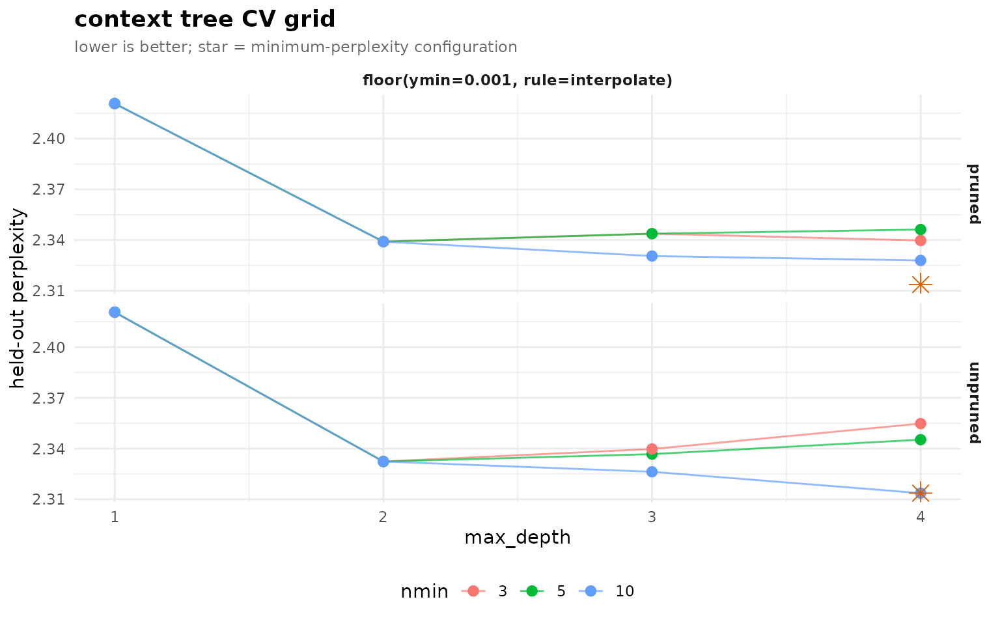
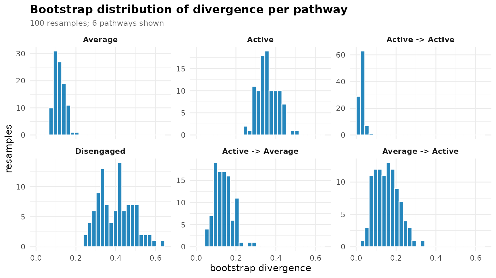
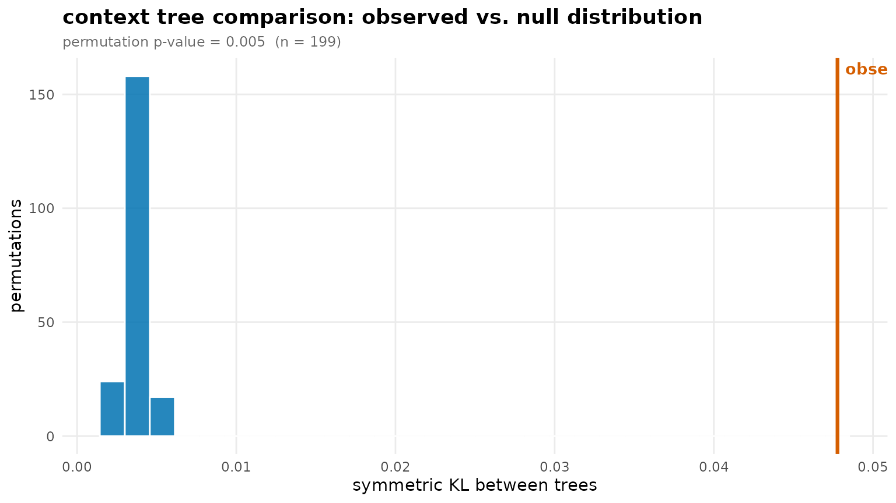

# 4. Advanced analysis: smoothing, tuning, comparison, and mining

This vignette covers the parts of `transitiontrees` beyond the basic
fit-prune-predict loop: choosing a smoother and a pruning rule, picking
hyperparameters by cross-validation, quantifying pathway reliability,
comparing cohorts with a permutation test, introspecting the fitted
tree, and mining it for contexts and sequences of interest.

## Setup

We work throughout from one fit on the bundled `trajectories` data and
its pruned form – the same starting point as *Getting started*.

``` r

library(transitiontrees)
data(trajectories)
set.seed(1)

tree   <- context_tree(trajectories, max_depth = 4L, min_count = 5L)
pruned <- prune_tree(tree, criterion = "G2", alpha = 0.05)
```

## 1. Smoothing schemes

Smoothing decides what probability an *unseen* next state receives. Five
schemes are implemented (`floor`, `laplace`, `kneser_ney`,
`witten_bell`, `jelinek_mercer`).
[`compare_smoothing()`](https://pak.dynasite.org/transitiontrees/reference/compare_smoothing.md)
refits under each and reports in-sample perplexity in one call.

``` r

compare_smoothing(trajectories, max_depth = 4L, min_count = 5L)
#>        smoothing n_nodes perplexity
#> 1          floor      82   2.157411
#> 2        laplace      82   2.181832
#> 3     kneser_ney      82   2.167730
#> 4    witten_bell      82   2.161948
#> 5 jelinek_mercer      82   2.200473
```

Two things to read. First, `n_nodes` is identical across schemes –
smoothing changes *probabilities*, never *which contexts exist*;
topology is set by `min_count`, not the smoother. Second, do **not**
pick a smoother on in-sample perplexity (it rewards memorisation); the
cross-validation in section 3 is the verdict that counts.

Handed a *fitted* tree,
[`compare_smoothing()`](https://pak.dynasite.org/transitiontrees/reference/compare_smoothing.md)
re-smooths it under every scheme (via
[`smooth_tree()`](https://pak.dynasite.org/transitiontrees/reference/smooth_tree.md),
without re-counting) instead of refitting – a smoothing sweep on the
already-pruned model in one call:

``` r

compare_smoothing(pruned)
#>        smoothing n_nodes perplexity
#> 1          floor      25   2.239207
#> 2        laplace      25   2.243759
#> 3     kneser_ney      25   2.241328
#> 4    witten_bell      25   2.240596
#> 5 jelinek_mercer      25   2.296256
```

## 2. Pruning criteria

[`prune_tree()`](https://pak.dynasite.org/transitiontrees/reference/prune_tree.md)
supports four criteria.
[`compare_pruning()`](https://pak.dynasite.org/transitiontrees/reference/compare_pruning.md)
applies each – holding `alpha`/`threshold` fixed – and reports how hard
each one trims.

``` r

compare_pruning(tree)
#>   criterion n_nodes reduction_pct
#> 1        G2      25          69.5
#> 2        KL      78           4.9
#> 3       AIC      42          48.8
#> 4       BIC      36          56.1
```

`G2` (the likelihood-ratio test) and `AIC` ask “is the extra depth
justified given its sample size?”; `BIC` punishes parameters harder than
`AIC` (its penalty scales with `log n`); `KL` at a lenient absolute
`threshold` keeps almost everything. On these data `G2` is the
strictest, keeping 25 of 82 contexts; `BIC` and `AIC` keep 36 and 42,
and `KL` 78. Use `G2` (or `AIC`) unless you have a specific reason, and
report the reduction – “most grown contexts were unjustified” is itself
a finding.

## 3. Cross-validated tuning

[`tune_tree()`](https://pak.dynasite.org/transitiontrees/reference/tune_tree.md)
runs k-fold CV at the **sequence level** over a grid of
`(max_depth, min_count, smoothing, prune)` and returns a data.frame
ranked by held-out perplexity; printing it also shows the winning
configuration under “best”.

``` r

tg <- tune_tree(trajectories, max_depth = 1L:4L, folds = 5L, seed = 42L)
print(tg, n = 6L)
#> <transitiontrees_tune>  24 configurations
#>  max_depth nmin                           smoothing prune    logLik n_scored
#>          4   10 floor(ymin=0.001, rule=interpolate) FALSE -1568.594     1870
#>          3   10 floor(ymin=0.001, rule=interpolate) FALSE -1578.793     1870
#>          4   10 floor(ymin=0.001, rule=interpolate)  TRUE -1580.100     1870
#>          3   10 floor(ymin=0.001, rule=interpolate)  TRUE -1582.190     1870
#>          2    3 floor(ymin=0.001, rule=interpolate) FALSE -1583.660     1870
#>          2    5 floor(ymin=0.001, rule=interpolate) FALSE -1583.660     1870
#>  perplexity n_nodes_avg folds_failed
#>    2.313636        59.8            0
#>    2.326290        31.2            0
#>    2.327916        23.4            0
#>    2.330519        15.4            0
#>    2.332352        13.0            0
#>    2.332352        13.0            0
#> 
#> best (min perplexity):
#>  max_depth nmin                           smoothing prune    logLik n_scored
#>          4   10 floor(ymin=0.001, rule=interpolate) FALSE -1568.594     1870
#>  perplexity n_nodes_avg folds_failed
#>    2.313636        59.8            0
```

(`min_count` and `prune` are swept by their defaults; add `smoothing =`
or a wider `min_count =` to grow the grid.)

``` r

plot(tg)
```



The shape of the curve is as informative as the winning point: if
perplexity keeps falling with `max_depth` the process has long memory;
if it flattens early the useful memory is short and deeper trees mostly
fit noise. Here the drop from one to two steps of memory is the large
one (held-out perplexity about 2.42 to 2.33); every configuration with
`max_depth >= 2` lies between 2.31 and 2.35, and which of them wins
depends on the fold split (with `seed = 1` the winner is a pruned
depth-4 tree with `min_count = 3`). The defensible reading is that
memory beyond two steps adds little, so prefer the simpler tree unless
the deeper contexts are themselves of interest. Refit at the chosen
configuration on the full data for downstream use.

## 4. Bootstrap pathway reliability

[`bootstrap_pathways()`](https://pak.dynasite.org/transitiontrees/reference/bootstrap_pathways.md)
resamples whole sequences and reports, per pathway, `stability_rate`
(the count reproduces) and `informative_rate` (the G-squared against the
parent reproducibly clears the chi-square bar). Keeping the raw
resamples lets you also see the full distribution of any statistic.

``` r

boot <- bootstrap_pathways(pruned, iter = 100L, stat = "count",
                          seed = 1L, keep_resamples = TRUE)
boot
#> <transitiontrees_bootstrap>  100 resamples
#>   stability  : count in [0.50, 1.50] x observed, p < 0.05
#>   informative: G^2 > qchisq(0.95, df=k-1) = 5.99, threshold 0.80
#>   pathways   : 25 total, 23 stable, 16 informative, 15 both
#> 
#> top pathways (stable + informative first):
#>                                pathway depth count p_stability stability_rate
#>                                Average     1   751        0.01              1
#>                                 Active     1   658        0.01              1
#>                       Active -> Active     2   433        0.01              1
#>                             Disengaged     1   325        0.01              1
#>                      Active -> Average     2   160        0.01              1
#>                      Average -> Active     2   144        0.01              1
#>                  Disengaged -> Average     2   122        0.01              1
#>           Active -> Average -> Average     3    80        0.01              1
#>            Average -> Active -> Active     3    70        0.01              1
#>  Average -> Active -> Active -> Active     4    37        0.01              1
#>  stable informative_rate informative mean_G2 ci_G2_lo ci_G2_hi
#>    TRUE             1.00        TRUE 121.332   77.334  169.750
#>    TRUE             1.00        TRUE 323.544  262.193  397.656
#>    TRUE             0.99        TRUE  17.429    7.540   28.547
#>    TRUE             1.00        TRUE 182.436  116.621  263.531
#>    TRUE             1.00        TRUE  29.705   14.895   44.565
#>    TRUE             1.00        TRUE  29.645   11.605   50.310
#>    TRUE             1.00        TRUE  32.180   14.405   51.494
#>    TRUE             0.83        TRUE  12.651    2.896   26.037
#>    TRUE             0.99        TRUE  24.531    8.339   45.878
#>    TRUE             0.88        TRUE  13.321    2.527   30.223
#> # ... 15 more pathways (use summary(x) for full table)
```

[`summary()`](https://rdrr.io/r/base/summary.html) returns the tidy
per-pathway table, sorted so the trustworthy (stable *and* informative)
pathways come first. Each tracked statistic (`count`,
`next_probability`, `divergence`, `G2`) carries a symmetric
`mean / sd / ci_lo / ci_hi` quartet, so you can report a bootstrap CI
for any pathway statistic rather than a bare point estimate:

``` r

head(summary(boot))
#>             pathway depth count likely_next next_probability divergence
#> 1           Average     1   751     Average        0.6098535 0.11356246
#> 2            Active     1   658      Active        0.6975684 0.34948716
#> 3  Active -> Active     2   433      Active        0.7852194 0.02860157
#> 4        Disengaged     1   325  Disengaged        0.4830769 0.40306556
#> 5 Active -> Average     2   160     Average        0.5187500 0.12282588
#> 6 Average -> Active     2   144      Active        0.5000000 0.14727560
#>   changes_prediction        G2 p_stability stability_rate stable
#> 1              FALSE 118.23068  0.00990099              1   TRUE
#> 2               TRUE 318.79579  0.00990099              1   TRUE
#> 3              FALSE  17.16853  0.00990099              1   TRUE
#> 4               TRUE 181.59944  0.00990099              1   TRUE
#> 5              FALSE  27.24365  0.00990099              1   TRUE
#> 6              FALSE  29.40010  0.00990099              1   TRUE
#>   informative_rate informative flip_consistency mean_count sd_count ci_count_lo
#> 1             1.00        TRUE             0.90     751.89 46.40073      669.90
#> 2             1.00        TRUE             0.90     656.33 55.93558      548.90
#> 3             0.99        TRUE             1.00     433.31 48.66266      342.75
#> 4             1.00        TRUE             0.78     329.07 35.83725      257.65
#> 5             1.00        TRUE             0.97     157.98 13.71645      134.90
#> 6             1.00        TRUE             0.64     142.04 13.40279      119.90
#>   ci_count_hi mean_next_probability sd_next_probability ci_next_probability_lo
#> 1     838.100             0.6089800          0.02291564              0.5633791
#> 2     758.400             0.6984192          0.02710968              0.6430115
#> 3     518.525             0.7838157          0.02776100              0.7310934
#> 4     398.000             0.4890828          0.04122430              0.4257269
#> 5     180.000             0.5239125          0.03932595              0.4610542
#> 6     167.525             0.5263975          0.02480997              0.4924242
#>   ci_next_probability_hi mean_divergence sd_divergence ci_divergence_lo
#> 1              0.6551483       0.1170732    0.02630261       0.07344001
#> 2              0.7444871       0.3580817    0.05090311       0.27501751
#> 3              0.8300447       0.0292888    0.01077040       0.01297239
#> 4              0.5679302       0.4003099    0.08610383       0.26712291
#> 5              0.5880668       0.1367369    0.04571332       0.06137939
#> 6              0.5732639       0.1529062    0.05971739       0.05510873
#>   ci_divergence_hi   mean_G2     sd_G2   ci_G2_lo  ci_G2_hi
#> 1       0.16545642 121.33164 25.049863  77.334459 169.75013
#> 2       0.44831966 323.54387 37.804208 262.192780 397.65569
#> 3       0.05001702  17.42938  6.133403   7.540294  28.54731
#> 4       0.57597705 182.43597 43.775724 116.621329 263.53131
#> 5       0.22509244  29.70501  9.751262  14.895484  44.56477
#> 6       0.26864894  29.64515 10.691417  11.604989  50.30995
```

[`plot_pathway_resamples()`](https://pak.dynasite.org/transitiontrees/reference/plot_pathway_resamples.md)
draws the full resample distribution per pathway. A tight unimodal peak
means the estimate is well-determined; a bimodal or heavy-tailed panel
is the tell that the pathway is *carrier-driven* – a few sequences
account for it, and dropping them in a resample collapses it.

``` r

plot_pathway_resamples(boot, stat = "divergence", top = 6L)
```



## 5. Comparing two cohorts

Name an **external** group column and `context_tree(group = )` fits one
tree per group in a single call, returning a `transitiontrees_group`
that
[`prune_tree()`](https://pak.dynasite.org/transitiontrees/reference/prune_tree.md)
and
[`compare_trees()`](https://pak.dynasite.org/transitiontrees/reference/compare_trees.md)
consume directly – no manual splitting or label-building. We compare
high- and low-achieving students on the bundled `group_regulation_long`
log.

``` r

data(group_regulation_long)
grp <- prune_tree(context_tree(group_regulation_long,
                              actor = "Actor", time = "Time", action = "Action",
                              group = "Achiever", max_depth = 2L, min_count = 10L))
cmp <- compare_trees(grp, iter = 199L, seed = 1L)
cmp
#> <transitiontrees_comparison>  iter = 199
#>   observed distance : 0.0478
#>   null mean         : 0.00368
#>   p-value           : 0.005
#> 
#> top divergent pathways:
#>                pathway count_a count_b divergence_ab divergence_ba
#>   cohesion -> cohesion      40       0         0.473         0.447
#>              synthesis     278     374         0.300         0.311
#>     emotion -> emotion      86       0         0.133         0.251
#>                discuss    2003    1948         0.178         0.204
#>               cohesion     938     757         0.120         0.115
#>  discuss -> coregulate       0     170         0.096         0.080
#>  divergence_sym
#>           0.460
#>           0.305
#>           0.192
#>           0.191
#>           0.117
#>           0.088
```

The printed comparison reports the observed distance (`pdist`, a
count-weighted symmetric-KL between the cohorts’ pathway distributions)
and the `p_value` from permuting the sequence-to-cohort labels. A
significant result says the cohorts generate genuinely different pathway
dynamics, not a relabelling artefact.

``` r

plot(cmp)
```



For the full per-axis decomposition (behavioural vs usage) and a tidy
pairwise `distance_matrix`,
[`compare_groups()`](https://pak.dynasite.org/transitiontrees/reference/compare_groups.md)
consumes the same `group =`-fitted tree – see the *Complete analysis
case* vignette.

## 6. Tree introspection

Three accessors treat the tree as a queryable object.

``` r

query_pathway(pruned, c("Active", "Active"))               # full distribution
#>     Active    Average Disengaged 
#> 0.78521940 0.19399538 0.02078522
query_pathway(pruned, "Disengaged", next_state = "Disengaged")  # one cell
#> [1] 0.4830769
pathway_exists(pruned, "Active -> Disengaged")             # membership (no backoff)
#> [1] TRUE
```

By default an unseen context backs off to its longest matching suffix;
pass `exact = TRUE` to demand the literal node (returns `NA` if it is
not one) – the tool for auditing *which* contexts the tree actually
holds.

``` r

query_pathway(pruned, c("Active", "Average", "Active"), exact = TRUE)
#>     Active    Average Disengaged 
#>         NA         NA         NA
```

[`subtree()`](https://pak.dynasite.org/transitiontrees/reference/subtree.md)
extracts the slice rooted at a context – the same pathway API then runs
on the slice:

``` r

sub <- subtree(pruned, "Active")   # its banner reads "subtree of: Active"
sub
#> <transitiontrees>  7 nodes, depth <= 4, 3 states  [pruned]
#>   alphabet : Active, Average, Disengaged
#>   fit on   : 136 sequences, 1870 observations
#>   smoothing: floor(ymin=0.001, rule=interpolate)   min_count = 5
#>   pruned by: G2   alpha = 0.05
#>   subtree of: Active
head(tree_pathways(sub), 4)
#>                      pathway depth count likely_next next_probability
#> 1                     Active     1   658      Active        0.6975684
#> 2           Active -> Active     2   433      Active        0.7852194
#> 3 Active -> Active -> Active     3   316      Active        0.8354430
#> 4          Average -> Active     2   144      Active        0.5000000
#>   divergence changes_prediction
#> 1         NA                 NA
#> 2 0.02860157              FALSE
#> 3 0.01149187              FALSE
#> 4 0.14727560              FALSE
```

## 7. Mining contexts and sequences

[`mine_contexts()`](https://pak.dynasite.org/transitiontrees/reference/mine_contexts.md)
scans the tree for contexts where a chosen state is unusually likely (or
unlikely):

``` r

mine_contexts(pruned, state = "Disengaged", min_prob = 0.5)
#>                                          pathway depth count      state
#> 1 Disengaged -> Average -> Average -> Disengaged     4    13 Disengaged
#> 2                       Disengaged -> Disengaged     2   139 Disengaged
#>        prob is_modal
#> 1 0.8461538     TRUE
#> 2 0.6762590     TRUE
```

[`mine_sequences()`](https://pak.dynasite.org/transitiontrees/reference/mine_sequences.md)
ranks supplied sequences by how well the model predicts them – the
`surprising` ones are atypical trajectories worth a closer look:

``` r

mine_sequences(pruned, newdata = trajectories, which = "surprising", n = 5L)
#>   sequence_id n_scored   log_lik perplexity
#> 1          33        1 -1.664397   5.282486
#> 2          96        1 -1.664397   5.282486
#> 3          97        1 -1.664397   5.282486
#> 4         101        1 -1.664397   5.282486
#> 5         104        1 -1.664397   5.282486
```

## 8. Imputing gaps

[`impute_sequences()`](https://pak.dynasite.org/transitiontrees/reference/impute_sequences.md)
fills *internal* missing states from the fitted tree – `modal` takes the
most likely state at each gap, `prob` samples from the predicted
distribution:

``` r

gappy <- list(c("Active", "Active", NA, "Disengaged"),
              c("Average", NA, "Average"))
impute_sequences(pruned, gappy, method = "modal")
#> [[1]]
#> [1] "Active"     "Active"     "Active"     "Disengaged"
#> 
#> [[2]]
#> [1] "Average" "Average" "Average"
```

## 9. Generating sequences

Every fitted tree is also a generative model.
[`generate_sequences()`](https://pak.dynasite.org/transitiontrees/reference/generate_sequences.md)
samples by walking the conditional distributions;
[`simulate()`](https://rdrr.io/r/stats/simulate.html) is the R-standard
generic wrapping it with `nsim` and a `seed`.

``` r

generate_sequences(pruned, n = 4L, length = 10L)
#>      [,1]         [,2]         [,3]         [,4]         [,5]        
#> [1,] "Average"    "Active"     "Active"     "Active"     "Active"    
#> [2,] "Active"     "Active"     "Active"     "Active"     "Active"    
#> [3,] "Disengaged" "Disengaged" "Disengaged" "Disengaged" "Disengaged"
#> [4,] "Active"     "Disengaged" "Average"    "Average"    "Average"   
#>      [,6]         [,7]         [,8]         [,9]         [,10]       
#> [1,] "Active"     "Active"     "Average"    "Disengaged" "Active"    
#> [2,] "Average"    "Average"    "Average"    "Average"    "Average"   
#> [3,] "Disengaged" "Disengaged" "Disengaged" "Disengaged" "Disengaged"
#> [4,] "Average"    "Active"     "Average"    "Active"     "Active"
simulate(pruned, nsim = 4L, seed = 42L, length = 10L)
#>      [,1]         [,2]         [,3]         [,4]         [,5]        
#> [1,] "Disengaged" "Average"    "Disengaged" "Active"     "Disengaged"
#> [2,] "Disengaged" "Average"    "Disengaged" "Average"    "Average"   
#> [3,] "Average"    "Active"     "Active"     "Active"     "Active"    
#> [4,] "Disengaged" "Disengaged" "Average"    "Disengaged" "Disengaged"
#>      [,6]         [,7]      [,8]         [,9]         [,10]       
#> [1,] "Average"    "Average" "Average"    "Average"    "Average"   
#> [2,] "Average"    "Average" "Disengaged" "Average"    "Average"   
#> [3,] "Disengaged" "Active"  "Average"    "Average"    "Disengaged"
#> [4,] "Active"     "Average" "Disengaged" "Disengaged" "Disengaged"
```

Generated sequences should look plausibly like the real ones – a sanity
check that the model captured the gross dynamics – and give you a null
behavioural corpus for stress-testing a downstream pipeline.
