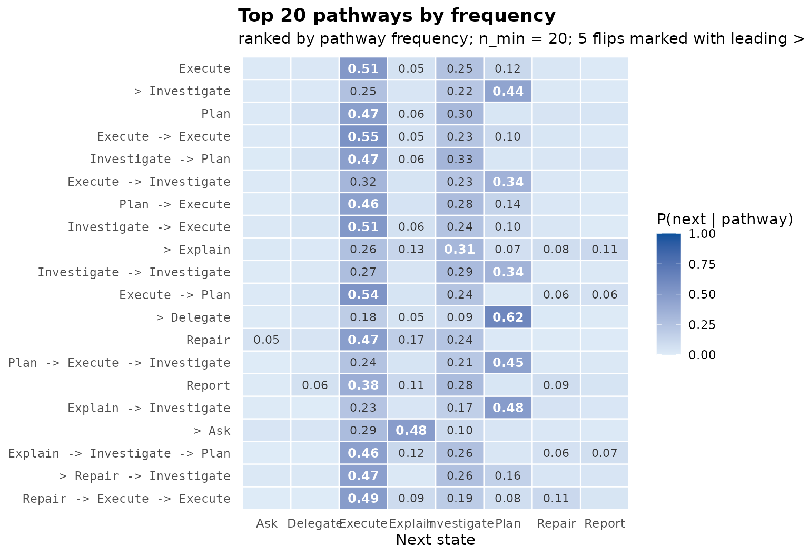

# Case study: human-AI collaboration

Work with an AI assistant unfolds as a conversation in which tasks are
delegated, plans are made, code is executed and inspected, results are
explained and errors are repaired. Coding the messages of such sessions
turns each session into a sequence of collaboration moves, and the order
of those moves describes how the collaboration proceeds: whether an
explanation leads to further investigation, what typically follows a
delegation, and which histories precede a repair.

Two analytical choices shape any sequence analysis of such data. The
first is how the log is cut into sequences. Collaboration logs are
usually exported as one row per message with a timestamp and a session
identifier, and the right unit of analysis is the session, not the
calendar day or the project. The second is the granularity of the state
space. A coding scheme with eight moves can be collapsed into three
broader categories, and the two levels can tell different stories about
how much history matters.

This case study fits variable-order transition trees (Ron, Singer &
Tishby, 1996; Bühlmann & Wyner, 1999) to a coded log of human-AI
collaboration sessions. It asks how the log should be reshaped into
sequences, how the coarse and fine state spaces differ in memory and
predictability, which histories predict which moves, and which histories
precede a repair.

``` r

library(transitiontrees)
```

## Data

`ai_long` is a bundled log of coded messages from AI-assisted project
work, one row per coded move. A message can carry several codes, so a
message may occupy several rows.

- **Actor:** `project` — the project; 34 projects contribute sessions.
- **Session:** `session_id` — the collaboration session, 428 in total;
  each session is one sequence.
- **Time:** `timestamp` — Unix time in seconds; `session_date` holds the
  same date as text.
- **Order:** `order_in_session` — the position of the move within its
  session; `message_id` and `code_order` identify the message and the
  position of the code within it.
- **Fine state:** `code` — the move, one of eight codes (`Ask`,
  `Delegate`, `Execute`, `Explain`, `Investigate`, `Plan`, `Repair`,
  `Report`).
- **Coarse state:** `cluster` — the category of the move: `Action`
  (`Delegate`, `Execute`, `Investigate`), `Communication` (`Ask`,
  `Explain`, `Report`) or `Repair` (`Plan`, `Repair`).

## From a message log to session sequences

The timestamp is stored as Unix seconds. Converting it to clock time
shows its resolution.

``` r

with(ai_long, table(clock_time = format(as.POSIXct(timestamp, tz = "UTC"), "%H:%M:%S")))
```

    #> clock_time
    #> 22:00:00 
    #>     8551

``` r

with(ai_long, range(as.POSIXct(timestamp, tz = "UTC")))
```

    #> [1] "2026-02-04 22:00:00 UTC" "2026-03-07 22:00:00 UTC"

All 8551 timestamps carry the same clock time, 22:00 UTC, which is
midnight in a UTC+2 time zone: the timestamp records the date of the
session (`session_date`), not the time of the message. The log spans
about a month of sessions. A time-gap rule, which starts a new session
whenever two consecutive events are more than 15 minutes apart, cannot
recover sessions from such a timestamp.
[`prepare_input()`](https://pak.dynasite.org/transitiontrees/reference/prepare_input.md)
shows the consequence: with `is_unix_time = TRUE` the numeric column is
read as Unix time, and every day of a project becomes one sequence.

``` r

prepare_input(ai_long, actor = "project", time = "timestamp",
              is_unix_time = TRUE, order = "order_in_session",
              action = "code") |>
  nrow()
```

    #> [1] 160

The time-gap route produces 160 sequences, one per project and day,
because several sessions of the same project held on the same day are
merged into one. Naming the session column instead takes the sessions
from the data, and `order` orders the moves within each session.

``` r

sessions <- prepare_input(ai_long, actor = "project", session = "session_id",
                          order = "order_in_session", action = "code")
nrow(sessions)
```

    #> [1] 428

``` r

summary(rowSums(!is.na(sessions)))
```

    #>    Min. 1st Qu.  Median    Mean 3rd Qu.    Max. 
    #>       1       7      13      20      25     138

The session route gives the 428 sessions of the data. Sessions are short
and uneven: the median session holds 13 moves, the longest 138. The rest
of the analysis passes the same arguments to
[`context_tree()`](https://pak.dynasite.org/transitiontrees/reference/context_tree.md)
and
[`tune_tree()`](https://pak.dynasite.org/transitiontrees/reference/tune_tree.md),
which reshape the log in the same way before fitting.

## Coarse and fine state spaces

The fine tree models the eight codes, the coarse tree the three
categories. Both are grown to a depth of three moves with at least ten
occurrences per context.

``` r

fine <- context_tree(ai_long, actor = "project", session = "session_id",
                     order = "order_in_session", action = "code",
                     max_depth = 3L, min_count = 10L)
coarse <- context_tree(ai_long, actor = "project", session = "session_id",
                       order = "order_in_session", action = "cluster",
                       max_depth = 3L, min_count = 10L)
state_frequencies(fine)
```

    #>         state count proportion
    #> 1     Execute  3258     0.3810
    #> 2 Investigate  2317     0.2710
    #> 3        Plan  1620     0.1895
    #> 4     Explain   524     0.0613
    #> 5    Delegate   295     0.0345
    #> 6      Repair   257     0.0301
    #> 7      Report   181     0.0212
    #> 8         Ask    99     0.0116

``` r

state_frequencies(coarse)
```

    #>           state count proportion
    #> 1        Action  5870      0.686
    #> 2        Repair  1877      0.220
    #> 3 Communication   804      0.094

`Execute` (38.1% of moves), `Investigate` (27.1%) and `Plan` (18.9%)
dominate the fine codes; `Ask` is the rarest move (1.2%). At the coarse
level, `Action` covers 68.6% of moves, `Repair` 22.0% and
`Communication` 9.4%. Because `Plan` belongs to the `Repair` category,
most coarse `Repair` moves are planning moves; the code `Repair` itself
accounts for 3.0% of moves.

How much history each state space needs is a question for held-out data.
[`tune_tree()`](https://pak.dynasite.org/transitiontrees/reference/tune_tree.md)
cross-validates depths from zero, the model with no history, to three,
with and without pruning, over five folds of sessions.

``` r

tuned_fine <- tune_tree(ai_long, actor = "project", session = "session_id",
                        order = "order_in_session", action = "code",
                        max_depth = 0L:3L, min_count = 10L,
                        prune = c(FALSE, TRUE), folds = 5L, seed = 1L)
print(as.data.frame(tuned_fine), digits = 4)
```

    #>   max_depth min_count                           smoothing prune logLik n_scored perplexity
    #> 1         1        10 floor(ymin=0.001, rule=interpolate) FALSE -12332     8551      4.230
    #> 2         1        10 floor(ymin=0.001, rule=interpolate)  TRUE -12332     8551      4.230
    #> 3         2        10 floor(ymin=0.001, rule=interpolate)  TRUE -12371     8551      4.249
    #> 4         3        10 floor(ymin=0.001, rule=interpolate)  TRUE -12397     8551      4.262
    #> 5         2        10 floor(ymin=0.001, rule=interpolate) FALSE -12536     8551      4.332
    #> 6         3        10 floor(ymin=0.001, rule=interpolate) FALSE -12949     8551      4.546
    #> 7         0        10 floor(ymin=0.001, rule=interpolate) FALSE -13369     8551      4.775
    #> 8         0        10 floor(ymin=0.001, rule=interpolate)  TRUE -13369     8551      4.775
    #>   n_nodes_avg folds_failed
    #> 1         9.0            0
    #> 2         9.0            0
    #> 3        16.6            0
    #> 4        20.6            0
    #> 5        52.8            0
    #> 6       143.8            0
    #> 7         1.0            0
    #> 8         1.0            0

For the eight codes, the first-order model has the lowest held-out
perplexity (4.230), against 4.775 for the model without history: knowing
the previous move reduces the effective number of candidate next moves
by 11%. Longer histories do not improve on this. The pruned depth-two
and depth-three trees come close (4.249 and 4.262), and the unpruned
depth-three tree, with an average of 144 contexts per fold, is worse
(4.546).

``` r

tuned_coarse <- tune_tree(ai_long, actor = "project", session = "session_id",
                          order = "order_in_session", action = "cluster",
                          max_depth = 0L:3L, min_count = 10L,
                          prune = c(FALSE, TRUE), folds = 5L, seed = 1L)
print(as.data.frame(tuned_coarse), digits = 4)
```

    #>   max_depth min_count                           smoothing prune logLik n_scored perplexity
    #> 1         3        10 floor(ymin=0.001, rule=interpolate)  TRUE  -6544     8551      2.150
    #> 2         2        10 floor(ymin=0.001, rule=interpolate)  TRUE  -6558     8551      2.153
    #> 3         2        10 floor(ymin=0.001, rule=interpolate) FALSE  -6560     8551      2.154
    #> 4         3        10 floor(ymin=0.001, rule=interpolate) FALSE  -6563     8551      2.154
    #> 5         1        10 floor(ymin=0.001, rule=interpolate) FALSE  -6602     8551      2.164
    #> 6         1        10 floor(ymin=0.001, rule=interpolate)  TRUE  -6602     8551      2.164
    #> 7         0        10 floor(ymin=0.001, rule=interpolate) FALSE  -6957     8551      2.256
    #> 8         0        10 floor(ymin=0.001, rule=interpolate)  TRUE  -6957     8551      2.256
    #>   n_nodes_avg folds_failed
    #> 1         9.4            0
    #> 2         6.6            0
    #> 3        13.0            0
    #> 4        37.8            0
    #> 5         4.0            0
    #> 6         4.0            0
    #> 7         1.0            0
    #> 8         1.0            0

For the three categories, the pruned depth-three tree is selected, with
a held-out perplexity of 2.150 against 2.164 for the first-order model
and 2.256 without history. History reduces the perplexity by only 5%,
but the reduction continues beyond the first move: at the coarse level,
runs of actions carry information that a single previous category does
not.

The two state spaces thus describe the process differently. At the fine
level the identity of the previous move matters most, and longer
histories do not generalize to new sessions. Collapsing the codes into
categories removes much of that first-order information, because moves
within the same category lead to different next moves, while making
longer runs of the same category visible.

## Which histories predict which moves?

The fine tree is pruned with the likelihood-ratio criterion before its
contexts are read.

``` r

fine_pruned <- prune_tree(fine, criterion = "G2")
fine_pruned
```

    #> <transitiontrees>  24 nodes, depth <= 3, 8 states  [pruned]
    #>   alphabet : Ask, Delegate, Execute, Explain, Investigate, Plan, Repair, Report
    #>   fit on   : 428 sequences, 8551 observations
    #>   smoothing: floor(ymin=0.001, rule=interpolate)   min_count = 10
    #>   pruned by: G2   alpha = 0.05
    #> (start)   n=8551   -> Execute (0.38)
    #> |-- Ask       n=91     -> Explain (0.48)
    #> |-- Delegate  n=280    -> Plan (0.62)
    #> |-- Execute   n=3090   -> Execute (0.51)
    #> |   |-- Execute   n=1503   -> Execute (0.55)
    #> |   |   `-- Repair    n=53     -> Execute (0.49)
    #> |   |-- Investigate  n=532    -> Execute (0.51)
    #> |   |   `-- Explain   n=32     -> Execute (0.38)
    #> |   `-- Plan      n=674    -> Execute (0.46)
    #> |-- Explain   n=504    -> Investigate (0.31)
    #> |-- Investigate  n=2235   -> Plan (0.44)
    #> |   |-- Execute   n=727    -> Plan (0.34)
    #> |   |   `-- Plan      n=183    -> Plan (0.45)
    #> |   |-- Explain   n=154    -> Plan (0.48)
    #> |   |-- Investigate  n=476    -> Plan (0.34)
    #> |   `-- Repair    n=58     -> Execute (0.47)
    #> |-- Plan      n=1510   -> Execute (0.47)
    #> |   |-- Execute   n=341    -> Execute (0.54)
    #> |   |-- Explain   n=30     -> Investigate (0.33)
    #> |   `-- Investigate  n=921    -> Execute (0.47)
    #> |       `-- Explain   n=69     -> Execute (0.46)
    #> |-- Repair    n=251    -> Execute (0.47)
    #> |   `-- Explain   n=41     -> Explain (0.46)
    #> `-- Report    n=162    -> Execute (0.38)

The pruned tree keeps 24 of 161 nodes.
[`divergent_pathways()`](https://pak.dynasite.org/transitiontrees/reference/divergent_pathways.md)
ranks the retained contexts by how far their next-move distribution
departs from that of their parent context.

``` r

divergent_pathways(fine_pruned, top = 10, min_count = 20L)
```

    #>                              pathway depth count likely_next next_probability divergence
    #> 1                                Ask     1    91     Explain            0.484      1.123
    #> 2                           Delegate     1   280        Plan            0.621      0.670
    #> 3                    Explain -> Plan     2    30 Investigate            0.332      0.597
    #> 4                  Explain -> Repair     2    41     Explain            0.461      0.408
    #> 5                             Repair     1   251     Execute            0.474      0.394
    #> 6  Explain -> Investigate -> Execute     3    32     Execute            0.375      0.350
    #> 7                            Explain     1   504 Investigate            0.313      0.348
    #> 8              Repair -> Investigate     2    58     Execute            0.466      0.326
    #> 9                             Report     1   162     Execute            0.377      0.250
    #> 10                       Investigate     1  2235        Plan            0.437      0.239
    #>    changes_prediction
    #> 1                TRUE
    #> 2                TRUE
    #> 3                TRUE
    #> 4                TRUE
    #> 5               FALSE
    #> 6               FALSE
    #> 7                TRUE
    #> 8                TRUE
    #> 9               FALSE
    #> 10               TRUE

The rare moves are the most informative contexts. An `Ask` is followed
by an `Explain` (0.48), a `Delegate` by a `Plan` (0.62) and an `Explain`
by an `Investigate` (0.31); each of these changes the predicted next
move away from `Execute`, the most likely move without history.
`Investigate`, which is frequent, is followed most often by `Plan`
(0.44). Two second-order contexts redirect the prediction of their
parents: after `Explain -> Repair` the most likely next move is another
`Explain` (0.46), whereas `Repair` alone leads to `Execute`, and after
`Repair -> Investigate` the most likely next move is `Execute` (0.47),
whereas `Investigate` alone leads to `Plan`.

[`plot_pathways()`](https://pak.dynasite.org/transitiontrees/reference/plot_pathways.md)
draws the next-move distribution of each context as a heatmap.

``` r

plot_pathways(fine_pruned, min_count = 20L)
```



The heatmap shows the 20 most frequent contexts with at least 20
occurrences. Each row is a context and each column a next move; the cell
shows the conditional probability, and a leading `>` marks the five
contexts whose most likely next move differs from that of their parent.
The `Execute` column is dark for most contexts, which reflects the
dominance of execution in these sessions. The marked rows depart from
it: `Delegate` concentrates its probability on `Plan` (0.62), `Ask` on
`Explain` (0.48), and `Investigate` and `Repair -> Investigate` lead to
`Plan` and `Execute` respectively.

## Which histories precede a repair?

A repair move signals that something in the collaboration has to be
corrected, which makes the histories that lead to it of particular
interest.
[`mine_contexts()`](https://pak.dynasite.org/transitiontrees/reference/mine_contexts.md)
lists, for one move, its probability after each context of the tree.
Contexts seen fewer than 30 times are dropped.

``` r

mine_contexts(fine_pruned, "Repair", min_count = 30L)
```

    #>                              pathway depth count  state    prob is_modal
    #> 1                    Explain -> Plan     2    30 Repair 0.16633    FALSE
    #> 2  Explain -> Investigate -> Execute     3    32 Repair 0.12500    FALSE
    #> 3       Repair -> Execute -> Execute     3    53 Repair 0.11330    FALSE
    #> 4                             Report     1   162 Repair 0.08642    FALSE
    #> 5                            Explain     1   504 Repair 0.08333    FALSE
    #> 6                    Execute -> Plan     2   341 Repair 0.06158    FALSE
    #> 7     Explain -> Investigate -> Plan     3    69 Repair 0.05851    FALSE
    #> 8             Explain -> Investigate     2   154 Repair 0.04609    FALSE
    #> 9                               Plan     1  1510 Repair 0.03974    FALSE
    #> 10             Repair -> Investigate     2    58 Repair 0.03448    FALSE
    #> 11                Execute -> Execute     2  1503 Repair 0.03127    FALSE
    #> 12                           Execute     1  3090 Repair 0.03010    FALSE
    #> 13                           (start)     0  8551 Repair 0.03005    FALSE
    #> 14               Investigate -> Plan     2   921 Repair 0.02823    FALSE
    #> 15            Investigate -> Execute     2   532 Repair 0.02820    FALSE
    #> 16                   Plan -> Execute     2   674 Repair 0.02522    FALSE
    #> 17            Execute -> Investigate     2   727 Repair 0.02338    FALSE
    #> 18                               Ask     1    91 Repair 0.02198    FALSE
    #> 19                       Investigate     1  2235 Repair 0.01790    FALSE
    #> 20    Plan -> Execute -> Investigate     3   183 Repair 0.01726    FALSE
    #> 21        Investigate -> Investigate     2   476 Repair 0.01681    FALSE
    #> 22                          Delegate     1   280 Repair 0.01429    FALSE
    #> 23                            Repair     1   251 Repair 0.00797    FALSE
    #> 24                 Explain -> Repair     2    41 Repair 0.00100    FALSE

Without history, the probability of a repair is 0.030. It is highest
after `Explain -> Plan` (0.166, 30 occurrences), and it is raised after
a `Report` (0.086) and after an `Explain` (0.083), roughly three times
the baseline. Two three-move contexts,
`Explain -> Investigate -> Execute` (0.125) and
`Repair -> Execute -> Execute` (0.113), show that an explanation or a
repair two moves earlier also raises the chance of a repair. A repair
directly after `Explain -> Repair` is almost never observed (0.001, the
smoothing floor). After the frequent `Execute` and `Investigate` moves
it stays close to or below the baseline (0.030 and 0.018). Repair is
never the most likely next move (`is_modal` is `FALSE` throughout): even
in the contexts that raise it, repairs remain the exception. Repairs are
therefore more likely after communication moves, explanations and
reports, than after action moves, which is consistent with repairs that
follow a description of what went wrong rather than the action itself.

The same question can be asked of the unpruned tree, which keeps
contexts that the G² test does not support. A lower probability bound
restricts the list to contexts in which a repair is at least three times
as likely as without history.

``` r

mine_contexts(fine, "Repair", min_prob = 0.09, min_count = 20L)
```

    #>                                  pathway depth count  state   prob is_modal
    #> 1                        Explain -> Plan     2    30 Repair 0.1663    FALSE
    #> 2                         Ask -> Explain     2    39 Repair 0.1536    FALSE
    #> 3                      Repair -> Explain     2    43 Repair 0.1394    FALSE
    #> 4                      Explain -> Report     2    53 Repair 0.1320    FALSE
    #> 5      Execute -> Investigate -> Explain     3    31 Repair 0.1290    FALSE
    #> 6      Explain -> Investigate -> Execute     3    32 Repair 0.1250    FALSE
    #> 7           Repair -> Execute -> Execute     3    53 Repair 0.1133    FALSE
    #> 8          Investigate -> Plan -> Report     3    29 Repair 0.1036    FALSE
    #> 9  Investigate -> Explain -> Investigate     3    29 Repair 0.1036    FALSE
    #> 10     Investigate -> Execute -> Explain     3    31 Repair 0.0970    FALSE
    #> 11      Repair -> Execute -> Investigate     3    31 Repair 0.0970    FALSE
    #> 12                        Ask -> Execute     2    21 Repair 0.0955    FALSE

The unpruned tree adds contexts such as `Ask -> Explain` (0.15) and
`Repair -> Explain` (0.14), again ending in communication moves. These
contexts are not retained by pruning, so they are candidates for further
study rather than established findings.

## What the analysis shows

The way the log is cut into sequences changes the data: because the Unix
timestamps hold only the session date, a time-gap rule merges same-day
sessions into 160 sequences, and the session column is needed to recover
the 428 sessions. In the fine state space the previous move carries most
of the predictive information, and rare moves such as `Ask` and
`Delegate` are the most informative contexts; in the coarse space the
effect of history is smaller but extends over longer runs. Repairs are
rare, and they are most likely after explanations and reports.

The analysis has limits. `ai_long` is a bundled example dataset, and its
codes do not identify whether a move was made by the human or the AI
assistant, so the pathways describe the joint conversation rather than
either partner. Sessions are nested within 34 projects, and the tree
pools them; projects with many sessions weigh more heavily in every
estimate. The contexts in which repairs are more likely are based on 30
to a few hundred occurrences, and their reliability under resampling of
sessions can be checked with
[`bootstrap_pathways()`](https://pak.dynasite.org/transitiontrees/reference/bootstrap_pathways.md).

## References

Bühlmann, P., & Wyner, A. J. (1999). Variable length Markov chains. *The
Annals of Statistics, 27*(2), 480-513.
[doi:10.1214/aos/1018031204](https://doi.org/10.1214/aos/1018031204)

Ron, D., Singer, Y., & Tishby, N. (1996). The power of amnesia: Learning
probabilistic automata with variable memory length. *Machine Learning,
25*(2-3), 117-149.
[doi:10.1023/A:1026490906255](https://doi.org/10.1023/A:1026490906255)
