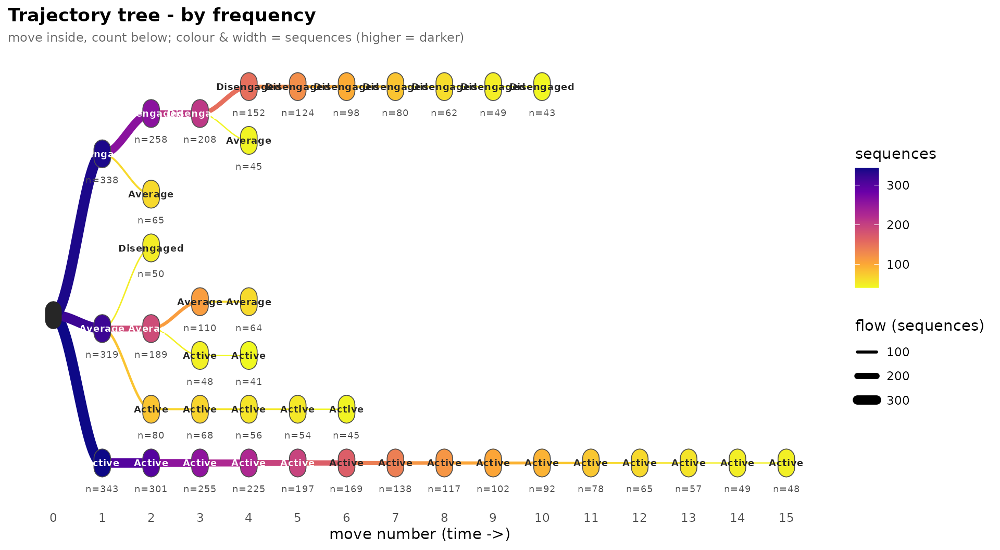
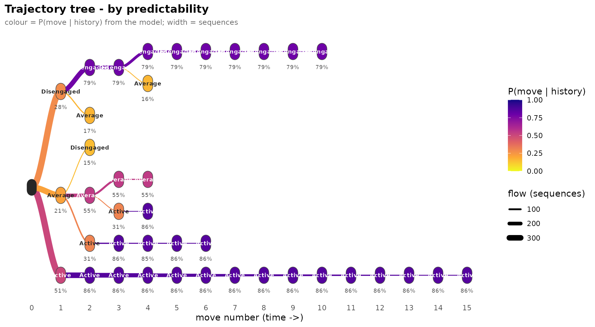

# Case study: engagement trajectories

Engagement in a course is not a fixed trait. Students move between
active participation, average involvement and disengagement from one
week to the next, and the sequence of these states over a course is a
trajectory. Longitudinal studies of online engagement describe such
trajectories as largely stable, with a minority of students drifting
into persistent disengagement. Two questions follow for anyone who wants
to act on them. The first is how persistent disengagement is once it
begins. The second is whether the route into disengagement matters: is a
student who has recently dropped from active to disengaged in the same
position as one who has been disengaged for several weeks, or does the
earlier history change what comes next?

A first-order Markov chain answers the first question and assumes the
answer to the second: the next state depends only on the current one. A
variable-order transition tree (Ron, Singer & Tishby, 1996; Bühlmann &
Wyner, 1999) relaxes that assumption locally. It keeps a longer history
only where that history changes the prediction, so the fitted tree is
itself an answer to the question of how far back the past reaches.

This case study fits such a tree to the weekly engagement states of 1000
learners. It asks how persistent each state is, which histories lead
into disengagement, how much memory the process has, what the forward
trajectories look like, and whether sequences simulated from the fitted
model reproduce the observed data.

``` r

library(transitiontrees)
```

## Data

`engagement` is a bundled wide sequence frame: one row per learner and
one column per time-step.

- **Sequence:** each row — one learner’s trajectory, 1000 learners.
- **Time:** columns `T1` to `T25` — successive time-steps of the course;
  trajectories run for 23 to 25 steps, and trailing `NA` marks the end
  of a shorter trajectory.
- **State:** each cell — the engagement state, `Active`, `Average` or
  `Disengaged`.

The frame is already in the shape that
[`context_tree()`](https://pak.dynasite.org/transitiontrees/reference/context_tree.md)
consumes, so no reshaping is needed.

## How persistent is each state?

The tree is grown to a depth of four time-steps, with at least ten
occurrences required for a context to receive its own node.

``` r

tree <- context_tree(engagement, max_depth = 4L, min_count = 10L)
tree
```

    #> <transitiontrees>  109 nodes, depth <= 4, 3 states  [unpruned]
    #>   alphabet : Active, Average, Disengaged
    #>   fit on   : 1000 sequences, 24555 observations
    #>   smoothing: floor(ymin=0.001, rule=interpolate)   min_count = 10
    #> (start)   n=24555  -> Active (0.51)
    #> |-- Active    n=11894  -> Active (0.86)
    #> |   |-- Active    n=9766   -> Active (0.86)
    #> |   |   |-- Active    n=7994   -> Active (0.86)
    #> |   |   |   |-- Active    n=6546   -> Active (0.86)
    #> |   |   |   |-- Average   n=984    -> Active (0.85)
    #> |   |   |   `-- Disengaged  n=209    -> Active (0.85)
    #> |   |   |-- Average   n=1215   -> Active (0.85)
    #> |   |   |   |-- Active    n=246    -> Active (0.86)
    #> |   |   |   |-- Average   n=641    -> Active (0.83)
    #> |   |   |   `-- Disengaged  n=260    -> Active (0.89)
    #> |   |   `-- Disengaged  n=256    -> Active (0.86)
    #> |   |       |-- Active    n=15     -> Active (0.87)
    #> |   |       |-- Average   n=31     -> Active (0.87)
    #> |   |       `-- Disengaged  n=196    -> Active (0.88)
    #> |   |-- Average   n=1473   -> Active (0.86)
    #> |   |   |-- Active    n=296    -> Active (0.86)
    #> |   |   |   |-- Active    n=241    -> Active (0.87)
    #> |   |   |   `-- Average   n=40     -> Active (0.90)
    #> |   |   |-- Average   n=781    -> Active (0.85)
    #> |   |   |   |-- Active    n=150    -> Active (0.84)
    #> |   |   |   |-- Average   n=420    -> Active (0.85)
    #> |   |   |   `-- Disengaged  n=163    -> Active (0.88)
    #> |   |   `-- Disengaged  n=316    -> Active (0.87)
    #> |   |       |-- Active    n=20     -> Active (0.90)
    #> |   |       |-- Average   n=41     -> Active (0.85) 
    #> ... 83 more nodes (use as.data.frame(x) or summary(x))

The tree is fitted on 1000 sequences and 24555 observed states. With no
history the most likely state is `Active` (0.51), and after `Active` the
most likely state is again `Active` (0.86). The first branches of the
tree show how little the deeper `Active` histories change this: after
two, three or four active steps the probability of staying active
remains 0.86.

[`state_frequencies()`](https://pak.dynasite.org/transitiontrees/reference/state_frequencies.md)
gives the overall distribution of states.

``` r

state_frequencies(tree)
```

    #>        state count proportion
    #> 1     Active 12426      0.506
    #> 2 Disengaged  6873      0.280
    #> 3    Average  5256      0.214

Half of all observed states are `Active` (50.6%), 28.0% are `Disengaged`
and 21.4% are `Average`.
[`common_pathways()`](https://pak.dynasite.org/transitiontrees/reference/common_pathways.md)
restricted to the first-order contexts gives the persistence of each
state.

``` r

common_pathways(tree, depth = 1L)
```

    #>      pathway depth count likely_next next_probability divergence changes_prediction
    #> 1     Active     1 11894      Active            0.859      0.418              FALSE
    #> 2 Disengaged     1  6598  Disengaged            0.786      0.945               TRUE
    #> 3    Average     1  5063     Average            0.548      0.384               TRUE

`Active` is the most persistent state (0.86 probability of remaining
active), followed by `Disengaged` (0.79). `Average` is the least stable:
a learner in the average state stays there with probability 0.55. Once
disengagement begins, it is therefore likely to continue: a learner who
is disengaged now is disengaged at the next step four times out of five.

## Does the route into disengagement matter?

If disengagement entrenches over time, the probability of remaining
disengaged should rise with the length of the disengaged run.
[`query_pathway()`](https://pak.dynasite.org/transitiontrees/reference/query_pathway.md)
returns the next-state distribution for any history.

``` r

query_pathway(tree, "Disengaged")
```

    #>     Active    Average Disengaged 
    #>     0.0485     0.1655     0.7860

``` r

query_pathway(tree, "Disengaged -> Disengaged")
```

    #>     Active    Average Disengaged 
    #>     0.0488     0.1599     0.7913

``` r

query_pathway(tree, "Disengaged -> Disengaged -> Disengaged -> Disengaged")
```

    #>     Active    Average Disengaged 
    #>     0.0534     0.1503     0.7963

The probability of remaining disengaged is 0.786 after one disengaged
step, 0.791 after two and 0.796 after four. The run length barely
matters: disengagement is persistent, but it does not become measurably
more persistent the longer it lasts.

[`mine_contexts()`](https://pak.dynasite.org/transitiontrees/reference/mine_contexts.md)
asks the reverse question: which histories make disengagement the most
likely next state? The `min_count` argument keeps contexts seen at least
50 times, and `min_prob` keeps those with a probability of at least 0.5.

``` r

mine_contexts(tree, "Disengaged", min_prob = 0.5, min_count = 50L)
```

    #>                                                 pathway depth count      state  prob
    #> 1                       Average -> Active -> Disengaged     3    82 Disengaged 0.902
    #> 2             Average -> Active -> Active -> Disengaged     4    59 Disengaged 0.898
    #> 3         Average -> Active -> Disengaged -> Disengaged     4    70 Disengaged 0.843
    #> 4                                  Active -> Disengaged     2   581 Disengaged 0.818
    #> 5                        Active -> Active -> Disengaged     3   466 Disengaged 0.813
    #> 6     Disengaged -> Average -> Disengaged -> Disengaged     4    80 Disengaged 0.812
    #> 7      Active -> Disengaged -> Disengaged -> Disengaged     4   342 Disengaged 0.804
    #> 8              Active -> Active -> Active -> Disengaged     4   373 Disengaged 0.802
    #> 9  Disengaged -> Disengaged -> Disengaged -> Disengaged     4  2827 Disengaged 0.796
    #> 10               Disengaged -> Disengaged -> Disengaged     3  3751 Disengaged 0.792
    #> 11                             Disengaged -> Disengaged     2  4960 Disengaged 0.791
    #> 12                   Active -> Disengaged -> Disengaged     3   449 Disengaged 0.788
    #> 13    Average -> Disengaged -> Disengaged -> Disengaged     4   374 Disengaged 0.786
    #> 14                                           Disengaged     1  6598 Disengaged 0.786
    #> 15           Active -> Average -> Average -> Disengaged     4    74 Disengaged 0.784
    #> 16         Active -> Active -> Disengaged -> Disengaged     4   357 Disengaged 0.782
    #> 17       Average -> Average -> Disengaged -> Disengaged     4   285 Disengaged 0.779
    #> 18                  Average -> Disengaged -> Disengaged     3   502 Disengaged 0.779
    #> 19       Disengaged -> Average -> Average -> Disengaged     4    85 Disengaged 0.765
    #> 20                     Average -> Average -> Disengaged     3   396 Disengaged 0.755
    #> 21          Average -> Average -> Average -> Disengaged     4   206 Disengaged 0.752
    #> 22        Active -> Average -> Disengaged -> Disengaged     4   100 Disengaged 0.740
    #> 23                                Average -> Disengaged     2   719 Disengaged 0.734
    #> 24                  Disengaged -> Average -> Disengaged     3   118 Disengaged 0.729
    #> 25    Disengaged -> Disengaged -> Average -> Disengaged     4    87 Disengaged 0.724
    #> 26            Active -> Active -> Average -> Disengaged     4   130 Disengaged 0.685
    #> 27                      Active -> Average -> Disengaged     3   155 Disengaged 0.684
    #>    is_modal
    #> 1      TRUE
    #> 2      TRUE
    #> 3      TRUE
    #> 4      TRUE
    #> 5      TRUE
    #> 6      TRUE
    #> 7      TRUE
    #> 8      TRUE
    #> 9      TRUE
    #> 10     TRUE
    #> 11     TRUE
    #> 12     TRUE
    #> 13     TRUE
    #> 14     TRUE
    #> 15     TRUE
    #> 16     TRUE
    #> 17     TRUE
    #> 18     TRUE
    #> 19     TRUE
    #> 20     TRUE
    #> 21     TRUE
    #> 22     TRUE
    #> 23     TRUE
    #> 24     TRUE
    #> 25     TRUE
    #> 26     TRUE
    #> 27     TRUE

All 27 contexts end in `Disengaged`: no history that ends in an active
or average step makes disengagement the most likely next state. The
highest probabilities belong to recent drops from activity: after
`Average -> Active -> Disengaged` the probability of remaining
disengaged is 0.90 (82 occurrences), and after `Active -> Disengaged` it
is 0.82 (581 occurrences), slightly above the 0.79 of `Disengaged`
alone. The lowest belong to arrivals from the average state: after
`Average -> Disengaged` the probability is 0.73 (719 occurrences). These
are descriptive differences in the grown tree; the pruning step below
tests which of them are supported.

[`tree_dependence()`](https://pak.dynasite.org/transitiontrees/reference/tree_dependence.md)
measures, for each context, how far its next-state distribution departs
from that of its parent (`divergence`) and how much next-state
uncertainty it removes (`entropy_drop`, in bits).

``` r

tree_dependence(tree, top = 8)
```

    #>                                         pathway depth count divergence entropy
    #> 1                                    Disengaged     1  6598      0.945  0.9143
    #> 2                                        Active     1 11894      0.418  0.7196
    #> 3                                       Average     1  5063      0.384  1.4047
    #> 4     Active -> Average -> Disengaged -> Active     4    10      0.274  0.4825
    #> 5                Active -> Disengaged -> Active     3    22      0.255  1.0226
    #> 6  Active -> Disengaged -> Disengaged -> Active     4    11      0.152  0.4532
    #> 7     Average -> Disengaged -> Active -> Active     4    31      0.151  0.5677
    #> 8 Disengaged -> Average -> Active -> Disengaged     4    16      0.135  0.0228
    #>   entropy_before entropy_drop likely_next likely_before changes_prediction
    #> 1          1.487       0.5732  Disengaged        Active               TRUE
    #> 2          1.487       0.7679      Active        Active              FALSE
    #> 3          1.487       0.0828     Average        Active               TRUE
    #> 4          0.745       0.2624      Active        Active              FALSE
    #> 5          0.744      -0.2791      Active        Active              FALSE
    #> 6          0.708       0.2549      Active        Active              FALSE
    #> 7          0.710       0.1426      Active        Active              FALSE
    #> 8          0.514       0.4914  Disengaged    Disengaged              FALSE

The three first-order contexts dominate. `Disengaged` departs most from
the root (divergence 0.95) and changes the prediction from `Active` to
`Disengaged`. The longer contexts in the list are rare (10 to 31
occurrences), and one of them, `Active -> Disengaged -> Active`, has a
negative `entropy_drop` (-0.28 bits): the longer history leaves the next
state more uncertain than its parent does. Rare contexts of this kind
are the ones that pruning should remove.

## How long is the memory?

[`compare_pruning()`](https://pak.dynasite.org/transitiontrees/reference/compare_pruning.md)
shows how many contexts each pruning criterion keeps.

``` r

compare_pruning(tree)
```

    #>   criterion n_nodes reduction_pct
    #> 1        G2      17          84.4
    #> 2        KL      68          37.6
    #> 3       AIC      21          80.7
    #> 4       BIC       6          94.5

The grown tree has 109 nodes. The likelihood-ratio criterion (G²) keeps
17, AIC 21 and BIC 6; the Kullback-Leibler threshold is the most
permissive and keeps 68. The criteria agree that most deep contexts are
not supported, and differ in how many second-order refinements they
retain.

``` r

pruned <- prune_tree(tree, criterion = "G2")
pruned
```

    #> <transitiontrees>  17 nodes, depth <= 4, 3 states  [pruned]
    #>   alphabet : Active, Average, Disengaged
    #>   fit on   : 1000 sequences, 24555 observations
    #>   smoothing: floor(ymin=0.001, rule=interpolate)   min_count = 10
    #>   pruned by: G2   alpha = 0.05
    #> (start)   n=24555  -> Active (0.51)
    #> |-- Active    n=11894  -> Active (0.86)
    #> |   |-- Active    n=9766   -> Active (0.86)
    #> |   |   |-- Average   n=1215   -> Active (0.85)
    #> |   |   |   `-- Disengaged  n=260    -> Active (0.89)
    #> |   |   `-- Disengaged  n=256    -> Active (0.86)
    #> |   |       `-- Average   n=31     -> Active (0.87)
    #> |   `-- Disengaged  n=312    -> Active (0.85)
    #> |       `-- Active    n=22     -> Active (0.73)
    #> |-- Average   n=5063   -> Average (0.55)
    #> |   `-- Disengaged  n=1043   -> Average (0.57)
    #> `-- Disengaged  n=6598   -> Disengaged (0.79)
    #>     |-- Average   n=719    -> Disengaged (0.73)
    #>     `-- Disengaged  n=4960   -> Disengaged (0.79)
    #>         |-- Active    n=449    -> Disengaged (0.79)
    #>         `-- Average   n=502    -> Disengaged (0.78)
    #>             `-- Disengaged  n=80     -> Disengaged (0.81)

The G²-pruned tree keeps 16 contexts below the root. In the `Disengaged`
branch it retains `Average -> Disengaged` (0.73) and
`Disengaged -> Disengaged` (0.79), but not `Active -> Disengaged`. The
route into disengagement therefore matters in one supported respect: a
learner who arrives from the average state is less likely to remain
disengaged than one in an established run. The higher persistence after
an abrupt drop from activity, seen in the grown tree, is not
distinguishable from that of `Disengaged` alone by the G² test.

[`tune_tree()`](https://pak.dynasite.org/transitiontrees/reference/tune_tree.md)
gives a held-out comparison of memory length. It cross-validates every
combination of depth, minimum count and pruning over five folds of
learners.

``` r

tuned <- tune_tree(engagement, max_depth = 1L:4L, min_count = c(10L, 30L),
                   prune = c(FALSE, TRUE), folds = 5L, seed = 1L)
summary(tuned)
```

    #> <transitiontrees_tune summary>  16 configurations, 0 with a failed fold
    #> selected (minimum held-out perplexity):
    #>  max_depth min_count                           smoothing prune perplexity n_nodes_avg
    #>          2        10 floor(ymin=0.001, rule=interpolate) FALSE      1.934          13

``` r

print(as.data.frame(tuned), digits = 5)
```

    #>    max_depth min_count                           smoothing prune logLik n_scored perplexity
    #> 1          2        10 floor(ymin=0.001, rule=interpolate) FALSE -16200    24555     1.9343
    #> 2          2        30 floor(ymin=0.001, rule=interpolate) FALSE -16200    24555     1.9343
    #> 3          2        10 floor(ymin=0.001, rule=interpolate)  TRUE -16202    24555     1.9345
    #> 4          2        30 floor(ymin=0.001, rule=interpolate)  TRUE -16202    24555     1.9345
    #> 5          1        10 floor(ymin=0.001, rule=interpolate) FALSE -16206    24555     1.9347
    #> 6          1        30 floor(ymin=0.001, rule=interpolate) FALSE -16206    24555     1.9347
    #> 7          1        10 floor(ymin=0.001, rule=interpolate)  TRUE -16206    24555     1.9347
    #> 8          1        30 floor(ymin=0.001, rule=interpolate)  TRUE -16206    24555     1.9347
    #> 9          3        30 floor(ymin=0.001, rule=interpolate)  TRUE -16210    24555     1.9351
    #> 10         3        10 floor(ymin=0.001, rule=interpolate)  TRUE -16217    24555     1.9357
    #> 11         4        30 floor(ymin=0.001, rule=interpolate)  TRUE -16218    24555     1.9357
    #> 12         3        30 floor(ymin=0.001, rule=interpolate) FALSE -16225    24555     1.9363
    #> 13         4        10 floor(ymin=0.001, rule=interpolate)  TRUE -16229    24555     1.9366
    #> 14         3        10 floor(ymin=0.001, rule=interpolate) FALSE -16234    24555     1.9370
    #> 15         4        30 floor(ymin=0.001, rule=interpolate) FALSE -16290    24555     1.9414
    #> 16         4        10 floor(ymin=0.001, rule=interpolate) FALSE -16332    24555     1.9447
    #>    n_nodes_avg folds_failed
    #> 1         13.0            0
    #> 2         13.0            0
    #> 3          5.4            0
    #> 4          5.4            0
    #> 5          4.0            0
    #> 6          4.0            0
    #> 7          4.0            0
    #> 8          4.0            0
    #> 9          6.6            0
    #> 10         7.4            0
    #> 11         9.2            0
    #> 12        36.6            0
    #> 13        11.6            0
    #> 14        40.0            0
    #> 15        83.4            0
    #> 16       105.6            0

The selected configuration is the unpruned depth-two tree, with a
held-out perplexity of 1.934. The first-order model scores 1.935, and
the worst configuration in the grid, the unpruned depth-four tree,
scores 1.945. The differences are in the third decimal. Engagement in
these data is close to a first-order process: the current state carries
nearly all the information about the next one, and longer histories add
little that generalises to new learners.

## What do the forward trajectories look like?

The context tree reads histories backwards, from the most recent state.
[`plot_trajectories()`](https://pak.dynasite.org/transitiontrees/reference/plot_trajectories.md)
draws the complementary forward view: the observed sequences as a prefix
tree from the first time-step, with branches kept when they are followed
by at least `min_count` learners.

``` r

plot_trajectories(pruned, min_count = 40L)
```



Each path from the left is a sequence of states that at least 40
learners share from the start of the course; branch width and color
reflect the number of learners. The learners start almost evenly divided
between the three states (343 active, 319 average and 338 disengaged).
The active and disengaged starts both continue in long runs: 48 learners
are active for all of the first 15 steps, and 43 learners who start
disengaged are still disengaged at step 10. Learners who start in the
average state split quickly between the other states. With
`measure = "predictability"` the same tree is colored by the model’s
probability of each move given its history.

``` r

plot_trajectories(pruned, measure = "predictability", min_count = 40L)
```



Moves that continue an active or disengaged run are predicted with
probabilities of 0.86 and 0.79; switches between states and the first
move are the less predictable ones. The first move is scored against the
root distribution (51% active), which differs from the even split of
observed starting states.

## Does the model reproduce the data?

A fitted transition tree is a generative model. If it captures the
process, sequences simulated from it should resemble the observed ones.
[`simulate()`](https://rdrr.io/r/stats/simulate.html) with `tidy = TRUE`
returns a wide data frame in the same layout as `engagement`, which
[`context_tree()`](https://pak.dynasite.org/transitiontrees/reference/context_tree.md)
accepts directly.

``` r

simulated <- simulate(pruned, nsim = 1000L, seed = 1L, length = 24L,
                      tidy = TRUE)
head(simulated, 3)
```

    #>           T1         T2         T3         T4         T5         T6         T7         T8
    #> 1     Active     Active    Average     Active     Active     Active     Active     Active
    #> 2     Active     Active Disengaged Disengaged Disengaged Disengaged Disengaged Disengaged
    #> 3 Disengaged Disengaged    Average    Average    Average    Average     Active     Active
    #>           T9     T10     T11     T12     T13     T14     T15        T16    T17    T18
    #> 1     Active Average Average Average Average  Active  Active     Active Active Active
    #> 2 Disengaged  Active  Active  Active  Active Average Average Disengaged Active Active
    #> 3     Active  Active  Active  Active  Active  Active  Active     Active Active Active
    #>      T19     T20     T21    T22     T23     T24
    #> 1 Active Average Average Active  Active  Active
    #> 2 Active  Active  Active Active  Active  Active
    #> 3 Active  Active  Active Active Average Average

The simulated sequences are refitted, and the state distributions of the
observed and simulated data are merged by state.

``` r

simulated_tree <- context_tree(simulated, max_depth = 4L, min_count = 10L)
merge(state_frequencies(tree), state_frequencies(simulated_tree),
      by = "state", suffixes = c("_observed", "_simulated"))
```

    #>        state count_observed proportion_observed count_simulated proportion_simulated
    #> 1     Active          12426               0.506           12767                0.532
    #> 2    Average           5256               0.214            4925                0.205
    #> 3 Disengaged           6873               0.280            6308                0.263

The simulated data contain somewhat more `Active` states than the
observed data (53.2% against 50.6%) and fewer `Disengaged` states (26.3%
against 28.0%). Part of this gap comes from the simulation design: each
simulated sequence starts from the overall state distribution (51%
active), whereas the observed learners start almost evenly divided
between the three states, and every simulated sequence has 24 steps.

[`compare_trees()`](https://pak.dynasite.org/transitiontrees/reference/compare_trees.md)
tests whether the transition structure itself differs. It pools the two
sets of sequences, permutes their labels and compares the observed
distance between the two trees with the permutation distribution.

``` r

observed_tree  <- context_tree(engagement, max_depth = 2L, min_count = 10L)
simulated_tree <- context_tree(simulated, max_depth = 2L, min_count = 10L)
summary(compare_trees(observed_tree, simulated_tree, iter = 99L))
```

    #> <transitiontrees_comparison summary>
    #>  distance null_mean  null_sd null_q95 p_value iter n_pathways
    #>  0.000692  0.000444 0.000215 0.000805     0.1   99         13

The distance between the observed and simulated trees is not larger than
the distances produced by random relabelling (p = 0.10 with 99
permutations). Within the depth-two contexts tested here, the transition
structure of the simulated data is consistent with that of the observed
data, although the small number of permutations gives the test limited
resolution.

## What the analysis shows

Engagement in these data is persistent and close to first-order. Active
and disengaged states each tend to continue (probabilities 0.86 and
0.79), the average state is the least stable, and the probability of
remaining disengaged barely changes with the length of the disengaged
run. The route into disengagement makes a small, supported difference:
learners who arrive from the average state are less likely to remain
disengaged (0.73) than learners in an established run (0.79). Held-out
perplexity confirms that histories longer than one or two steps add
little predictive information, and the pruned model generates sequences
whose transition structure matches the observed one.

The analysis has limits. `engagement` is a bundled example dataset, so
the estimates illustrate the method rather than describe a real course.
The model is homogeneous in time: it assumes that the same transition
rules hold at the start and at the end of the course, and it pools all
learners, so heterogeneity between groups of learners appears only as
averaged probabilities. The simulation check compares state frequencies
and depth-two transitions; it does not test sequence-level properties
such as the distribution of run lengths, and it uses only 99
permutations.

## References

Bühlmann, P., & Wyner, A. J. (1999). Variable length Markov chains. *The
Annals of Statistics, 27*(2), 480-513.
[doi:10.1214/aos/1018031204](https://doi.org/10.1214/aos/1018031204)

Ron, D., Singer, Y., & Tishby, N. (1996). The power of amnesia: Learning
probabilistic automata with variable memory length. *Machine Learning,
25*(2-3), 117-149.
[doi:10.1023/A:1026490906255](https://doi.org/10.1023/A:1026490906255)
