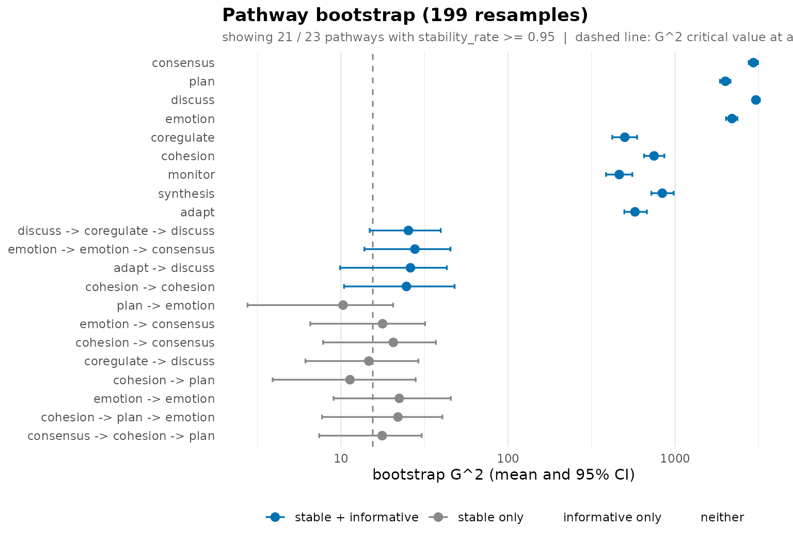
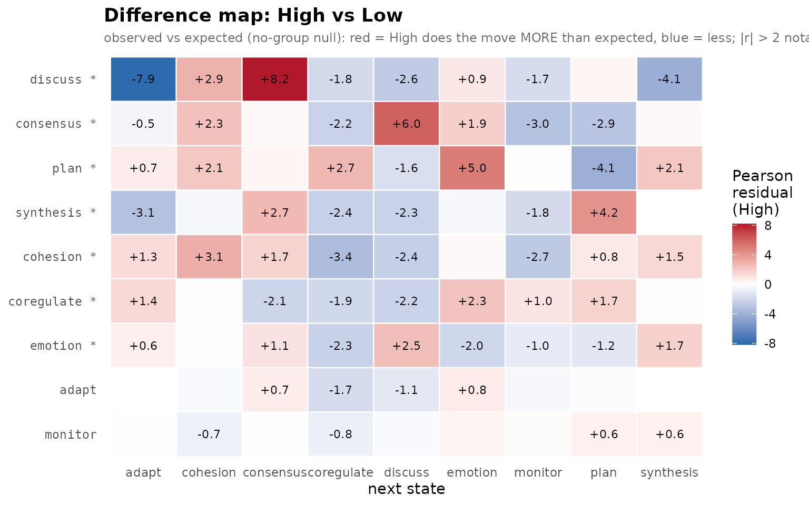

# Case study: collaborative regulation by achievement

When students learn together, regulation is a shared activity. Members
of a group plan the task, monitor their progress, discuss and reach
consensus, adapt when something fails and attend to the emotional
climate of the group. These moves are not independent: a plan invites a
response, a disagreement calls for discussion, and a moment of cohesion
often precedes a decision. The temporal order of regulatory moves is
therefore as informative as their frequency, and transition network
analysis (Saqr et al., 2025) has made the first-order transitions
between them a standard object of study in learning analytics.

A first-order transition model assumes that the next move depends on the
current move alone. Whether that assumption holds is an empirical
question. A variable-order transition tree, the prediction suffix tree
of Ron, Singer and Tishby (1996), lets each history keep as much of its
past as the data support: a context such as `consensus -> cohesion` gets
its own next-move distribution only when it predicts differently from
the shorter context `cohesion`. The same idea underlies variable-length
Markov chains (Bühlmann & Wyner, 1999).

This case study addresses three questions about collaborative
regulation. First, how do regulatory moves follow one another? Second,
how much history is needed to predict the next move, and which longer
pathways reproducibly change the prediction? Third, do high and low
achievers move through regulation differently, and does that difference
survive when the course in which they studied is held fixed?

``` r

library(transitiontrees)
```

## Data

`group_regulation_long` is a bundled event log of coded collaborative
regulation, one row per regulatory move. The variables play the
following roles:

- **Actor:** `Actor` — the student; each student contributes one
  sequence of moves.
- **Time:** `Time` — the timestamp of each move; it orders the moves
  and, through the default 15-minute gap rule, would split a student’s
  moves into separate sessions.
- **State:** `Action` — the regulatory move, one of nine codes (`adapt`,
  `cohesion`, `consensus`, `coregulate`, `discuss`, `emotion`,
  `monitor`, `plan`, `synthesis`).
- **Grouping:** `Achiever` — the student’s achievement level, `High` or
  `Low`.
- **Context:** `Group` — the collaboration group, and `Course` — the
  course, `A`, `B` or `C`.

The design matters for the group comparison, so the distribution of
moves over courses and achievement levels comes first.

``` r

with(group_regulation_long, table(Course, Achiever))
```

    #>       Achiever
    #> Course  High   Low
    #>      A 12390     0
    #>      B  1331  8295
    #>      C     0  5517

Achievement and course are entangled. All moves in course A come from
high achievers and all moves in course C from low achievers; only course
B contains both levels. Any difference between high and low achievers
may therefore partly reflect differences between courses. The last
analytical section returns to this.

## How do regulatory moves follow one another?

[`context_tree()`](https://pak.dynasite.org/transitiontrees/reference/context_tree.md)
reads the event log directly when the actor, time and state columns are
named. The tree is grown to a depth of three moves, and a context needs
at least ten occurrences to receive its own node.

``` r

tree <- context_tree(group_regulation_long,
                     actor = "Actor", time = "Time", action = "Action",
                     max_depth = 3L, min_count = 10L)
tree
```

    #> <transitiontrees>  377 nodes, depth <= 3, 9 states  [unpruned]
    #>   alphabet : adapt, cohesion, consensus, coregulate, discuss, emotion, monitor, plan, synthesis
    #>   fit on   : 2000 sequences, 27533 observations
    #>   smoothing: floor(ymin=0.001, rule=interpolate)   min_count = 10
    #> (start)   n=27533  -> consensus (0.25)
    #> |-- adapt     n=509    -> consensus (0.47)
    #> |   |-- consensus  n=27     -> cohesion (0.48)
    #> |   |-- coregulate  n=28     -> consensus (0.50)
    #> |   |   `-- consensus  n=21     -> consensus (0.43)
    #> |   |-- discuss   n=259    -> consensus (0.47)
    #> |   |   |-- consensus  n=60     -> consensus (0.53)
    #> |   |   |-- coregulate  n=37     -> consensus (0.43)
    #> |   |   |-- discuss   n=48     -> consensus (0.52)
    #> |   |   |-- emotion   n=14     -> consensus (0.50)
    #> |   |   |-- monitor   n=25     -> consensus (0.40)
    #> |   |   `-- plan      n=26     -> consensus (0.42)
    #> |   |-- monitor   n=16     -> consensus (0.50)
    #> |   `-- synthesis  n=140    -> consensus (0.48)
    #> |       `-- discuss   n=107    -> consensus (0.45)
    #> |-- cohesion  n=1695   -> consensus (0.50)
    #> |   |-- adapt     n=130    -> consensus (0.54)
    #> |   |   |-- consensus  n=13     -> consensus (0.61)
    #> |   |   |-- discuss   n=65     -> consensus (0.55)
    #> |   |   `-- synthesis  n=32     -> consensus (0.56)
    #> |   |-- cohesion  n=45     -> consensus (0.42)
    #> |   |   `-- emotion   n=24     -> consensus (0.46)
    #> |   |-- consensus  n=84     -> consensus (0.51)
    #> |   |   |-- cohesion  n=11     -> plan (0.45)
    #> |   |   |-- discuss   n=13     -> consensus (0.61)
    #> |   |   |-- emotion   n=11     -> consensus (0.45) 
    #> ... 351 more nodes (use as.data.frame(x) or summary(x))

The tree is fitted on 2000 sequences (one per student) and 27533 moves.
With no history, the most likely next move is `consensus`, with
probability 0.25; this root distribution is the baseline that every
longer context must improve on. The unpruned tree holds 377 contexts,
many of them deep histories seen only a few dozen times.

[`state_frequencies()`](https://pak.dynasite.org/transitiontrees/reference/state_frequencies.md)
reports how often each move occurs.

``` r

state_frequencies(tree)
```

    #>        state count proportion
    #> 1  consensus  6797     0.2469
    #> 2       plan  6623     0.2405
    #> 3    discuss  4267     0.1550
    #> 4    emotion  3075     0.1117
    #> 5 coregulate  2133     0.0775
    #> 6   cohesion  1839     0.0668
    #> 7    monitor  1516     0.0551
    #> 8  synthesis   729     0.0265
    #> 9      adapt   554     0.0201

`consensus` (24.7% of moves) and `plan` (24.1%) together account for
almost half of all regulation, followed by `discuss` (15.5%) and
`emotion` (11.2%). `synthesis` and `adapt` are rare, at 2.6% and 2.0%.
This imbalance shapes every later result: predicting `consensus` or
`plan` is right a quarter of the time without any history, so the
informative contexts are those that move the prediction away from these
two defaults.

[`common_pathways()`](https://pak.dynasite.org/transitiontrees/reference/common_pathways.md)
lists the most frequent histories and the move that most often follows
each.

``` r

common_pathways(tree, top = 8)
```

    #>             pathway depth count likely_next next_probability divergence changes_prediction
    #> 1           (start)     0 27533   consensus            0.247         NA                 NA
    #> 2         consensus     1  6329        plan            0.396   0.334030               TRUE
    #> 3              plan     1  6157        plan            0.374   0.234143               TRUE
    #> 4           discuss     1  3951   consensus            0.321   0.555626              FALSE
    #> 5           emotion     1  2837    cohesion            0.325   0.555145               TRUE
    #> 6 consensus -> plan     2  2336        plan            0.375   0.000648              FALSE
    #> 7      plan -> plan     2  2108        plan            0.376   0.000432              FALSE
    #> 8        coregulate     1  1970     discuss            0.274   0.180891               TRUE

The first-order contexts already carry clear structure. After
`consensus` the most likely move is `plan` (0.40), and `plan` is most
often followed by another `plan` (0.37). `emotion` is followed by
`cohesion` (0.33) and `coregulate` by `discuss` (0.27). The
`changes_prediction` column marks the contexts whose most likely next
move differs from that of the parent context. The two most frequent
second-order contexts, `consensus -> plan` and `plan -> plan`,
illustrate the opposite case: their next-move distributions are almost
identical to that of `plan` alone (`divergence` below 0.001), so the
extra move of history adds nothing to the prediction.

## How much history matters?

A grown tree keeps every context with enough occurrences, whether or not
it predicts better than its parent.
[`prune_tree()`](https://pak.dynasite.org/transitiontrees/reference/prune_tree.md)
removes a context when a likelihood-ratio (G²) test does not show that
the longer history changes the next-move distribution relative to its
one-move-shorter parent.

``` r

pruned <- prune_tree(tree, criterion = "G2", alpha = 0.05)
pruned
```

    #> <transitiontrees>  23 nodes, depth <= 3, 9 states  [pruned]
    #>   alphabet : adapt, cohesion, consensus, coregulate, discuss, emotion, monitor, plan, synthesis
    #>   fit on   : 2000 sequences, 27533 observations
    #>   smoothing: floor(ymin=0.001, rule=interpolate)   min_count = 10
    #>   pruned by: G2   alpha = 0.05
    #> (start)   n=27533  -> consensus (0.25)
    #> |-- adapt     n=509    -> consensus (0.47)
    #> |-- cohesion  n=1695   -> consensus (0.50)
    #> |   `-- cohesion  n=45     -> consensus (0.42)
    #> |-- consensus  n=6329   -> plan (0.40)
    #> |   |-- cohesion  n=795    -> plan (0.38)
    #> |   |   `-- cohesion  n=19     -> plan (0.37)
    #> |   `-- emotion   n=830    -> plan (0.39)
    #> |       `-- emotion   n=58     -> plan (0.62)
    #> |-- coregulate  n=1970   -> discuss (0.27)
    #> |-- discuss   n=3951   -> consensus (0.32)
    #> |   |-- adapt     n=29     -> adapt (0.24)
    #> |   `-- coregulate  n=486    -> consensus (0.32)
    #> |       `-- discuss   n=88     -> consensus (0.27)
    #> |-- emotion   n=2837   -> cohesion (0.33)
    #> |   |-- emotion   n=199    -> cohesion (0.35)
    #> |   `-- plan      n=831    -> consensus (0.33)
    #> |       `-- cohesion  n=33     -> cohesion (0.27)
    #> |-- monitor   n=1433   -> discuss (0.38)
    #> |-- plan      n=6157   -> plan (0.37)
    #> |   `-- cohesion  n=221    -> plan (0.36)
    #> |       `-- consensus  n=12     -> plan (0.83)
    #> `-- synthesis  n=652    -> consensus (0.46)

Pruning reduces the tree from 377 to 23 nodes: the root, all nine
first-order contexts, eight second-order and five third-order contexts.
The fit statistics of the two trees can be compared directly.

``` r

rbind(unpruned = model_fit(tree), pruned = model_fit(pruned))
```

    #>          logLik   df  nobs   AIC    BIC perplexity
    #> unpruned -45465 3016 27533 96962 121763       5.21
    #> pruned   -46570  184 27533 93509  95022       5.43

The pruned tree uses 184 free parameters instead of 3016. Its in-sample
perplexity is slightly higher (5.43 against 5.21 equally likely next
moves), which is expected because the larger tree fits its own data more
closely, but its AIC (93509 against 96962) and BIC (95022 against
121763) are both lower. Perplexity is the effective number of equally
likely next moves; with nine codes the uniform baseline is 9.

In-sample perplexity favors larger trees.
[`tune_tree()`](https://pak.dynasite.org/transitiontrees/reference/tune_tree.md)
gives a held-out estimate: it splits the students into five folds, fits
each configuration on four and scores the fifth.

``` r

tuned <- tune_tree(group_regulation_long,
                   actor = "Actor", time = "Time", action = "Action",
                   max_depth = 1L:3L, min_count = 10L,
                   prune = c(FALSE, TRUE), folds = 5L, seed = 1L)
summary(tuned)
```

    #> <transitiontrees_tune summary>  6 configurations, 0 with a failed fold
    #> selected (minimum held-out perplexity):
    #>  max_depth min_count                           smoothing prune perplexity n_nodes_avg
    #>          1        10 floor(ymin=0.001, rule=interpolate) FALSE       5.46          10

``` r

as.data.frame(tuned)
```

    #>   max_depth min_count                           smoothing prune logLik n_scored perplexity
    #> 1         1        10 floor(ymin=0.001, rule=interpolate) FALSE -46738    27533       5.46
    #> 2         1        10 floor(ymin=0.001, rule=interpolate)  TRUE -46738    27533       5.46
    #> 3         2        10 floor(ymin=0.001, rule=interpolate)  TRUE -46763    27533       5.47
    #> 4         3        10 floor(ymin=0.001, rule=interpolate)  TRUE -46884    27533       5.49
    #> 5         2        10 floor(ymin=0.001, rule=interpolate) FALSE -47111    27533       5.53
    #> 6         3        10 floor(ymin=0.001, rule=interpolate) FALSE -48782    27533       5.88
    #>   n_nodes_avg folds_failed
    #> 1        10.0            0
    #> 2        10.0            0
    #> 3        12.2            0
    #> 4        23.4            0
    #> 5        79.6            0
    #> 6       344.4            0

The first-order model has the lowest held-out perplexity (5.46). The
pruned second-order tree is practically indistinguishable (5.47), and
the pruned third-order tree is close behind (5.49). The unpruned deeper
trees generalize worse: 5.53 at depth two and 5.88 at depth three, where
the folds average 344 contexts. Collaborative regulation in these data
therefore has short memory. The current move carries almost all the
predictive information, and the longer contexts retained by pruning
refine a small number of predictions without improving overall held-out
prediction.

[`tree_dependence()`](https://pak.dynasite.org/transitiontrees/reference/tree_dependence.md)
quantifies the contribution of each retained context in bits:
`entropy_drop` is the reduction in next-move uncertainty relative to the
parent context.

``` r

tree_dependence(pruned, sort_by = "entropy_drop", top = 8)
```

    #>                           pathway depth count divergence entropy entropy_before
    #> 1   consensus -> cohesion -> plan     3    12      0.926   0.885           2.29
    #> 2                           adapt     1   509      0.789   2.037           2.79
    #> 3 emotion -> emotion -> consensus     3    58      0.241   1.773           2.37
    #> 4                        cohesion     1  1695      0.315   2.225           2.79
    #> 5                            plan     1  6157      0.234   2.261           2.79
    #> 6                       synthesis     1   652      0.892   2.270           2.79
    #> 7                         emotion     1  2837      0.555   2.390           2.79
    #> 8                       consensus     1  6329      0.334   2.393           2.79
    #>   entropy_drop likely_next likely_before changes_prediction
    #> 1        1.404        plan          plan              FALSE
    #> 2        0.755   consensus     consensus              FALSE
    #> 3        0.597        plan          plan              FALSE
    #> 4        0.567   consensus     consensus              FALSE
    #> 5        0.531        plan     consensus               TRUE
    #> 6        0.522   consensus     consensus              FALSE
    #> 7        0.401    cohesion     consensus               TRUE
    #> 8        0.399        plan     consensus               TRUE

Among the first-order contexts, `adapt` removes the most uncertainty
(0.75 bits): after an adaptation, the group almost always returns to
`consensus`. The largest drop overall belongs to
`consensus -> cohesion -> plan` (1.40 bits), where the next move is
`plan` with high probability, but this context occurs only 12 times.
`emotion -> emotion -> consensus` (58 occurrences) lowers uncertainty by
0.60 bits relative to `emotion -> consensus`. The bootstrap below asks
which of these refinements are reproducible.

## Which pathways are reliable?

[`bootstrap_pathways()`](https://pak.dynasite.org/transitiontrees/reference/bootstrap_pathways.md)
resamples students with replacement, refits the pruned tree’s contexts
in each resample, and records two properties of each pathway: whether
its count stays within half to one and a half times the observed count
(`stable`), and whether its G² against the parent context exceeds the
chi-squared critical value in at least 80% of resamples (`informative`).

``` r

boot <- bootstrap_pathways(pruned, iter = 199L, stat = "count", seed = 1L)
boot
```

    #> <transitiontrees_bootstrap>  199 resamples
    #>   stability  : count in [0.50, 1.50] x observed, p < 0.05
    #>   informative: G^2 > qchisq(0.95, df=k-1) = 15.51, threshold 0.80
    #>   pathways   : 23 total, 22 stable, 14 informative, 13 both
    #> 
    #> top pathways (stable + informative first):
    #>                           pathway depth count p_stability stability_rate stable
    #>                         consensus     1  6329       0.005              1   TRUE
    #>                              plan     1  6157       0.005              1   TRUE
    #>                           discuss     1  3951       0.005              1   TRUE
    #>                           emotion     1  2837       0.005              1   TRUE
    #>                        coregulate     1  1970       0.005              1   TRUE
    #>                          cohesion     1  1695       0.005              1   TRUE
    #>                           monitor     1  1433       0.005              1   TRUE
    #>                         synthesis     1   652       0.005              1   TRUE
    #>                             adapt     1   509       0.005              1   TRUE
    #>  discuss -> coregulate -> discuss     3    88       0.005              1   TRUE
    #>  informative_rate informative mean_G2 ci_G2_lo ci_G2_hi
    #>             1.000        TRUE  2944.9   2758.4   3139.2
    #>             1.000        TRUE  2001.4   1858.0   2146.2
    #>             1.000        TRUE  3046.9   2922.3   3218.0
    #>             1.000        TRUE  2191.5   2020.7   2363.9
    #>             1.000        TRUE   500.2    421.0    592.8
    #>             1.000        TRUE   748.6    652.8    862.6
    #>             1.000        TRUE   463.5    386.1    555.0
    #>             1.000        TRUE   838.2    721.2    981.2
    #>             1.000        TRUE   575.8    497.0    678.1
    #>             0.945        TRUE    25.3     14.9     39.6
    #> # ... 13 more pathways (use summary(x) for full table)

Of the 23 pathways, 22 are stable, 14 are informative and 13 are both.
The summary table shows the bootstrap rates and the 95% interval of each
pathway’s G² against its parent.

``` r

summary(boot) |>
  subset(select = c(pathway, depth, count, stability_rate,
                    informative_rate, ci_G2_lo, ci_G2_hi, stable, informative))
```

    #>                              pathway depth count stability_rate informative_rate ci_G2_lo
    #> 1                          consensus     1  6329          1.000            1.000  2758.44
    #> 2                               plan     1  6157          1.000            1.000  1858.03
    #> 3                            discuss     1  3951          1.000            1.000  2922.34
    #> 4                            emotion     1  2837          1.000            1.000  2020.67
    #> 5                         coregulate     1  1970          1.000            1.000   420.98
    #> 6                           cohesion     1  1695          1.000            1.000   652.80
    #> 7                            monitor     1  1433          1.000            1.000   386.08
    #> 8                          synthesis     1   652          1.000            1.000   721.18
    #> 9                              adapt     1   509          1.000            1.000   497.03
    #> 10  discuss -> coregulate -> discuss     3    88          1.000            0.945    14.86
    #> 11   emotion -> emotion -> consensus     3    58          1.000            0.960    13.81
    #> 12                  adapt -> discuss     2    29          1.000            0.874     9.88
    #> 13              cohesion -> cohesion     2    45          0.995            0.834    10.43
    #> 14                           (start)     0 27533          1.000               NA       NA
    #> 15                   plan -> emotion     2   831          1.000            0.131     2.76
    #> 16              emotion -> consensus     2   830          1.000            0.618     6.55
    #> 17             cohesion -> consensus     2   795          1.000            0.698     7.82
    #> 18             coregulate -> discuss     2   486          1.000            0.392     6.13
    #> 19                  cohesion -> plan     2   221          1.000            0.221     3.90
    #> 20                emotion -> emotion     2   199          1.000            0.774     9.04
    #> 21       cohesion -> plan -> emotion     3    33          0.995            0.764     7.69
    #> 22     consensus -> cohesion -> plan     3    12          0.955            0.633     7.41
    #> 23 cohesion -> cohesion -> consensus     3    19          0.935            0.869     9.74
    #>    ci_G2_hi stable informative
    #> 1    3139.2   TRUE        TRUE
    #> 2    2146.2   TRUE        TRUE
    #> 3    3218.0   TRUE        TRUE
    #> 4    2363.9   TRUE        TRUE
    #> 5     592.8   TRUE        TRUE
    #> 6     862.6   TRUE        TRUE
    #> 7     555.0   TRUE        TRUE
    #> 8     981.2   TRUE        TRUE
    #> 9     678.1   TRUE        TRUE
    #> 10     39.6   TRUE        TRUE
    #> 11     45.3   TRUE        TRUE
    #> 12     43.0   TRUE        TRUE
    #> 13     47.9   TRUE        TRUE
    #> 14       NA   TRUE       FALSE
    #> 15     20.5   TRUE       FALSE
    #> 16     31.9   TRUE       FALSE
    #> 17     37.0   TRUE       FALSE
    #> 18     29.1   TRUE       FALSE
    #> 19     28.0   TRUE       FALSE
    #> 20     45.4   TRUE       FALSE
    #> 21     40.5   TRUE       FALSE
    #> 22     30.4   TRUE       FALSE
    #> 23     42.3  FALSE        TRUE

All nine first-order contexts are both stable and informative. Four
longer pathways also meet both criteria:
`discuss -> coregulate -> discuss` (informative in 94.5% of resamples),
`emotion -> emotion -> consensus` (96.0%), `adapt -> discuss` (87.4%)
and `cohesion -> cohesion` (83.4%). After `adapt -> discuss`, the most
likely next move is `adapt` again, whereas `discuss` alone leads to
`consensus`; an adaptation followed by discussion tends to produce
further adaptation. Several frequent second-order contexts, such as
`plan -> emotion` (831 occurrences) and `cohesion -> consensus` (795),
are stable but informative in fewer than 80% of resamples: they are
common, but their next-move distributions are not reproducibly different
from those of their parents. The striking
`consensus -> cohesion -> plan` context is stable but informative in
only 63.3% of resamples, so its sharp prediction should not be reported
as a finding.

The forest plot draws the same intervals against the chi-squared
critical value.

``` r

plot(boot) + ggplot2::scale_x_log10()
```



Each bar is the bootstrap interval of a pathway’s G², drawn on a
logarithmic axis so that the first-order contexts, whose G² runs into
the thousands, do not compress the longer pathways against the axis; the
dashed line is the critical value. The plot shows the 21 pathways with a
stability rate of at least 0.95. Pathways whose bars lie entirely to the
right of the line are reproducibly informative; those whose bars cross
it are not.

## Do high and low achievers regulate differently?

Passing `group = "Achiever"` fits one tree per achievement level over a
shared alphabet. A depth of two keeps the number of compared contexts
manageable.

``` r

grp <- context_tree(group_regulation_long,
                    actor = "Actor", time = "Time", action = "Action",
                    group = "Achiever", max_depth = 2L, min_count = 10L)
summary(grp)
```

    #> <transitiontrees_group summary>  2 groups
    #> 
    #>  group n_seq n_obs n_nodes max_depth pruned logLik  df  nobs   AIC   BIC perplexity
    #>   High  1000 13721      74         2  FALSE -22787 592 13721 46758 51214       5.26
    #>    Low  1000 13812      77         2  FALSE -22984 616 13812 47199 51840       5.28

Each level contributes 1000 students (13721 and 13812 moves), and the
two trees have similar size (74 and 77 contexts) and perplexity (5.26
and 5.28). Overall predictability is therefore similar; the question is
whether the same histories lead to different moves.

[`state_frequencies()`](https://pak.dynasite.org/transitiontrees/reference/state_frequencies.md)
returns the move frequencies of each group.

``` r

state_frequencies(grp)
```

    #>    group      state count proportion
    #> 1   High  consensus  3651     0.2661
    #> 2   High       plan  3102     0.2261
    #> 3   High    discuss  2166     0.1579
    #> 4   High    emotion  1686     0.1229
    #> 5   High   cohesion  1018     0.0742
    #> 6   High coregulate   959     0.0699
    #> 7   High    monitor   668     0.0487
    #> 8   High  synthesis   316     0.0230
    #> 9   High      adapt   155     0.0113
    #> 10   Low       plan  3521     0.2549
    #> 11   Low  consensus  3146     0.2278
    #> 12   Low    discuss  2101     0.1521
    #> 13   Low    emotion  1389     0.1006
    #> 14   Low coregulate  1174     0.0850
    #> 15   Low    monitor   848     0.0614
    #> 16   Low   cohesion   821     0.0594
    #> 17   Low  synthesis   413     0.0299
    #> 18   Low      adapt   399     0.0289

High achievers make more `consensus` (26.6% against 22.8%), `emotion`
(12.3% against 10.1%) and `cohesion` moves (7.4% against 5.9%). Low
achievers make more `plan` (25.5% against 22.6%), `monitor` (6.1%
against 4.9%) and `adapt` moves (2.9% against 1.1%).

[`compare_groups()`](https://pak.dynasite.org/transitiontrees/reference/compare_groups.md)
tests the difference with a permutation test. It shuffles the
achievement labels across sequences, refits the counts and compares two
omnibus statistics with their permutation distributions. The
*behavioral* statistic sums the Jensen-Shannon divergence between the
groups’ next-move distributions over shared contexts, weighted by count;
it asks whether the same history leads to different moves. The *usage*
statistic is a summed G² homogeneity test of how often each group
reaches each context. Per-context p-values are adjusted with the
Benjamini-Hochberg procedure.

``` r

cmp <- compare_groups(grp, iter = 199L, seed = 1L)
summary(cmp)
```

    #> Group comparison: High vs Low (80 contexts, 199 permutations)
    #>   behavioral omnibus: JSD = 1772.142 bits, p = 0.005
    #>   usage omnibus     : G2 = 1356.46, p = 0.005
    #>   pathways with a behavioral difference (adjusted p < 0.05): 29
    #>   pathways with a usage difference      (adjusted p < 0.05): 45
    #>   pathways whose modal next state differs between groups: 26

Both omnibus p-values equal 0.005, the smallest value attainable with
199 permutations (1 / 200): no permutation produced a difference as
large as the observed one. After adjustment, 29 of the 80 contexts
differ in their next-move distributions and 45 in how often the groups
reach them, and in 26 contexts the most likely next move differs between
the groups.

The pathway table ranks contexts by behavioral divergence.

``` r

as.data.frame(cmp, what = "pathways") |> head(10)
```

    #>                    pathway depth count_total count_High count_Low modal_High modal_Low
    #> 1         adapt -> monitor     2          16          4        12    discuss   discuss
    #> 2     monitor -> synthesis     2          22         11        11  consensus     adapt
    #> 3  synthesis -> coregulate     2          26          4        22    emotion consensus
    #> 4         adapt -> discuss     2          29          4        25  consensus     adapt
    #> 5        plan -> synthesis     2          11         10         1  consensus     adapt
    #> 6     synthesis -> discuss     2          36          7        29  consensus synthesis
    #> 7   consensus -> synthesis     2          38         19        19  consensus     adapt
    #> 8       monitor -> monitor     2          23         11        12    discuss   discuss
    #> 9  coregulate -> synthesis     2          32         13        19  consensus consensus
    #> 10        adapt -> emotion     2          57         19        38  consensus  cohesion
    #>    flips jsd_bits jsd_p jsd_padj usage_g2 usage_p usage_padj
    #> 1  FALSE    0.381 0.150    0.293 4.12e+00   0.045     0.0773
    #> 2   TRUE    0.350 0.100    0.242 3.92e-04   0.975     0.9800
    #> 3   TRUE    0.316 0.145    0.293 1.36e+01   0.005     0.0110
    #> 4   TRUE    0.269 0.435    0.581 1.68e+01   0.005     0.0110
    #> 5   TRUE    0.189 0.855    0.912 8.63e+00   0.015     0.0269
    #> 6   TRUE    0.179 0.450    0.581 1.43e+01   0.005     0.0110
    #> 7   TRUE    0.170 0.325    0.531 6.77e-04   0.960     0.9800
    #> 8  FALSE    0.167 0.340    0.533 3.55e-02   0.870     0.9043
    #> 9  FALSE    0.157 0.450    0.581 1.08e+00   0.290     0.3695
    #> 10  TRUE    0.146 0.120    0.267 6.31e+00   0.005     0.0110

The largest divergences occur in rare contexts that involve `adapt` and
`synthesis`. After `synthesis -> discuss`, high achievers most often
move to `consensus` and low achievers to `synthesis`; after
`adapt -> discuss`, high achievers move to `consensus` and low achievers
to `adapt`. These contexts are seen 36 and 29 times, and their
behavioral differences are not significant after adjustment (`jsd_padj`
0.58), although low achievers reach them more often (`usage_padj`
0.011). The individual top-ranked contexts are too rare to carry the
difference on their own; the significant behavioral differences are
spread over more frequent contexts further down the table.

[`plot_difference()`](https://pak.dynasite.org/transitiontrees/reference/plot_difference.md)
maps where the groups differ. With `depth = 1` it shows the first-order
transitions; each cell is the Pearson residual of the high achievers’
next-move counts against the pooled expectation for that context, and
passing the comparison stars the contexts whose behavioral difference is
significant after adjustment.

``` r

plot_difference(grp, depth = 1L, comparison = cmp)
```



Positive (red) cells mark next moves that high achievers make more often
than expected from the pooled data, negative (blue) cells moves they
make less often. Seven of the nine first-order contexts are starred. The
largest residuals are in the `discuss` row: after discussion, high
achievers move to `consensus` more often than expected (+8.2) and to
`adapt` less often (-7.9). High achievers also move from `consensus` to
`discuss` (+6.0) and from `plan` to `emotion` (+5.0) more often, and
repeat `plan` less often (-4.1). Low achievers thus adapt more after
discussion and plan repeatedly, whereas high achievers more often close
a discussion with consensus.

## Is the difference a course effect?

Course A contains only high achievers and course C only low achievers,
so the comparison above mixes achievement with course. Passing
`block = "Course"` stratifies the permutation: labels are shuffled only
within courses, which holds the course composition of each group fixed
in every permutation. Because courses A and C contain one achievement
level each, only the 700 students of course B are actually reshuffled.

``` r

grp_course <- context_tree(group_regulation_long,
                           actor = "Actor", time = "Time", action = "Action",
                           group = "Achiever", block = "Course",
                           max_depth = 2L, min_count = 10L)
cmp_course <- compare_groups(grp_course, iter = 199L, seed = 1L)
summary(cmp_course)
```

    #> Group comparison: High vs Low (80 contexts, 199 stratified permutations)
    #>   behavioral omnibus: JSD = 1772.142 bits, p = 0.005
    #>   usage omnibus     : G2 = 1356.46, p = 0.005
    #>   pathways with a behavioral difference (adjusted p < 0.05): 12
    #>   pathways with a usage difference      (adjusted p < 0.05): 10
    #>   pathways whose modal next state differs between groups: 26

Both omnibus p-values remain at 0.005. Under a null distribution that
preserves the confounding between course and achievement, the observed
difference is still larger than any permuted one, so it is not explained
by course composition alone. The number of individually significant
contexts falls, however, from 29 to 12 for behavior and from 45 to 10
for usage. Many of the per-context differences in the unstratified test
are therefore attributable to differences between courses rather than to
achievement within a course.

## What the analysis shows

Collaborative regulation in these data has short memory. The current
move predicts the next one about as well as any longer history: the
first-order model has the lowest held-out perplexity, and pruning
removes 354 of the 377 grown contexts. A few longer pathways
reproducibly refine the prediction: an adaptation followed by discussion
tends to produce another adaptation, and repeated emotional moves
followed by consensus lead to planning. High and low achievers differ
both in the moves they make after the same history and in how often they
reach particular histories, and the difference remains when the
permutation holds course composition fixed.

The analysis has limits. The bundled data are an example dataset, so the
estimates illustrate the method rather than establish findings about
collaborative regulation. Achievement is constant within each
collaboration group, and students in the same group are not independent;
the permutation treats sequences as exchangeable, so its p-values are
optimistic with respect to group-level dependence. The stratified test
holds course fixed, but in courses A and C the two levels cannot be
compared at all, so the achievement contrast rests largely on course B.
Finally, the 199 permutations and resamples used here keep the article
fast; a reported analysis should use more.

## References

Bühlmann, P., & Wyner, A. J. (1999). Variable length Markov chains. *The
Annals of Statistics, 27*(2), 480-513.
[doi:10.1214/aos/1018031204](https://doi.org/10.1214/aos/1018031204)

Ron, D., Singer, Y., & Tishby, N. (1996). The power of amnesia: Learning
probabilistic automata with variable memory length. *Machine Learning,
25*(2-3), 117-149.
[doi:10.1023/A:1026490906255](https://doi.org/10.1023/A:1026490906255)

Saqr, M., López-Pernas, S., Törmänen, T., Kaliisa, R., Misiejuk, K., &
Tikka, S. (2025). Transition network analysis: A novel framework for
modeling, visualizing, and identifying the temporal patterns of learners
and learning processes. In *Proceedings of the 15th International
Learning Analytics and Knowledge Conference (LAK ’25)* (pp. 351-361).
[doi:10.1145/3706468.3706513](https://doi.org/10.1145/3706468.3706513)
