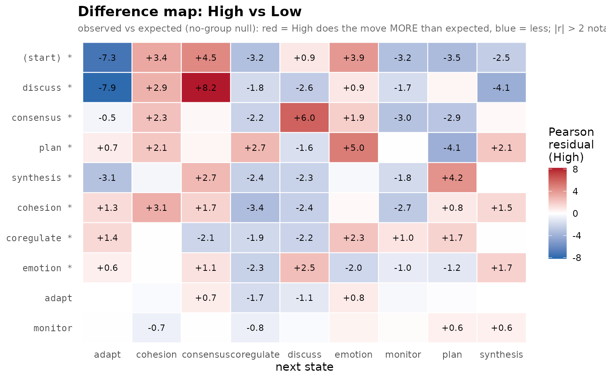

# Comparing groups

Many questions about sequential behavior are comparative. Do high and
low achievers regulate their collaboration in the same order? Do
students who persist move between engagement states differently from
those who drop out? Two groups can use the same states at similar rates
and still differ in what follows a given history, and they can also
differ in how often they reach that history at all. These are distinct
questions, and a single distance between two transition matrices
conflates them.

A variable-order transition tree fitted to each group gives both pieces
of information for every context: the next-state distribution
$`P(x_t \mid c)`$ and the number of times the context occurs. The
`transitiontrees` package compares groups on these two axes. The
**behavioral** axis asks whether, given the same context, the groups
predict a different next state; it is measured per context by the
Jensen-Shannon divergence between the groups’ next-state distributions,

``` math
\mathrm{JSD}(c) = H\Big(\sum_g w_g P_g(\cdot \mid c)\Big) -
\sum_g w_g H\big(P_g(\cdot \mid c)\big), \qquad
w_g = \frac{N_g(c)}{\sum_h N_h(c)},
```

where $`H`$ is the Shannon entropy in bits and $`N_g(c)`$ the count of
the context in group $`g`$. The **usage** axis asks whether the groups
reach the context at different rates; it is measured by a $`G^2`$
homogeneity statistic on the context’s share of each group’s positions
at the same depth. The reference distribution of every statistic is
built by permuting the group labels of whole sequences, and per-context
p-values are adjusted for multiplicity with the Benjamini-Hochberg
procedure. The model itself is introduced in the [variable-order
transition
trees](https://pak.dynasite.org/transitiontrees/articles/transitiontrees.html)
vignette.

## Data

`group_regulation_long` is an event log of collaborative regulation: one
row per action, 27,533 rows from 2,000 students.

- **Actor:** `Actor` identifies the student whose actions form a
  sequence.
- **Time:** `Time` orders the actions; a gap of more than 15 minutes
  starts a new sequence.
- **State:** `Action`, one of nine regulation moves (`adapt`,
  `cohesion`, `consensus`, `coregulate`, `discuss`, `emotion`,
  `monitor`, `plan`, `synthesis`).
- **Group:** `Achiever`, the student’s achievement level (`High` or
  `Low`), constant within a student.
- **Stratum:** `Course`, the course the student took (`A`, `B` or `C`).

``` r

library(transitiontrees)
```

Achievement and course are related. The cross-tabulation of actions by
course and achievement level shows that course `A` contains only high
achievers, course `C` only low achievers, and course `B` both.

``` r

xtabs(~ Course + Achiever, data = group_regulation_long)
#>       Achiever
#> Course  High   Low
#>      A 12390     0
#>      B  1331  8295
#>      C     0  5517
```

## Fitting one tree per group

Naming the group column in
[`context_tree()`](https://pak.dynasite.org/transitiontrees/reference/context_tree.md)
fits one tree per group over a shared alphabet and returns a
`transitiontrees_group`. The trees below hold contexts of one action,
which keeps the permutation tests fast; the [collaborative regulation
case
study](https://pak.dynasite.org/transitiontrees/articles/case-regulation-achievement.html)
compares deeper trees.

``` r

grp <- context_tree(group_regulation_long,
                    actor = "Actor", time = "Time", action = "Action",
                    group = "Achiever", max_depth = 1, min_count = 10)
grp
#> <transitiontrees_group>  2 groups
#>   High            10 nodes, depth <= 1, 1000 seq, 13721 obs
#>   Low             10 nodes, depth <= 1, 1000 seq, 13812 obs
```

[`summary()`](https://rdrr.io/r/base/summary.html) returns one row per
group with the size and fit of its tree.

``` r

summary(grp)
#> <transitiontrees_group summary>  2 groups
#> 
#>  group n_seq n_obs n_nodes max_depth pruned logLik df  nobs   AIC   BIC perplexity
#>   High  1000 13721      10         1  FALSE -23003 80 13721 46165 46768       5.35
#>    Low  1000 13812      10         1  FALSE -23193 80 13812 46546 47148       5.36
```

Each group contributes 1,000 sequences and about 13,700 actions. The two
trees fit their own data about equally well: a perplexity of 5.35 for
high achievers and 5.36 for low achievers, against nine possible
actions.

[`state_frequencies()`](https://pak.dynasite.org/transitiontrees/reference/state_frequencies.md)
lists the shares of the actions in each group.

``` r

state_frequencies(grp)
#>    group      state count proportion
#> 1   High  consensus  3651     0.2661
#> 2   High       plan  3102     0.2261
#> 3   High    discuss  2166     0.1579
#> 4   High    emotion  1686     0.1229
#> 5   High   cohesion  1018     0.0742
#> 6   High coregulate   959     0.0699
#> 7   High    monitor   668     0.0487
#> 8   High  synthesis   316     0.0230
#> 9   High      adapt   155     0.0113
#> 10   Low       plan  3521     0.2549
#> 11   Low  consensus  3146     0.2278
#> 12   Low    discuss  2101     0.1521
#> 13   Low    emotion  1389     0.1006
#> 14   Low coregulate  1174     0.0850
#> 15   Low    monitor   848     0.0614
#> 16   Low   cohesion   821     0.0594
#> 17   Low  synthesis   413     0.0299
#> 18   Low      adapt   399     0.0289
```

High achievers use `consensus` most (26.6% of their actions) and low
achievers `plan` (25.5%). Low achievers use `adapt`, `monitor` and
`synthesis` more often; high achievers use `emotion` and `cohesion` more
often.

## Overall difference between two trees

[`compare_trees()`](https://pak.dynasite.org/transitiontrees/reference/compare_trees.md)
tests whether two trees predict differently overall. Its statistic is
the count-weighted symmetric Kullback-Leibler divergence between the
trees’ next-state distributions, in nats; the null distribution comes
from refitting both trees after reassigning the sequences at random to
the two groups.

``` r

cmp <- compare_trees(grp, iter = 99)
summary(cmp)
#> <transitiontrees_comparison summary>
#>  distance null_mean  null_sd null_q95 p_value iter n_pathways
#>    0.0471    0.0029 0.000522  0.00367    0.01   99         10
```

The observed distance of 0.0471 is many times the permutation mean of
0.0029 and exceeds every one of the 99 permuted distances, so the
p-value is at its floor of $`1 / (99 + 1) = 0.01`$. The per-context
breakdown shows which histories contribute most.

``` r

as.data.frame(cmp, what = "pathways")
#>       pathway count_a count_b divergence_ab divergence_ba divergence_sym
#> 1   synthesis     278     374       0.30009       0.31081        0.30545
#> 2     discuss    2003    1948       0.17777       0.20403        0.19090
#> 3    cohesion     938     757       0.11951       0.11497        0.11724
#> 4       adapt     141     368       0.04356       0.09434        0.06895
#> 5   consensus    3392    2937       0.04993       0.04583        0.04788
#> 6  coregulate     894    1076       0.04552       0.04714        0.04633
#> 7        plan    2892    3265       0.04178       0.03591        0.03884
#> 8     emotion    1550    1287       0.03462       0.03462        0.03462
#> 9     (start)   13721   13812       0.01956       0.02204        0.02080
#> 10    monitor     633     800       0.00524       0.00533        0.00529
```

What follows `synthesis` differs most between the groups (a symmetric
divergence of 0.305), then what follows `discuss` (0.191) and `cohesion`
(0.117). What follows `monitor` hardly differs (0.005).

## Behavioral and usage differences

[`compare_groups()`](https://pak.dynasite.org/transitiontrees/reference/compare_groups.md)
separates the two axes, tests every context, and works for any number of
groups. [`summary()`](https://rdrr.io/r/base/summary.html) reduces the
result to one row with a verdict.

``` r

cg <- compare_groups(grp, iter = 99)
summary(cg)
#> Group comparison: High vs Low (10 contexts, 99 permutations)
#>   behavioral omnibus: JSD = 874.104 bits, p = 0.010
#>   usage omnibus     : G2 = 282.97, p = 0.010
#>   pathways with a behavioral difference (adjusted p < 0.05): 8
#>   pathways with a usage difference      (adjusted p < 0.05): 8
#>   pathways whose modal next state differs between groups: 4
```

Both omnibus tests reach the permutation floor of 0.01: given the same
preceding action the groups choose different next actions, and they also
reach the preceding actions at different rates. Eight of the ten
contexts, the root among them, show a behavioral difference after false
discovery rate adjustment, and eight of the nine contexts with a usage
test (the root has none) show a usage difference.

The omnibus table and the pairwise distance are available as data
frames.

``` r

as.data.frame(cg, what = "omnibus")
#>         axis                 statistic value p_value
#> 1 behavioral count-weighted JSD (bits)   874    0.01
#> 2      usage                   sum G^2   283    0.01
as.data.frame(cg, what = "distance")
#>   group_a group_b distance
#> 1    High     Low   0.0471
```

The behavioral statistic is the count-weighted sum of the per-context
divergences, 874 bits; the usage statistic is the sum of the per-context
$`G^2`$ values, 283. The pairwise distance is the
[`compare_trees()`](https://pak.dynasite.org/transitiontrees/reference/compare_trees.md)
statistic, 0.0471.

The per-context table gives the counts, the modal next action in each
group, whether the modal actions differ (`flips`), and both tests with
raw and adjusted p-values.

``` r

as.data.frame(cg, what = "pathways")
#>       pathway depth count_total count_High count_Low modal_High modal_Low flips jsd_bits
#> 1   synthesis     1         652        278       374  consensus consensus FALSE  0.10220
#> 2     discuss     1        3951       2003      1948  consensus   discuss  TRUE  0.06557
#> 3    cohesion     1        1695        938       757  consensus consensus FALSE  0.04285
#> 4   consensus     1        6329       3392      2937       plan      plan FALSE  0.01696
#> 5  coregulate     1        1970        894      1076       plan   discuss  TRUE  0.01639
#> 6       adapt     1         509        141       368  consensus consensus FALSE  0.01536
#> 7        plan     1        6157       2892      3265       plan      plan FALSE  0.01365
#> 8     emotion     1        2837       1550      1287  consensus  cohesion  TRUE  0.01349
#> 9     (start)     0       27533      13721     13812  consensus      plan  TRUE  0.00739
#> 10    monitor     1        1433        633       800    discuss   discuss FALSE  0.00188
#>    jsd_p jsd_padj usage_g2 usage_p usage_padj
#> 1   0.01   0.0125    13.86    0.01     0.0112
#> 2   0.01   0.0125     1.43    0.21     0.2100
#> 3   0.01   0.0125    22.14    0.01     0.0112
#> 4   0.01   0.0125    47.94    0.01     0.0112
#> 5   0.01   0.0125    16.87    0.01     0.0112
#> 6   0.08   0.0889   105.31    0.01     0.0112
#> 7   0.01   0.0125    26.39    0.01     0.0112
#> 8   0.01   0.0125    29.61    0.01     0.0112
#> 9   0.01   0.0125       NA      NA         NA
#> 10  0.88   0.8800    19.42    0.01     0.0112
```

After `discuss`, high achievers most often move to `consensus` and low
achievers continue to `discuss`. After `coregulate` the modal action is
`plan` for high achievers and `discuss` for low achievers, and after
`emotion` it is `consensus` against `cohesion`. `synthesis` has the
largest behavioral divergence (0.102 bits) although both groups most
often follow it with `consensus`; the difference lies in the rest of the
distribution. `monitor` (adjusted p = 0.88) and `adapt` (0.089) show no
behavioral difference, and `discuss` is the one context with no usage
difference (adjusted p = 0.21). `adapt` differs in usage ($`G^2`$ = 105)
more than any other action but not in what follows it.

## Where the groups differ

[`plot_difference()`](https://pak.dynasite.org/transitiontrees/reference/plot_difference.md)
draws one row per context and one column per next action. Each cell is
the Pearson residual of the first group against the no-difference null,
so red cells are transitions high achievers make more often than
expected and blue cells transitions they make less often. With
`comparison = cg`, contexts whose behavioral difference survives the
adjustment are starred.

``` r

plot_difference(grp, comparison = cg)
```



The largest residuals sit in the `discuss` row: after discussing, high
achievers move to `consensus` more often than expected (+8.2) and to
`adapt` less often (-7.9). High achievers also move from `consensus` to
`discuss` (+6.0) and from `plan` to `emotion` (+5.0) more often, and
from `synthesis` to `plan` (+4.2). The `adapt` and `monitor` rows are
pale and unstarred: what follows these actions does not differ between
the groups.

## Stratified permutation

The permutation tests above reassign achievement labels freely across
all students. Because course `A` contains only high achievers and course
`C` only low achievers, part of the observed difference may be a
difference between courses. Naming `Course` as `block` restricts the
permutation to reassign labels only within each course, so the null
distribution keeps the course composition of each group fixed. The block
is stored on the fitted object, and
[`compare_groups()`](https://pak.dynasite.org/transitiontrees/reference/compare_groups.md)
uses it without further arguments. The same argument handles repeated
measures: with several sequences per person, `block` set to the person
column keeps each person’s sequences together in the null.

``` r

grp_course <- context_tree(group_regulation_long,
                           actor = "Actor", time = "Time", action = "Action",
                           group = "Achiever", block = "Course",
                           max_depth = 1, min_count = 10)
cg_course <- compare_groups(grp_course, iter = 99)
summary(cg_course)
#> Group comparison: High vs Low (10 contexts, 99 stratified permutations)
#>   behavioral omnibus: JSD = 874.104 bits, p = 0.010
#>   usage omnibus     : G2 = 282.97, p = 0.010
#>   pathways with a behavioral difference (adjusted p < 0.05): 6
#>   pathways with a usage difference      (adjusted p < 0.05): 4
#>   pathways whose modal next state differs between groups: 4
```

The observed statistics are unchanged, and both omnibus tests remain at
the permutation floor. The per-context results are more conservative:
six contexts keep a behavioral difference and four a usage difference.

``` r

as.data.frame(cg_course, what = "pathways")
#>       pathway depth count_total count_High count_Low modal_High modal_Low flips jsd_bits
#> 1   synthesis     1         652        278       374  consensus consensus FALSE  0.10220
#> 2     discuss     1        3951       2003      1948  consensus   discuss  TRUE  0.06557
#> 3    cohesion     1        1695        938       757  consensus consensus FALSE  0.04285
#> 4   consensus     1        6329       3392      2937       plan      plan FALSE  0.01696
#> 5  coregulate     1        1970        894      1076       plan   discuss  TRUE  0.01639
#> 6       adapt     1         509        141       368  consensus consensus FALSE  0.01536
#> 7        plan     1        6157       2892      3265       plan      plan FALSE  0.01365
#> 8     emotion     1        2837       1550      1287  consensus  cohesion  TRUE  0.01349
#> 9     (start)     0       27533      13721     13812  consensus      plan  TRUE  0.00739
#> 10    monitor     1        1433        633       800    discuss   discuss FALSE  0.00188
#>    jsd_p jsd_padj usage_g2 usage_p usage_padj
#> 1   0.01   0.0167    13.86    0.01     0.0225
#> 2   0.01   0.0167     1.43    0.31     0.3100
#> 3   0.01   0.0167    22.14    0.13     0.1671
#> 4   0.01   0.0167    47.94    0.01     0.0225
#> 5   0.04   0.0571    16.87    0.26     0.2925
#> 6   0.24   0.2667   105.31    0.01     0.0225
#> 7   0.01   0.0167    26.39    0.04     0.0720
#> 8   0.05   0.0625    29.61    0.01     0.0225
#> 9   0.01   0.0167       NA      NA         NA
#> 10  0.45   0.4500    19.42    0.06     0.0900
```

`coregulate` and `emotion`, two of the contexts whose modal next action
differs between the groups, no longer pass the behavioral adjustment
(adjusted p = 0.057 and 0.062), and the usage differences after
`cohesion`, `coregulate`, `plan` and `monitor` are no longer
significant. The behavioral differences after `synthesis`, `discuss`,
`cohesion`, `consensus` and `plan` remain under a null that holds the
course composition of each group fixed.

## Assumptions

- Sequences are exchangeable under the null hypothesis, within blocks
  when `block` is given.
- With `block`, only blocks that contain more than one group contribute
  to the permutation; here only course `B` does.
- The tested contexts are those in the fitted trees; a context rarer
  than `min_count` in every group is not tested.
- Weighted trees cannot be compared, because the permutation refits from
  the raw sequences.
