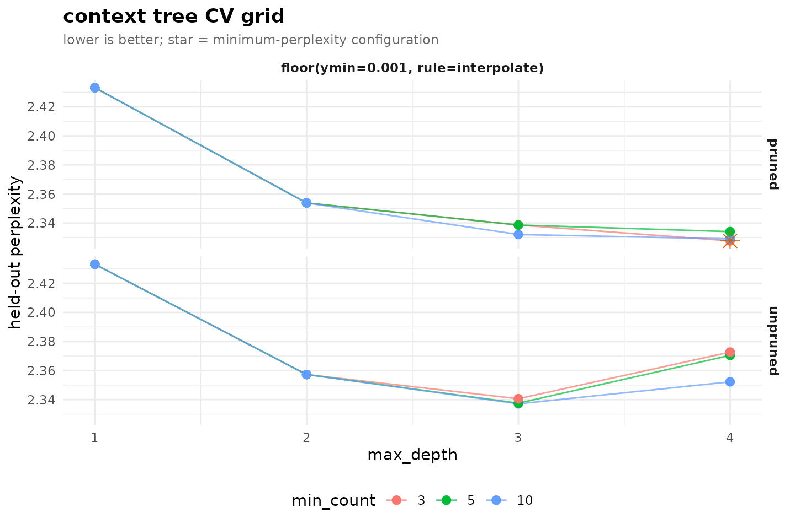

# Model selection: tuning, fit and perplexity

A prediction suffix tree is defined by four choices made before
estimation: the longest history it may hold (`max_depth`), the number of
observations a context needs to receive its own node (`min_count`), the
smoother, and whether and how the tree is pruned. Each choice trades the
detail of the model against the precision of its estimates. A deeper
tree with a lower `min_count` describes the data it was fitted on more
closely, but its longer contexts rest on fewer observations and may
describe noise that does not recur (Bühlmann & Wyner, 1999). The
question for selection is therefore not how well a tree fits its own
data, which always improves with depth, but how well it predicts
sequences it has not seen.

This guide describes the measures of fit that `transitiontrees` reports:
the log likelihood and the information criteria derived from it, and
perplexity, in sample and on held-out data. It then selects the
configuration by k-fold cross-validation with
[`tune_tree()`](https://pak.dynasite.org/transitiontrees/reference/tune_tree.md)
and examines how stable the selection is. The smoothers and pruning
criteria among which the selection chooses are described in [smoothing
and
pruning](https://pak.dynasite.org/transitiontrees/articles/smoothing-and-pruning.md).

``` r

library(transitiontrees)
```

## Data

The examples use `trajectories`, the engagement states of 138 learners
over 15 time steps; the data are small enough for every grid below to
run in seconds.

- **Sequence:** each row is one learner, read from left to right; two
  rows contain no observed state, which leaves 136 sequences and 1,870
  observed states.
- **States:** `Active`, `Average` and `Disengaged`.
- **Missing cells:** trailing `NA`s mark the end of a learner’s record
  and are dropped.

## Likelihood and information criteria

For a sequence $`x_1, \dots, x_T`$, the tree predicts each state from
the longest context $`c^*(t)`$ in the tree that ends the history before
it. The log likelihood of a set of sequences is the sum over all
predicted positions,

``` math
\ell = \sum_t \log \tilde p\big(x_t \mid c^*(t)\big),
```

and the tree has $`|\mathcal{C}|\,(|S| - 1)`$ free parameters, one
distribution over $`|S|`$ states for each of its $`|\mathcal{C}|`$
contexts. The standard generics return these quantities.

``` r

tree <- context_tree(trajectories, max_depth = 4, min_count = 5)
logLik(tree)
#> 'log Lik.' -1438 (df=164)
nobs(tree)
#> [1] 1870
AIC(tree)
#> [1] 3204
BIC(tree)
#> [1] 4111
```

The depth-4 tree has 82 contexts and therefore $`82 \times 2 = 164`$
parameters, estimated from 1,870 observations. With $`n`$ predicted
states, $`\mathrm{AIC} = -2\ell + 2\,\mathrm{df}`$ and
$`\mathrm{BIC} = -2\ell + \log(n)\,\mathrm{df}`$.
[`model_fit()`](https://pak.dynasite.org/transitiontrees/reference/model_fit.md)
returns all of them in one row, together with perplexity,

``` math
\mathrm{perplexity} = \exp(-\ell / n),
```

the effective number of equally likely next states: it is $`|S| = 3`$
for a uniform guess and 1 for perfect prediction.

``` r

model_fit(tree)
#>   logLik  df nobs  AIC  BIC perplexity
#> 1  -1438 164 1870 3204 4111       2.16
```

## Comparing candidate trees in sample

Three candidates illustrate the information criteria: a first-order
chain (depth 1), the depth-4 tree, and the depth-4 tree pruned with the
G2 criterion.

``` r

first_order <- context_tree(trajectories, max_depth = 1, min_count = 5)
pruned <- prune_tree(tree, criterion = "G2", alpha = 0.05)
rbind(first_order = model_fit(first_order),
      depth_4 = model_fit(tree),
      pruned = model_fit(pruned))
#>             logLik  df nobs  AIC  BIC perplexity
#> first_order  -1645   8 1870 3306 3350       2.41
#> depth_4      -1438 164 1870 3204 4111       2.16
#> pruned       -1507  50 1870 3115 3392       2.24
```

The depth-4 tree has the highest likelihood and the lowest in-sample
perplexity (2.16), as the model with the most parameters does on the
data it was fitted on. AIC penalizes each parameter by 2 and prefers the
pruned tree (3115), which reaches a perplexity of 2.24 with 50
parameters. BIC penalizes each parameter by $`\log 1870 \approx 7.5`$
and prefers the first-order chain with 8 parameters (3350), followed by
the pruned tree (3392). The two criteria disagree about whether memory
beyond the current state is worth its parameters, and neither measures
predictive accuracy directly.

## Perplexity on held-out sequences

The information criteria approximate predictive accuracy; held-out data
measure it. With `newdata`,
[`perplexity()`](https://pak.dynasite.org/transitiontrees/reference/perplexity.md)
and
[`model_fit()`](https://pak.dynasite.org/transitiontrees/reference/model_fit.md)
score sequences that were not used for fitting. Here the tree is fitted
on the first 100 learners and scored on the remaining 38.

``` r

training <- head(trajectories, 100)
test <- tail(trajectories, 38)
deep <- context_tree(training, max_depth = 4, min_count = 5)
rbind(in_sample = model_fit(deep),
      held_out = model_fit(deep, newdata = test))
#>           logLik  df nobs  AIC  BIC perplexity
#> in_sample  -1058 150 1374 2415 3199       2.16
#> held_out    -404 150  496 1108 1739       2.26
```

The deep tree predicts its own sequences with a perplexity of 2.16 and
the held-out sequences with 2.26. On held-out data, AIC and BIC are
computed from the held-out log likelihood with the parameters of the
fitted tree. The same comparison for the pruned tree:

``` r

c(in_sample = perplexity(prune_tree(deep)),
  held_out = perplexity(prune_tree(deep), newdata = test))
#> in_sample  held_out 
#>      2.23      2.38
```

In this split, pruning raises both: the in-sample perplexity to 2.23 and
the held-out perplexity to 2.38, against 2.26 for the unpruned tree.
With 100 training sequences, the G2 test removes contexts that would
have predicted the 38 test learners well. A single split of 136
sequences is one noisy sample of predictive accuracy, and its verdict
depends on which learners fall on each side; cross-validation averages
over many splits.

## Cross-validated tuning

[`tune_tree()`](https://pak.dynasite.org/transitiontrees/reference/tune_tree.md)
divides the sequences at random into `folds` groups, fits each
configuration on all groups but one, and scores the held-out group;
every sequence is held out once. Splitting by sequence rather than by
position keeps the positions of one sequence, which are dependent, on
the same side of the split. The held-out log likelihoods are summed over
folds, and the configuration with the lowest pooled perplexity is
selected among those that scored on every fold. The grid below crosses
four depths, three values of `min_count`, and pruned and unpruned trees:
24 configurations.

``` r

grid <- tune_tree(trajectories, max_depth = 1:4, min_count = c(3, 5, 10),
                  prune = c(FALSE, TRUE), folds = 5, seed = 1)
summary(grid)
#> <transitiontrees_tune summary>  24 configurations, 0 with a failed fold
#> selected (minimum held-out perplexity):
#>  max_depth min_count                           smoothing prune perplexity n_nodes_avg
#>          4         3 floor(ymin=0.001, rule=interpolate)  TRUE      2.328        26.4
```

The selected configuration is a pruned tree of depth 4 with
`min_count = 3`, with a held-out perplexity of 2.33 and on average 26
contexts. The full grid, sorted by held-out perplexity:

``` r

head(as.data.frame(grid, what = "grid"), 10)
#>    max_depth min_count                           smoothing prune logLik n_scored
#> 1          4         3 floor(ymin=0.001, rule=interpolate)  TRUE  -1580     1870
#> 2          4        10 floor(ymin=0.001, rule=interpolate)  TRUE  -1581     1870
#> 3          3        10 floor(ymin=0.001, rule=interpolate)  TRUE  -1583     1870
#> 4          4         5 floor(ymin=0.001, rule=interpolate)  TRUE  -1585     1870
#> 5          3        10 floor(ymin=0.001, rule=interpolate) FALSE  -1587     1870
#> 6          3         5 floor(ymin=0.001, rule=interpolate) FALSE  -1588     1870
#> 7          3         3 floor(ymin=0.001, rule=interpolate)  TRUE  -1589     1870
#> 8          3         5 floor(ymin=0.001, rule=interpolate)  TRUE  -1589     1870
#> 9          3         3 floor(ymin=0.001, rule=interpolate) FALSE  -1590     1870
#> 10         4        10 floor(ymin=0.001, rule=interpolate) FALSE  -1600     1870
#>    perplexity n_nodes_avg folds_failed
#> 1        2.33        26.4            0
#> 2        2.33        24.2            0
#> 3        2.33        16.6            0
#> 4        2.33        25.4            0
#> 5        2.34        31.0            0
#> 6        2.34        37.2            0
#> 7        2.34        17.2            0
#> 8        2.34        17.2            0
#> 9        2.34        39.4            0
#> 10       2.35        60.4            0
```

The ten best configurations lie between 2.33 and 2.35, and all of them
use depth 3 or 4. The configurations of depth 1 and 2:

``` r

subset(as.data.frame(grid, what = "grid"), max_depth <= 2,
       select = c(max_depth, min_count, prune, perplexity, n_nodes_avg))
#>    max_depth min_count prune perplexity n_nodes_avg
#> 11         2         3  TRUE       2.35        11.6
#> 12         2         5  TRUE       2.35        11.6
#> 13         2        10  TRUE       2.35        11.6
#> 14         2         3 FALSE       2.36        13.0
#> 15         2         5 FALSE       2.36        13.0
#> 16         2        10 FALSE       2.36        13.0
#> 19         1         3 FALSE       2.43         4.0
#> 20         1         5 FALSE       2.43         4.0
#> 21         1        10 FALSE       2.43         4.0
#> 22         1         3  TRUE       2.43         4.0
#> 23         1         5  TRUE       2.43         4.0
#> 24         1        10  TRUE       2.43         4.0
```

Every depth-1 configuration reaches 2.43 and every depth-2 configuration
2.35 or 2.36; at these depths `min_count` makes no difference, because
every context is observed more than ten times. The plot shows the whole
surface; the star marks the selected configuration and is drawn in each
panel at its depth and perplexity.

``` r

plot(grid)
```



The large step is from one to two states of memory; from depth 2 onward
the pruned trees change little, whereas the unpruned trees deteriorate
at depth 4 as their number of contexts grows. Pruning makes the result
insensitive to the depth limit, and `min_count` matters only for
unpruned trees.

### Smoothers in the grid

`smoothing` takes a vector of smoother names, or a list of
specifications with parameters, and adds them to the grid.

``` r

smoothing_grid <- tune_tree(trajectories, max_depth = 2:4, min_count = 5,
                            smoothing = c("floor", "laplace", "kneser_ney",
                                          "witten_bell"),
                            prune = TRUE, folds = 5, seed = 1)
as.data.frame(smoothing_grid, what = "grid")
#>    max_depth min_count                           smoothing prune logLik n_scored
#> 1          4         5           kneser_ney(discount=0.75)  TRUE  -1570     1870
#> 2          4         5                         witten_bell  TRUE  -1570     1870
#> 3          4         5                    laplace(alpha=1)  TRUE  -1570     1870
#> 4          3         5                         witten_bell  TRUE  -1584     1870
#> 5          3         5                    laplace(alpha=1)  TRUE  -1585     1870
#> 6          4         5 floor(ymin=0.001, rule=interpolate)  TRUE  -1585     1870
#> 7          3         5           kneser_ney(discount=0.75)  TRUE  -1587     1870
#> 8          3         5 floor(ymin=0.001, rule=interpolate)  TRUE  -1589     1870
#> 9          2         5                         witten_bell  TRUE  -1600     1870
#> 10         2         5                    laplace(alpha=1)  TRUE  -1600     1870
#> 11         2         5 floor(ymin=0.001, rule=interpolate)  TRUE  -1601     1870
#> 12         2         5           kneser_ney(discount=0.75)  TRUE  -1602     1870
#>    perplexity n_nodes_avg folds_failed
#> 1        2.32        25.8            0
#> 2        2.32        25.0            0
#> 3        2.32        26.0            0
#> 4        2.33        16.8            0
#> 5        2.33        16.6            0
#> 6        2.33        25.4            0
#> 7        2.34        17.0            0
#> 8        2.34        17.2            0
#> 9        2.35        11.6            0
#> 10       2.35        11.6            0
#> 11       2.35        11.6            0
#> 12       2.36        11.6            0
```

``` r

as.data.frame(smoothing_grid, what = "best")
#>   max_depth min_count                 smoothing prune logLik n_scored perplexity
#> 1         4         5 kneser_ney(discount=0.75)  TRUE  -1570     1870       2.32
#>   n_nodes_avg folds_failed
#> 1        25.8            0
```

The smoothers differ by less than 0.01 in held-out perplexity at each
depth; the lowest value, 2.32, is shared by Kneser-Ney, Witten-Bell and
Laplace smoothing at depth 4, with Kneser-Ney first by a margin smaller
than the printed precision. With these data, the choice of smoother
matters much less than the choice of depth and pruning.

## Stability of the selection

The assignment of sequences to folds is random, and the selected
configuration can change with it when several configurations are close.
Repeating the tuning with different seeds shows how much.

``` r

do.call(rbind, lapply(1:5, \(seed)
  data.frame(seed = seed,
             summary(tune_tree(trajectories, max_depth = 1:4,
                               min_count = c(3, 5, 10),
                               prune = c(FALSE, TRUE), folds = 5,
                               seed = seed)))))
#>   seed n_configurations n_failed max_depth min_count                           smoothing
#> 1    1               24        0         4         3 floor(ymin=0.001, rule=interpolate)
#> 2    2               24        0         4        10 floor(ymin=0.001, rule=interpolate)
#> 3    3               24        0         4        10 floor(ymin=0.001, rule=interpolate)
#> 4    4               24        0         4        10 floor(ymin=0.001, rule=interpolate)
#> 5    5               24        0         3        10 floor(ymin=0.001, rule=interpolate)
#>   prune perplexity n_nodes_avg
#> 1  TRUE       2.33        26.4
#> 2 FALSE       2.33        60.0
#> 3 FALSE       2.33        59.4
#> 4  TRUE       2.33        24.0
#> 5  TRUE       2.33        16.2
```

Four of the five seeds select depth 4 and one selects depth 3; the
selected `min_count` is 3 or 10, and two seeds select an unpruned tree.
Every selected configuration reaches a held-out perplexity of 2.33.
Within this near-tie of the top configurations, the fold assignment
decides. The stable conclusions are that two or more states of memory
predict better than one and that pruning protects against the
degradation of deep trees; among the configurations within this margin,
the simpler tree is the more defensible choice unless its deeper
contexts are themselves of interest.

## Reporting the selection

A report of the selection states the grid, the folds and seeds, the
selected configuration with its held-out perplexity, and the range of
near-equivalent configurations. For these data:

> Depth (1 to 4), minimum context count (3, 5, 10) and G2 pruning
> ($`\alpha = 0.05`$) were selected by five-fold cross-validation over
> sequences, with held-out perplexity as the criterion. Two or more
> states of memory reduced held-out perplexity from 2.43 (first order)
> to between 2.33 and 2.35. The selected configuration (depth 4, minimum
> count 3, pruned; perplexity 2.33) was not stable across five fold
> assignments, which selected depth 3 or 4, a minimum count of 3 or 10,
> and pruned or unpruned trees, all with a held-out perplexity of 2.33.

The tree for the subsequent analysis is then refitted on all sequences
with the selected configuration.

``` r

final <- prune_tree(context_tree(trajectories, max_depth = 4, min_count = 3))
model_fit(final)
#>   logLik df nobs  AIC  BIC perplexity
#> 1  -1502 52 1870 3107 3395       2.23
```

The refitted tree has 26 contexts (52 parameters) and an in-sample
perplexity of 2.23; the held-out value of 2.33 from cross-validation is
the figure to report for its predictive accuracy.

## References

Bühlmann, P., & Wyner, A. J. (1999). Variable length Markov chains. *The
Annals of Statistics*, 27(2), 480–513.
<https://doi.org/10.1214/aos/1018031204>

Ron, D., Singer, Y., & Tishby, N. (1996). The power of amnesia: Learning
probabilistic automata with variable memory length. *Machine Learning*,
25(2–3), 117–149. <https://doi.org/10.1023/A:1026490906255>
