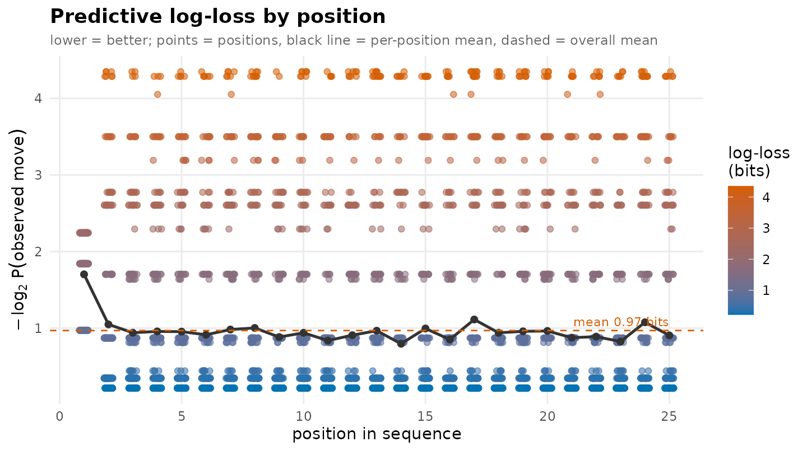
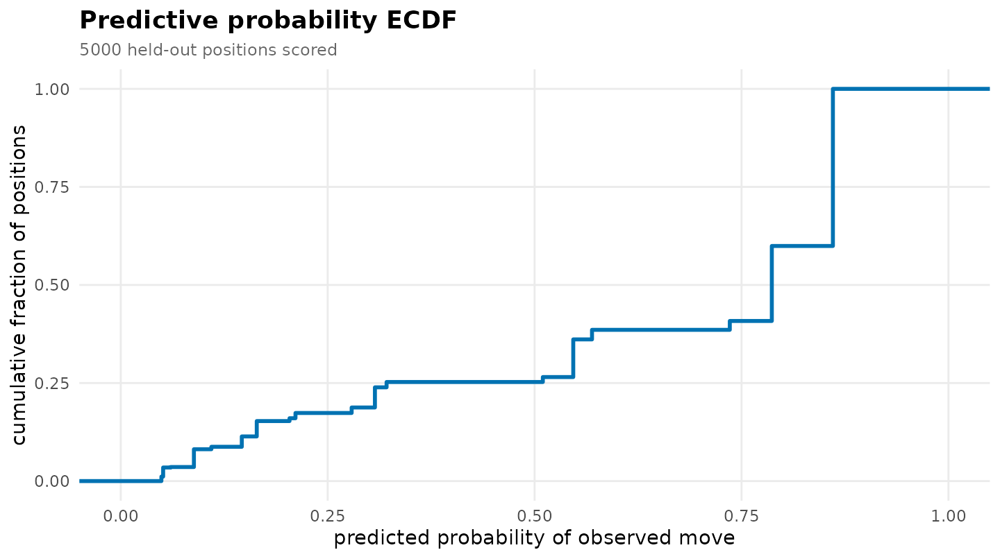
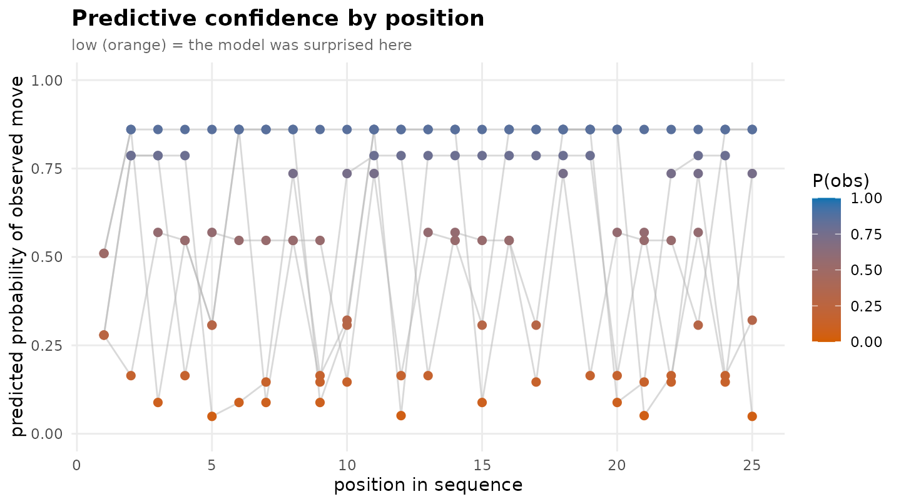

# Prediction, scoring, imputation and mining

A variable-order transition tree is a probabilistic model of the next
state given the states that preceded it. For every history it selects
the longest suffix that the tree holds as a context and returns that
context’s next-state distribution (Ron, Singer and Tishby, 1996;
Bühlmann and Wyner, 1999). The same distribution serves several
purposes. It predicts what comes next. It assigns a likelihood to an
observed sequence, so sequences and single transitions can be ranked by
how expected or surprising they are, and so a model can be judged by the
probability it gives to sequences it has not seen. It generates new
sequences, and it fills gaps in incomplete ones.

This guide covers these uses:
[`predict()`](https://rdrr.io/r/stats/predict.html) and
[`query_pathway()`](https://pak.dynasite.org/transitiontrees/reference/query_pathway.md)
for the next state,
[`perplexity()`](https://pak.dynasite.org/transitiontrees/reference/perplexity.md)
and
[`model_fit()`](https://pak.dynasite.org/transitiontrees/reference/model_fit.md)
for held-out fit,
[`score_sequences()`](https://pak.dynasite.org/transitiontrees/reference/score_sequences.md),
[`score_positions()`](https://pak.dynasite.org/transitiontrees/reference/score_positions.md)
and
[`plot_predictive()`](https://pak.dynasite.org/transitiontrees/reference/plot_predictive.md)
for scoring,
[`mine_sequences()`](https://pak.dynasite.org/transitiontrees/reference/mine_sequences.md)
and
[`mine_contexts()`](https://pak.dynasite.org/transitiontrees/reference/mine_contexts.md)
for finding unusual sequences and contexts,
[`generate_sequences()`](https://pak.dynasite.org/transitiontrees/reference/generate_sequences.md)
and [`simulate()`](https://rdrr.io/r/stats/simulate.html) for
generation, and
[`impute_sequences()`](https://pak.dynasite.org/transitiontrees/reference/impute_sequences.md)
for gaps.

## Data

`engagement` holds the engagement states of 1,000 students over 25 time
steps.

- **Sequence:** one row per student.
- **Time:** columns `T1` to `T25`; `NA` marks positions after a student
  dropped out.
- **State:** `Active`, `Average` or `Disengaged`.

The first 800 students are used to fit the tree and the last 200 are
held out to evaluate it. [`head()`](https://rdrr.io/r/utils/head.html)
and [`tail()`](https://rdrr.io/r/utils/head.html) split the rows.

``` r

library(transitiontrees)
dim(engagement)
#> [1] 1000   25
training <- head(engagement, 800)
held_out <- tail(engagement, 200)
```

## The model

To fit the tree, we call
[`context_tree()`](https://pak.dynasite.org/transitiontrees/reference/context_tree.md)
with `max_depth` for the longest history and `min_count` for the
smallest number of observations a context needs;
[`prune_tree()`](https://pak.dynasite.org/transitiontrees/reference/prune_tree.md)
then removes contexts whose prediction does not differ from their
parent’s by the $`G^2`$ test.

``` r

grown <- context_tree(training, max_depth = 3L, min_count = 10L)
tree <- prune_tree(grown)
tree
#> <transitiontrees>  6 nodes, depth <= 3, 3 states  [pruned]
#>   alphabet : Active, Average, Disengaged
#>   fit on   : 800 sequences, 19555 observations
#>   smoothing: floor(ymin=0.001, rule=interpolate)   min_count = 10
#>   pruned by: G2   alpha = 0.05
#> (start)   n=19555  -> Active (0.51)
#> |-- Active    n=9548   -> Active (0.86)
#> |-- Average   n=3973   -> Average (0.55)
#> |   `-- Disengaged  n=822    -> Average (0.57)
#> `-- Disengaged  n=5234   -> Disengaged (0.79)
#>     `-- Average   n=564    -> Disengaged (0.74)
```

Of the 40 contexts grown, pruning keeps 6. One step of history carries
most of the information: only two contexts of depth two survive,
`Disengaged -> Average` and `Average -> Disengaged`, and none of depth
three. The pathway notation reads oldest to newest, so
`Disengaged -> Average` is a student who was disengaged and is now
average.

## Predicting the next state

To predict the next state after one or more histories, we call
[`predict()`](https://rdrr.io/r/stats/predict.html) with `newdata` for
the histories and `tidy = TRUE` for one row per history. Each history is
a character vector of states, oldest first.

``` r

histories <- list(c("Active", "Active"),
                  c("Disengaged", "Average"),
                  c("Average", "Average", "Disengaged"))
predict(tree, newdata = histories, tidy = TRUE)
#>   id                          history               context  predicted probability Active Average
#> 1  1                 Active -> Active                Active     Active       0.860 0.8604  0.0884
#> 2  2            Disengaged -> Average Disengaged -> Average    Average       0.569 0.3212  0.5693
#> 3  3 Average -> Average -> Disengaged Average -> Disengaged Disengaged       0.736 0.0603  0.2039
#>   Disengaged
#> 1     0.0512
#> 2     0.1095
#> 3     0.7358
```

`history` is the history as given and `context` the longest suffix of it
that the tree holds, from which the prediction is made. The first
history backs off from `Active -> Active` to `Active`, because pruning
removed the longer context; the third backs off to
`Average -> Disengaged`. `predicted` is the most likely next state,
`probability` its probability, and the last three columns give the full
distribution. A student who was disengaged and is now average stays
average with probability 0.57, becomes active with probability 0.32 and
returns to disengagement with probability 0.11.

To obtain only the predicted states, we set `type = "class"`.

``` r

predict(tree, newdata = histories, type = "class")
#> [1] "Active"     "Average"    "Disengaged"
```

## Querying a pathway

To read the distribution of one context, we call
[`query_pathway()`](https://pak.dynasite.org/transitiontrees/reference/query_pathway.md)
with the pathway. A pathway the tree does not hold backs off to its
longest held suffix, as in
[`predict()`](https://rdrr.io/r/stats/predict.html).

``` r

query_pathway(tree, c("Disengaged", "Average"))
#>     Active    Average Disengaged 
#>      0.321      0.569      0.109
```

To obtain the probability of one next state, we add `next_state`.

``` r

query_pathway(tree, "Disengaged", next_state = "Disengaged")
#> [1] 0.787
```

To refuse back-off and require the context itself, we set
`exact = TRUE`; a pathway the tree does not hold then returns `NA`.
[`pathway_exists()`](https://pak.dynasite.org/transitiontrees/reference/pathway_exists.md)
answers the same question with `TRUE` or `FALSE`.

``` r

query_pathway(tree, c("Active", "Active"), exact = TRUE)
#>     Active    Average Disengaged 
#>         NA         NA         NA
pathway_exists(tree, "Disengaged -> Average")
#> [1] TRUE
pathway_exists(tree, "Active -> Active")
#> [1] FALSE
```

## Held-out fit

Perplexity is the exponential of the average negative log-likelihood per
predicted state. It reads as the effective number of equally likely next
states the model is choosing between: a model that knows nothing about
three states has perplexity 3, and a model that is always certain and
correct has perplexity 1. To compute it on the training sequences and on
the held-out ones, we call
[`perplexity()`](https://pak.dynasite.org/transitiontrees/reference/perplexity.md)
without and with `newdata`.

``` r

perplexity(tree)
#> [1] 1.93
perplexity(tree, newdata = held_out)
#> [1] 1.96
perplexity(grown, newdata = held_out)
#> [1] 1.96
```

The pruned tree has perplexity 1.93 on the sequences it was fitted to
and 1.96 on the held-out students, a small gap that shows little
overfitting. The unpruned tree, with 40 contexts instead of 6, predicts
the held-out students no better (1.96). To obtain the log-likelihood,
degrees of freedom, number of predicted states, AIC, BIC and perplexity
in one row, we call
[`model_fit()`](https://pak.dynasite.org/transitiontrees/reference/model_fit.md).

``` r

model_fit(tree)
#>   logLik df  nobs   AIC   BIC perplexity
#> 1 -12835 12 19555 25694 25788       1.93
model_fit(tree, newdata = held_out)
#>   logLik df nobs  AIC  BIC perplexity
#> 1  -3358 12 5000 6740 6819       1.96
```

The held-out row scores 5,000 transitions of the 200 students. The
choice of `max_depth`, `min_count`, smoothing and pruning by
cross-validated perplexity is covered in [Model selection: tuning, fit
and
perplexity](https://pak.dynasite.org/transitiontrees/articles/model-selection.md).

## Scoring sequences

To score each held-out sequence, we call
[`score_sequences()`](https://pak.dynasite.org/transitiontrees/reference/score_sequences.md).
Each row is one sequence: `n_scored` is the number of states predicted,
`log_lik` the summed natural-log probability of the observed states and
`perplexity` the sequence’s own perplexity.

``` r

sequence_scores <- score_sequences(tree, newdata = held_out)
head(sequence_scores)
#>   sequence_id n_scored log_lik perplexity
#> 1           1       25   -21.2       2.34
#> 2           2       25   -18.5       2.10
#> 3           3       25   -13.1       1.69
#> 4           4       25   -22.1       2.42
#> 5           5       25   -20.0       2.23
#> 6           6       25   -19.2       2.16
summary(sequence_scores)
#>   sequence_id       n_scored     log_lik         perplexity  
#>  Min.   :  1.0   Min.   :25   Min.   :-26.33   Min.   :1.30  
#>  1st Qu.: 50.8   1st Qu.:25   1st Qu.:-19.68   1st Qu.:1.71  
#>  Median :100.5   Median :25   Median :-16.86   Median :1.96  
#>  Mean   :100.5   Mean   :25   Mean   :-16.79   Mean   :1.99  
#>  3rd Qu.:150.2   3rd Qu.:25   3rd Qu.:-13.44   3rd Qu.:2.20  
#>  Max.   :200.0   Max.   :25   Max.   : -6.56   Max.   :2.87
```

Most held-out students have a perplexity close to the model’s 1.96; the
range runs from 1.30 to 2.87. To list the sequences the model finds most
surprising, we call
[`mine_sequences()`](https://pak.dynasite.org/transitiontrees/reference/mine_sequences.md)
with `which = "surprising"` and `n` for the number to return;
`which = "expected"` returns the most predictable.

``` r

mine_sequences(tree, newdata = held_out, which = "surprising", n = 5L)
#>   sequence_id n_scored log_lik perplexity
#> 1         111       25   -26.3       2.87
#> 2          53       25   -26.1       2.85
#> 3         197       25   -26.1       2.84
#> 4          85       25   -26.0       2.83
#> 5          54       25   -25.9       2.82
mine_sequences(tree, newdata = held_out, which = "expected", n = 3L)
#>   sequence_id n_scored log_lik perplexity
#> 1          99       25   -6.56       1.30
#> 2         146       25   -7.04       1.33
#> 3          56       25   -7.59       1.35
```

`sequence_id` is the row of `held_out`. The most surprising student, row
111, has a perplexity of 2.87, close to the value of 3 for a model that
knows nothing; the most expected, row 99, has 1.30.

## Scoring positions

To score every transition, we call
[`score_positions()`](https://pak.dynasite.org/transitiontrees/reference/score_positions.md).
Each row is one position of one sequence, with the context used for the
prediction, the observed state, the probability the tree gave it and its
log-probability.

``` r

position_scores <- score_positions(tree, newdata = held_out)
head(position_scores)
#>   sequence_id position       matched_context   observed predicted_prob log_lik
#> 1           1        1               (start) Disengaged          0.279  -1.277
#> 2           1        2            Disengaged Disengaged          0.787  -0.240
#> 3           1        3            Disengaged Disengaged          0.787  -0.240
#> 4           1        4            Disengaged    Average          0.164  -1.806
#> 5           1        5 Disengaged -> Average    Average          0.569  -0.563
#> 6           1        6               Average    Average          0.547  -0.604
```

To list the least expected transitions, we set `worst` to the number to
return.

``` r

score_positions(tree, newdata = held_out, worst = 5L)
#>   sequence_id position matched_context observed predicted_prob log_lik
#> 1           4        5      Disengaged   Active         0.0491   -3.01
#> 2           4       25      Disengaged   Active         0.0491   -3.01
#> 3           7       10      Disengaged   Active         0.0491   -3.01
#> 4          19       23      Disengaged   Active         0.0491   -3.01
#> 5          29       13      Disengaged   Active         0.0491   -3.01
```

The least expected transitions are all a jump from `Disengaged` straight
to `Active`, which the tree gives a probability of 0.049.

## Plotting predictive performance

To see where in a sequence the model is uncertain, we call
[`plot_predictive()`](https://pak.dynasite.org/transitiontrees/reference/plot_predictive.md)
with `type = "logloss"`. Each point is one transition’s log-loss
$`-\log_2 P(\text{observed})`$ in bits; the line follows the mean at
each position.

``` r

plot_predictive(tree, newdata = held_out, type = "logloss")
```



To see the distribution of the probabilities given to the observed
states, we set `type = "ecdf"`. A curve that rises late belongs to a
model that gives high probability to what happens.

``` r

plot_predictive(tree, newdata = held_out, type = "ecdf")
```



Because the pruned tree has six contexts, each giving one probability to
each of the three states, the scored probabilities take at most 18
distinct values, and the curve rises in steps.

To follow individual sequences, we set `type = "position"`. The view is
readable for a few sequences, so we pass the first five held-out
students.

``` r

plot_predictive(tree, newdata = head(held_out, 5), type = "position")
```



## Mining contexts

To find the contexts in which a state is likely, we call
[`mine_contexts()`](https://pak.dynasite.org/transitiontrees/reference/mine_contexts.md)
with `state` and `min_prob`.

``` r

mine_contexts(tree, state = "Disengaged", min_prob = 0.5)
#>                 pathway depth count      state  prob is_modal
#> 1            Disengaged     1  5234 Disengaged 0.787     TRUE
#> 2 Average -> Disengaged     2   564 Disengaged 0.736     TRUE
```

Disengagement is the most likely next state after `Disengaged` (0.79)
and after `Average -> Disengaged` (0.74). To find the contexts in which
a state is unlikely, we use `max_prob`.

``` r

mine_contexts(tree, state = "Active", max_prob = 0.1)
#>                 pathway depth count  state   prob is_modal
#> 1 Average -> Disengaged     2   564 Active 0.0603    FALSE
#> 2            Disengaged     1  5234 Active 0.0491    FALSE
```

A student who was disengaged at the last step becomes active at the next
step with probability 0.05 to 0.06.

## Generating sequences

A fitted tree is a generative model: walking forward and drawing each
state from the distribution of the current context produces new
sequences. To generate sequences, we call
[`generate_sequences()`](https://pak.dynasite.org/transitiontrees/reference/generate_sequences.md)
with `n` for the number, `length` for their length and `tidy = TRUE` for
a wide data frame with one row per sequence.

``` r

set.seed(1)
generate_sequences(tree, n = 4L, length = 10L, tidy = TRUE)
#>           T1      T2      T3      T4         T5         T6         T7         T8         T9
#> 1     Active  Active  Active  Active     Active    Average    Average Disengaged Disengaged
#> 2     Active Average Average Average Disengaged Disengaged Disengaged Disengaged Disengaged
#> 3 Disengaged Average Average  Active     Active     Active     Active     Active     Active
#> 4    Average  Active  Active  Active     Active     Active     Active     Active     Active
#>          T10
#> 1    Average
#> 2 Disengaged
#> 3     Active
#> 4     Active
```

To fix the first state of each sequence, we pass one state per sequence
to `start`.

``` r

generate_sequences(tree, n = 3L, length = 8L,
                   start = c("Active", "Average", "Disengaged"), tidy = TRUE)
#>           T1         T2      T3     T4      T5      T6      T7         T8
#> 1     Active     Active  Active Active  Active  Active  Active     Active
#> 2    Average     Active  Active Active  Active  Active  Active     Active
#> 3 Disengaged Disengaged Average Active Average Average Average Disengaged
```

[`simulate()`](https://rdrr.io/r/stats/simulate.html) is the standard R
generic for the same draw; its `seed` argument makes the result
reproducible without setting the global seed.

``` r

simulate(tree, nsim = 4L, seed = 42L, length = 10L, tidy = TRUE)
#>        T1      T2     T3      T4         T5         T6         T7         T8         T9     T10
#> 1 Average  Active Active Average Disengaged    Average    Average    Average    Average Average
#> 2 Average Average Active  Active     Active     Active     Active     Active     Active  Active
#> 3  Active  Active Active  Active     Active Disengaged Disengaged Disengaged Disengaged Average
#> 4 Average Average Active Average     Active    Average Disengaged    Average     Active  Active
```

Simulated sequences can be compared with the data the tree was fitted
to. To compare the state frequencies, we simulate 800 sequences of 25
states, fit a tree to them, and call
[`state_frequencies()`](https://pak.dynasite.org/transitiontrees/reference/state_frequencies.md)
on both trees.

``` r

simulated <- simulate(tree, nsim = 800L, seed = 1L, length = 25L, tidy = TRUE)
state_frequencies(context_tree(simulated, max_depth = 1L))
#>        state count proportion
#> 1     Active 10559      0.528
#> 2 Disengaged  5212      0.261
#> 3    Average  4229      0.211
state_frequencies(tree)
#>        state count proportion
#> 1     Active  9972      0.510
#> 2 Disengaged  5455      0.279
#> 3    Average  4128      0.211
```

The proportions agree to within two percentage points (for example,
0.528 `Active` in the simulated sequences and 0.510 in the training
data). The simulated sequences have no dropout, so their totals differ.

## Imputing gaps

To fill internal gaps in incomplete sequences, we call
[`impute_sequences()`](https://pak.dynasite.org/transitiontrees/reference/impute_sequences.md).
Each missing state is predicted from the longest held context of the
states before it, left to right, so an imputed state becomes part of the
history for later gaps. Trailing `NA`s, which mark the end of a
sequence, are left as they are. `method = "modal"` fills with the most
likely state.

``` r

gappy <- data.frame(T1 = c("Active", "Average", "Disengaged"),
                    T2 = c("Active", NA, "Disengaged"),
                    T3 = c(NA, "Average", NA),
                    T4 = c("Disengaged", "Disengaged", "Average"),
                    T5 = c("Disengaged", NA, NA))
impute_sequences(tree, newdata = gappy, method = "modal")
#>           T1         T2         T3         T4         T5
#> 1     Active     Active     Active Disengaged Disengaged
#> 2    Average    Average    Average Disengaged       <NA>
#> 3 Disengaged Disengaged Disengaged    Average       <NA>
```

The trailing `NA`s in `T5` remain. To sample each gap from the predicted
distribution instead, we set `method = "prob"` with a `seed`; repeated
draws with different seeds give multiple imputations.

``` r

impute_sequences(tree, newdata = gappy, method = "prob", seed = 1L)
#>           T1         T2         T3         T4         T5
#> 1     Active     Active     Active Disengaged Disengaged
#> 2    Average    Average    Average Disengaged       <NA>
#> 3 Disengaged Disengaged Disengaged    Average       <NA>
impute_sequences(tree, newdata = gappy, method = "prob", seed = 2L)
#>           T1         T2         T3         T4         T5
#> 1     Active     Active     Active Disengaged Disengaged
#> 2    Average     Active    Average Disengaged       <NA>
#> 3 Disengaged Disengaged Disengaged    Average       <NA>
```

Modal imputation fills each gap with the single most likely state and so
understates the variability of the data; sampled imputation keeps it.

## Summary

| Question | Call |
|----|----|
| What comes next after these histories? | `predict(tree, newdata, tidy = TRUE)` |
| The predicted state only | `predict(tree, newdata, type = "class")` |
| The distribution after one pathway | `query_pathway(tree, pathway)` |
| Does the tree hold this context? | `pathway_exists(tree, pathway)` |
| How well does the model predict new sequences? | `perplexity(tree, newdata)`, `model_fit(tree, newdata)` |
| How expected is each sequence? | `score_sequences(tree, newdata)` |
| The most surprising sequences | `mine_sequences(tree, newdata, which = "surprising")` |
| How expected is each transition? | `score_positions(tree, newdata, worst = 5L)` |
| Where is the model uncertain? | `plot_predictive(tree, newdata, type = "logloss")` |
| In which contexts is a state likely? | `mine_contexts(tree, state, min_prob = 0.5)` |
| New sequences from the model | `simulate(tree, nsim, seed, length, tidy = TRUE)` |
| Fill gaps | `impute_sequences(tree, newdata, method = "modal")` |

## References

Bühlmann, P., & Wyner, A. J. (1999). Variable length Markov chains. *The
Annals of Statistics, 27*(2), 480-513.
<https://doi.org/10.1214/aos/1018031204>

Ron, D., Singer, Y., & Tishby, N. (1996). The power of amnesia: Learning
probabilistic automata with variable memory length. *Machine Learning,
25*(2-3), 117-149. <https://doi.org/10.1023/A:1026490906255>
