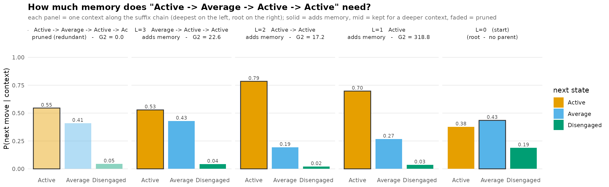

# Smoothing and pruning

A prediction suffix tree estimates a next-state distribution for every
context it keeps, and two decisions shape these estimates. The first is
how to treat states that never followed a context in the data. The
maximum likelihood estimate gives them probability zero, and a single
such transition in new data then makes the likelihood of the whole
sequence zero. Smoothing moves a small amount of probability to the
unobserved states, either toward the uniform distribution or toward the
distribution of the shorter context. The second decision is which
contexts to keep. A tree grown to a fixed depth holds every history
observed often enough, including many whose next-state distribution is
indistinguishable from that of their parent; pruning removes them, so
that the tree is as deep as the data require and no deeper (Ron, Singer,
& Tishby, 1996; Bühlmann & Wyner, 1999).

This guide states the five smoothers and the four pruning criteria as
they are implemented, shows their effect on one context and on the whole
tree, and draws the pruning decision along one pathway. The selection of
the smoother, depth and pruning by cross-validation is covered in [model
selection](https://pak.dynasite.org/transitiontrees/articles/model-selection.md).

``` r

library(transitiontrees)
```

## Data

The examples use `trajectories`, the engagement states of 138 learners
over 15 time steps.

- **Sequence:** each row is one learner, read from left to right; two
  rows contain no observed state, which leaves 136 sequences.
- **States:** `Active`, `Average` and `Disengaged`.
- **Missing cells:** trailing `NA`s mark the end of a learner’s record
  and are dropped.

The tree is grown to depth 4, with a node for every context observed at
least five times.

``` r

tree <- context_tree(trajectories, max_depth = 4, min_count = 5)
n_nodes(tree)
#> [1] 82
model_fit(tree)
#>   logLik  df nobs  AIC  BIC perplexity
#> 1  -1438 164 1870 3204 4111       2.16
```

The unpruned tree holds 82 contexts and is estimated from 1,870
observations.

## Notation

For a context $`c`$ and a state $`s`$ of the alphabet $`S`$, $`N(c, s)`$
is the number of times $`s`$ followed $`c`$, $`N(c) = \sum_s N(c, s)`$,
and $`\hat p(s \mid c) = N(c, s) / N(c)`$ is the maximum likelihood
estimate. $`\pi(c)`$ is the parent of $`c`$, the context with its oldest
state removed; the parent of a single state is the root, and the root
has no parent. $`\tilde p`$ is a smoothed distribution. The back-off
smoothers below use the smoothed distribution of the parent,
$`\tilde p(s \mid \pi(c))`$, computed first because the tree is smoothed
from the root down; at the root, the uniform distribution $`1/|S|`$
takes the place of the parent.

## The five smoothers

**Floor** (`"floor"`, the default; `ymin` $`= y_{\min}`$, default
0.001). With `rule = "interpolate"` (default), a distribution in which
every state was observed is left unchanged; otherwise it is shifted
toward the uniform distribution,

``` math
\tilde p(s \mid c) = (1 - |S|\, y_{\min})\, \hat p(s \mid c) + y_{\min},
```

so that every unobserved state receives exactly $`y_{\min}`$, which
requires $`y_{\min} < 1/|S|`$. With `rule = "cap"`, every probability is
raised to at least $`y_{\min}`$ and the vector is renormalized,
$`\tilde p(s \mid c) = \max\{\hat p(s \mid c), y_{\min}\} / \sum_{s'}
\max\{\hat p(s' \mid c), y_{\min}\}`$. The interpolating rule reproduces
the smoothing of the `PST` package (Gabadinho & Ritschard, 2016).

**Laplace** (`"laplace"`; `alpha` $`= \alpha`$, default 1). A
pseudo-count is added to every state:

``` math
\tilde p(s \mid c) = \frac{N(c, s) + \alpha}{N(c) + \alpha |S|}.
```

**Kneser-Ney** (`"kneser_ney"`; `discount` $`= D`$, default 0.75). An
absolute discount is subtracted from every count, and the mass removed
is given to the parent’s distribution:

``` math
\tilde p(s \mid c) = \frac{\max\{N(c, s) - D, 0\}}{N(c)} +
\lambda(c)\, \tilde p(s \mid \pi(c)),
\qquad
\lambda(c) = 1 - \sum_{s'} \frac{\max\{N(c, s') - D, 0\}}{N(c)}.
```

For integer counts $`\lambda(c) = D\, n_+(c) / N(c)`$, where $`n_+(c)`$
is the number of states observed after $`c`$. The back-off distribution
is the parent’s smoothed distribution, not the continuation counts of
the original Kneser-Ney method, which the tree does not store.

**Witten-Bell** (`"witten_bell"`; no parameter). The weight of the
parent grows with the number of distinct states observed after $`c`$,
relative to the number of observations:

``` math
\tilde p(s \mid c) = (1 - \lambda(c))\, \hat p(s \mid c) +
\lambda(c)\, \tilde p(s \mid \pi(c)),
\qquad
\lambda(c) = \frac{n_+(c)}{n_+(c) + N(c)}.
```

**Jelinek-Mercer** (`"jelinek_mercer"`; `lambda` $`= \lambda`$, default
0.5). The same interpolation with a fixed weight:

``` math
\tilde p(s \mid c) = (1 - \lambda)\, \hat p(s \mid c) +
\lambda\, \tilde p(s \mid \pi(c)).
```

The smoother is chosen with `smoothing =` in
[`context_tree()`](https://pak.dynasite.org/transitiontrees/reference/context_tree.md),
either by name or as a list with parameters, for example
`smoothing = list("kneser_ney", discount = 0.5)`.
[`smooth_tree()`](https://pak.dynasite.org/transitiontrees/reference/smooth_tree.md)
replaces the smoothing of a fitted tree without counting again.

## One context under the five smoothers

The context `Active -> Disengaged -> Active -> Active` was observed five
times; its parent, `Disengaged -> Active -> Active`, 15 times.

``` r

history <- "Active -> Disengaged -> Active -> Active"
parent <- "Disengaged -> Active -> Active"
subset(as.data.frame(tree), pathway %in% c(history, parent))
#>                                     pathway depth count likely_next next_probability
#> 57           Disengaged -> Active -> Active     3    15      Active            0.667
#> 79 Active -> Disengaged -> Active -> Active     4     5      Active            0.998
#>    divergence changes_prediction
#> 57     0.0771              FALSE
#> 79     0.5668              FALSE
```

The maximum likelihood estimate is obtained with a floor of zero. All
five observations of the context were followed by `Active`.

``` r

query_pathway(smooth_tree(tree, list("floor", ymin = 0)), history, exact = TRUE)
#>     Active    Average Disengaged 
#>          1          0          0
query_pathway(smooth_tree(tree, list("floor", ymin = 0)), parent, exact = TRUE)
#>     Active    Average Disengaged 
#>     0.6667     0.2667     0.0667
```

After the parent context, `Active` follows in two thirds of the cases
and `Average` in about a quarter. The distributions that the smoothers
assign to the longer context:

``` r

rbind(floor = query_pathway(tree, history, exact = TRUE),
      floor_cap = query_pathway(smooth_tree(tree, list("floor", rule = "cap")),
                                history, exact = TRUE),
      laplace = query_pathway(smooth_tree(tree, "laplace"), history, exact = TRUE),
      kneser_ney = query_pathway(smooth_tree(tree, "kneser_ney"), history,
                                 exact = TRUE),
      witten_bell = query_pathway(smooth_tree(tree, "witten_bell"), history,
                                  exact = TRUE),
      jelinek_mercer = query_pathway(smooth_tree(tree, "jelinek_mercer"),
                                     history, exact = TRUE))
#>                Active  Average Disengaged
#> floor           0.998 0.001000   0.001000
#> floor_cap       0.998 0.000998   0.000998
#> laplace         0.750 0.125000   0.125000
#> kneser_ney      0.960 0.036857   0.002933
#> witten_bell     0.948 0.042440   0.009839
#> jelinek_mercer  0.831 0.131636   0.037782
```

The floor gives each unobserved state 0.001 and keeps `Active` at 0.998;
the capped floor differs only in the sixth decimal. Laplace smoothing
adds one observation to each state, which with five observations moves a
quarter of the mass away from `Active` (0.75) and divides it equally
between the two unobserved states. The three back-off smoothers divide
the mass in proportion to the parent’s distribution, so `Average`
receives more than `Disengaged`. Kneser-Ney moves $`0.75/5 = 0.15`$ of
the mass to the parent, Witten-Bell $`1/(1 + 5) \approx 0.17`$, and
Jelinek-Mercer one half, which gives `Average` 0.13. The smoothers
differ most where a context has few observations; for a context observed
hundreds of times they nearly agree.

## Smoothing and the fit of the whole tree

[`compare_smoothing()`](https://pak.dynasite.org/transitiontrees/reference/compare_smoothing.md)
fits the tree under each smoother with the other arguments held fixed
and reports the size of the tree and its in-sample perplexity.

``` r

compare_smoothing(trajectories, max_depth = 4, min_count = 5)
#>        smoothing n_nodes perplexity
#> 1          floor      82       2.16
#> 2        laplace      82       2.18
#> 3     kneser_ney      82       2.17
#> 4    witten_bell      82       2.16
#> 5 jelinek_mercer      82       2.20
```

The number of contexts is the same under every smoother: which contexts
exist is decided by `min_count`, not by the smoother. The in-sample
perplexity ranges from 2.16 under the floor to 2.20 under
Jelinek-Mercer. The floor stays closest to the observed frequencies and
therefore has the lowest in-sample perplexity; this is not evidence that
it predicts new sequences best. The held-out comparison is made with
`tune_tree(smoothing = )`, described in [model
selection](https://pak.dynasite.org/transitiontrees/articles/model-selection.md).
Given a fitted tree,
[`compare_smoothing()`](https://pak.dynasite.org/transitiontrees/reference/compare_smoothing.md)
re-smooths it without counting again, for example after pruning.

``` r

compare_smoothing(prune_tree(tree))
#>        smoothing n_nodes perplexity
#> 1          floor      25       2.24
#> 2        laplace      25       2.24
#> 3     kneser_ney      25       2.24
#> 4    witten_bell      25       2.24
#> 5 jelinek_mercer      25       2.30
```

Smoothing is applied before pruning, and the pruning criteria compare a
context with its parent through the smoothed distributions. The smoother
therefore also changes how many contexts survive pruning.

``` r

smoothers <- c("floor", "laplace", "kneser_ney", "witten_bell", "jelinek_mercer")
vapply(smoothers, \(method) n_nodes(prune_tree(smooth_tree(tree, method))),
       integer(1))
#>          floor        laplace     kneser_ney    witten_bell jelinek_mercer 
#>             25             29             29             26             34
```

With the default criterion, between 25 (floor) and 34 (Jelinek-Mercer)
of the 82 contexts are kept. The smoothers that pull a parent toward its
own parent make the parent a poorer predictor of its children, so more
children pass the test.

## The four pruning criteria

Pruning works on the leaves of the tree. Each leaf $`c`$ is compared
with its parent $`\pi(c)`$ and is removed when it fails the criterion;
the parents that become leaves are tested in turn, and the procedure
stops when every leaf passes. The root is never removed. With
$`k = |S|`$:

**G2** (`"G2"`, the default; `alpha`, default 0.05). The likelihood
ratio statistic of the leaf’s counts against the parent’s smoothed
distribution,

``` math
G^2(c) = 2 \sum_{s:\, N(c, s) > 0} N(c, s)
\log \frac{N(c, s)}{N(c)\, \tilde p(s \mid \pi(c))},
```

is compared with the $`1 - \alpha`$ quantile of the $`\chi^2`$
distribution with $`k - 1`$ degrees of freedom; the leaf is kept when it
exceeds it. Each leaf is tested separately, without a correction for
multiple testing.

**KL** (`"KL"`; `threshold`, default 0.005). The leaf is kept when the
Kullback-Leibler divergence of its smoothed distribution from the
parent’s,

``` math
D(c) = \sum_s \tilde p(s \mid c) \log \frac{\tilde p(s \mid c)}{\tilde p(s
\mid \pi(c))},
```

exceeds the threshold. The divergence is in nats; the `divergence`
column of the pathway tables is in bits, larger by a factor
$`1/\log 2 \approx
1.44`$. The criterion does not depend on $`N(c)`$.

**AIC** and **BIC** (`"AIC"`, `"BIC"`). Let
$`\ell_c = \sum_s N(c, s) \log \tilde p(s \mid c)`$ and
$`\ell_{\pi} = \sum_s N(c, s) \log \tilde p(s \mid \pi(c))`$ be the log
likelihoods of the leaf’s observations under its own and under its
parent’s distribution. The leaf, which adds $`k - 1`$ parameters, is
kept when

``` math
2(\ell_c - \ell_{\pi}) > 2(k - 1) \quad \text{(AIC)}, \qquad
2(\ell_c - \ell_{\pi}) > \log N(c)\, (k - 1) \quad \text{(BIC)}.
```

With the floor smoother and every state observed,
$`2(\ell_c - \ell_{\pi})`$ equals $`G^2(c)`$, so AIC and BIC are
likelihood ratio tests with the fixed cut-off $`2(k - 1)`$ and a cut-off
that grows with the count of the context. For three states the G2
cut-off at $`\alpha = 0.05`$ is 5.99, the AIC cut-off 4, and the BIC
cut-off exceeds 5.99 once a context has been observed more than 20
times.

## Comparing the criteria

[`compare_pruning()`](https://pak.dynasite.org/transitiontrees/reference/compare_pruning.md)
prunes the tree under each criterion and reports the number of contexts
kept.

``` r

compare_pruning(tree)
#>   criterion n_nodes reduction_pct
#> 1        G2      25          69.5
#> 2        KL      78           4.9
#> 3       AIC      42          48.8
#> 4       BIC      36          56.1
```

`G2` keeps 25 of the 82 contexts, `BIC` 36, `AIC` 42 and `KL` 78. AIC is
more lenient than the G2 test for every context. BIC is stricter than
the test for contexts observed more than 20 times and more lenient for
rarer ones, which in this tree are numerous among the longer contexts:

``` r

with(subset(as.data.frame(tree), depth > 0),
     table(depth, observed_under_20 = count < 20))
#>      observed_under_20
#> depth FALSE TRUE
#>     1     3    0
#>     2     9    0
#>     3    15   10
#>     4    26   18
```

Ten of the 25 contexts of depth 3 and 18 of the 44 of depth 4 were
observed fewer than 20 times. BIC keeps several of them, and a kept leaf
also keeps its parent, because only leaves are tested; the contexts that
BIC keeps and G2 removes are of this kind. KL, which ignores the number
of observations, keeps almost every context at its default threshold.
Each criterion responds to its own parameter only.

``` r

compare_pruning(tree, alpha = 0.01, threshold = 0.05)
#>   criterion n_nodes reduction_pct
#> 1        G2      21          74.4
#> 2        KL      58          29.3
#> 3       AIC      42          48.8
#> 4       BIC      36          56.1
```

At $`\alpha = 0.01`$ G2 keeps 21 contexts, and a KL threshold of 0.05
nats keeps 58; AIC and BIC have no parameter and keep the same numbers
as before.

## Pruning along one pathway

[`plot_pruning()`](https://pak.dynasite.org/transitiontrees/reference/plot_pruning.md)
shows, for one context of the unpruned tree, the next-state distribution
of the context and of each of its suffixes down to the root, with the G2
statistic of each against its parent. Solid panels are informative,
faded panels are pruned, and panels of intermediate opacity are kept
only because a longer context below them is informative.

``` r

plot_pruning(tree, "Active -> Average -> Active -> Active")
```



After `Active -> Active`, the learner stays `Active` with probability
0.79; adding the earlier `Average` lowers it to 0.53 ($`G^2 = 22.6`$),
and the G2 statistic of `Active -> Active` against `Active` is 17.2,
both above the cut-off of 5.99. Adding a further `Active` at the start
changes the distribution very little (0.55 against 0.53; $`G^2 = 0.0`$
to one decimal), so the four-step context is pruned and its sequences
are predicted by `Average -> Active -> Active`. Three steps of memory
are needed on this pathway, not four.

The pruned tree:

``` r

pruned <- prune_tree(tree, criterion = "G2", alpha = 0.05)
pruned
#> <transitiontrees>  25 nodes, depth <= 4, 3 states  [pruned]
#>   alphabet : Active, Average, Disengaged
#>   fit on   : 136 sequences, 1870 observations
#>   smoothing: floor(ymin=0.001, rule=interpolate)   min_count = 5
#>   pruned by: G2   alpha = 0.05
#> (start)   n=1870   -> Average (0.43)
#> |-- Active    n=658    -> Active (0.70)
#> |   |-- Active    n=433    -> Active (0.79)
#> |   |   |-- Active    n=316    -> Active (0.84)
#> |   |   |   `-- Average   n=37     -> Active (0.59)
#> |   |   `-- Average   n=70     -> Active (0.53)
#> |   `-- Average   n=144    -> Active (0.50)
#> |       `-- Disengaged  n=12     -> Average (0.83)
#> |-- Average   n=751    -> Average (0.61)
#> |   |-- Active    n=160    -> Average (0.52)
#> |   |   `-- Disengaged  n=10     -> Average (0.50)
#> |   |-- Average   n=419    -> Average (0.68)
#> |   |   |-- Active    n=80     -> Average (0.57)
#> |   |   `-- Average   n=248    -> Average (0.72)
#> |   |       `-- Disengaged  n=37     -> Average (0.70)
#> |   `-- Disengaged  n=122    -> Average (0.52)
#> |       `-- Disengaged  n=31     -> Average (0.71)
#> `-- Disengaged  n=325    -> Disengaged (0.48)
#>     |-- Active    n=23     -> Active (0.39)
#>     |-- Average   n=134    -> Average (0.50)
#>     |   |-- Active    n=17     -> Active (0.41)
#>     |   `-- Average   n=62     -> Average (0.52)
#>     |       |-- Average   n=32     -> Average (0.75)
#>     |       `-- Disengaged  n=13     -> Disengaged (0.85)
#>     `-- Disengaged  n=139    -> Disengaged (0.68)
```

## References

Bühlmann, P., & Wyner, A. J. (1999). Variable length Markov chains. *The
Annals of Statistics*, 27(2), 480–513.
<https://doi.org/10.1214/aos/1018031204>

Gabadinho, A., & Ritschard, G. (2016). Analyzing state sequences with
probabilistic suffix trees: The PST R package. *Journal of Statistical
Software*, 72(3). <https://doi.org/10.18637/jss.v072.i03>

Ron, D., Singer, Y., & Tishby, N. (1996). The power of amnesia: Learning
probabilistic automata with variable memory length. *Machine Learning*,
25(2–3), 117–149. <https://doi.org/10.1023/A:1026490906255>
