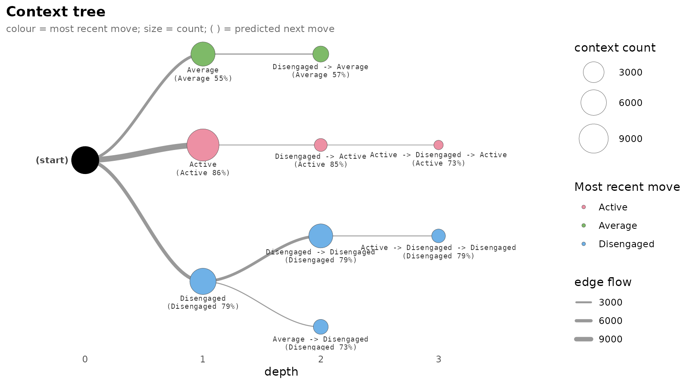

# Variable-order transition trees

Sequences of categorical states are among the most common records in the
learning and behavioral sciences: the weekly engagement of a student,
the moves of a group negotiating a task, the turns of a person working
with an AI assistant. A first-order Markov chain summarizes such data by
the probability of each next state given the current one. Its assumption
is that memory has the same length everywhere. A higher-order chain
relaxes the length but keeps it fixed, and the number of parameters
grows geometrically with the order, so most of the longer histories are
estimated from very few observations.

A variable-order Markov chain lets the length of the relevant history
depend on the history itself. After some states the next state is well
predicted by the current state alone; after others, one or two earlier
states change the prediction. The model is stored as a prediction suffix
tree (Ron, Singer, & Tishby, 1996): each node is a context, a short run
of recent states, and carries a distribution over the next state.
Contexts are kept only where the data support them, so the tree is deep
where history matters and shallow where it does not (Bühlmann & Wyner,
1999; Gabadinho & Ritschard, 2016). The `transitiontrees` package fits
these trees, reports them as tables of pathways, prunes them by
likelihood-ratio tests or information criteria, and uses them to
predict, score and compare sequences.

## The model

Let $`S`$ be a finite set of states (the alphabet) and
$`x_1, \dots, x_T`$ a sequence over $`S`$. A **context** of length $`k`$
is a run of $`k`$ consecutive states $`c = (x_{t-k}, \dots, x_{t-1})`$
that precedes position $`t`$. The model specifies, for each context in a
set $`\mathcal{C}`$, a next-state distribution

``` math
P(x_t = s \mid c), \qquad s \in S .
```

The set $`\mathcal{C}`$ is closed under suffixes: if a context is in the
tree, so is every shorter run obtained by dropping its oldest states. It
therefore forms a tree whose root is the empty context, written
`(start)`, and in which each child extends its parent by one state
further into the past.

**The longest-suffix rule.** To predict $`x_t`$ from the history
$`x_1, \dots, x_{t-1}`$, the model uses the longest suffix of the
history that is a context in the tree,

``` math
c^*(t) = \arg\max_{c \in \mathcal{C}} \{\, |c| : c \text{ is a suffix of }
(x_1, \dots, x_{t-1}) \,\},
\qquad
\hat P(x_t \mid x_1, \dots, x_{t-1}) = \hat P(x_t \mid c^*(t)).
```

A first-order chain is the special case in which $`\mathcal{C}`$ holds
the root and every single state; a fixed $`k`$-th order chain holds
every context up to length $`k`$.

**Estimation.** Let $`N(c, s)`$ be the number of times context $`c`$ is
followed by state $`s`$ in the data and $`N(c) = \sum_s N(c, s)`$. A
context receives its own node when it is no longer than `max_depth` and
$`N(c) \ge`$`min_count`. Its maximum likelihood distribution is
$`\hat p(s \mid c) = N(c, s) / N(c)`$.

**Smoothing.** A state never observed after $`c`$ would receive
probability zero, and one such event in new data would make the
likelihood zero. The default floor smoother leaves a fully observed
distribution unchanged and otherwise shifts it toward the uniform
distribution,

``` math
\tilde p(s \mid c) = (1 - |S|\, y_{\min})\, \hat p(s \mid c) + y_{\min},
```

so that each unobserved state receives exactly $`y_{\min}`$ (default
0.001). Laplace, Kneser-Ney, Witten-Bell and Jelinek-Mercer smoothers
are available through `smoothing =`.

**Pruning.** Let $`\pi(c)`$ be the parent of $`c`$, the context with the
oldest state removed. A leaf $`c`$ is kept when its counts differ from
the prediction of its parent by more than chance. The likelihood-ratio
statistic

``` math
G^2(c) = 2 \sum_{s \in S} N(c, s)\,
\log \frac{N(c, s)}{N(c)\, \tilde p(s \mid \pi(c))}
```

is compared with the $`1 - \alpha`$ quantile of a $`\chi^2`$
distribution with $`|S| - 1`$ degrees of freedom; leaves that fail are
removed, and the test is repeated on the new leaves until every leaf
passes. The `AIC` and `BIC` criteria keep a leaf when its log
likelihood, penalized by $`2(|S| - 1)`$ or $`\log N(c)\,(|S| - 1)`$,
exceeds that of its parent’s prediction.

**Fit.** The log likelihood of the data is
$`\ell = \sum_t \log \tilde p(x_t \mid c^*(t))`$, with
$`|\mathcal{C}|(|S| -
1)`$ free parameters. Perplexity, $`\exp(-\ell / n)`$ for $`n`$
predicted states, is the effective number of equally likely next states:
it equals $`|S|`$ for a uniform guess and 1 for perfect prediction.

**Divergence.** The pathway tables report, for each context, the
Kullback-Leibler divergence in bits of its next-state distribution from
its parent’s,
$`D(c) = \sum_s \tilde p(s \mid c) \log_2 [\tilde p(s \mid c) /
\tilde p(s \mid \pi(c))]`$. A large divergence marks a history that
changes the prediction made from the shorter history.

## Data

`engagement` holds the weekly engagement states of 1,000 students, one
student per row and one week per column (`T1` to `T25`).

- **Sequence:** each row is one student’s trajectory, read from left to
  right.
- **States:** `Active`, `Average` and `Disengaged`.
- **Missing cells:** `NA` marks weeks after a student’s record ends;
  such cells are dropped, not treated as a state.

``` r

library(transitiontrees)
head(engagement, 3)
#>        T1     T2     T3     T4     T5     T6      T7     T8     T9    T10    T11
#> 1 Average Active Active Active Active Active  Active Active Active Active Active
#> 2 Average Active Active Active Active Active  Active Active Active Active Active
#> 3  Active Active Active Active Active Active Average Active Active Active Active
#>          T12        T13        T14        T15        T16        T17        T18        T19
#> 1     Active    Average    Average     Active     Active     Active Disengaged Disengaged
#> 2     Active    Average    Average     Active    Average     Active     Active     Active
#> 3 Disengaged Disengaged Disengaged Disengaged Disengaged Disengaged Disengaged Disengaged
#>          T20     T21        T22        T23     T24  T25
#> 1 Disengaged  Active     Active     Active    <NA> <NA>
#> 2     Active  Active Disengaged Disengaged    <NA> <NA>
#> 3    Average Average Disengaged Disengaged Average <NA>
```

## Fitting a tree

[`context_tree()`](https://pak.dynasite.org/transitiontrees/reference/context_tree.md)
takes a wide data frame or matrix, a list of character vectors, or a
long event log. The tree below allows histories of up to three weeks and
gives a context its own node when it occurs at least ten times.

``` r

tree <- context_tree(engagement, max_depth = 3, min_count = 10)
tree
#> <transitiontrees>  40 nodes, depth <= 3, 3 states  [unpruned]
#>   alphabet : Active, Average, Disengaged
#>   fit on   : 1000 sequences, 24555 observations
#>   smoothing: floor(ymin=0.001, rule=interpolate)   min_count = 10
#> (start)   n=24555  -> Active (0.51)
#> |-- Active    n=11894  -> Active (0.86)
#> |   |-- Active    n=9766   -> Active (0.86)
#> |   |   |-- Active    n=7994   -> Active (0.86)
#> |   |   |-- Average   n=1215   -> Active (0.85)
#> |   |   `-- Disengaged  n=256    -> Active (0.86)
#> |   |-- Average   n=1473   -> Active (0.86)
#> |   |   |-- Active    n=296    -> Active (0.86)
#> |   |   |-- Average   n=781    -> Active (0.85)
#> |   |   `-- Disengaged  n=316    -> Active (0.87)
#> |   `-- Disengaged  n=312    -> Active (0.85)
#> |       |-- Active    n=22     -> Active (0.73)
#> |       |-- Average   n=37     -> Active (0.84)
#> |       `-- Disengaged  n=238    -> Active (0.86)
#> |-- Average   n=5063   -> Average (0.55)
#> |   |-- Active    n=1031   -> Average (0.54)
#> |   |   |-- Active    n=859    -> Average (0.54)
#> |   |   |-- Average   n=118    -> Average (0.53)
#> |   |   `-- Disengaged  n=29     -> Average (0.59)
#> |   |-- Average   n=2670   -> Average (0.54)
#> |   |   |-- Active    n=520    -> Average (0.54)
#> |   |   |-- Average   n=1394   -> Average (0.53)
#> |   |   `-- Disengaged  n=567    -> Average (0.54)
#> |   `-- Disengaged  n=1043   -> Average (0.57)
#> |       |-- Active    n=79     -> Average (0.66)
#> |       |-- Average   n=140    -> Average (0.59) 
#> ... 14 more nodes (use as.data.frame(x) or summary(x))
```

The banner reports 40 nodes over 1,000 sequences and 24,555 observed
states. Each line of the tree is a context with its count and its most
likely next state. Children extend their parent into the past: the line
`Disengaged` indented under `Active` is the context
`Disengaged -> Active`, a disengaged week followed by an active one. The
root line is the marginal distribution, the prediction made with no
history: `Active` with probability 0.51.

[`state_frequencies()`](https://pak.dynasite.org/transitiontrees/reference/state_frequencies.md)
gives the shares of the three states.

``` r

state_frequencies(tree)
#>        state count proportion
#> 1     Active 12426      0.506
#> 2 Disengaged  6873      0.280
#> 3    Average  5256      0.214
```

Half of all observed weeks are `Active`, 28% `Disengaged` and 21%
`Average`.

## Reading the tree

[`summary()`](https://rdrr.io/r/base/summary.html) returns the pathway
table, one row per context, sorted by count;
[`as.data.frame()`](https://rdrr.io/r/base/as.data.frame.html) returns
the same table for every node.

``` r

summary(tree)
#> <transitiontrees summary>  40 nodes, depth <= 3, 3 states  [unpruned]
#> 
#>                   pathway depth count likely_next next_probability divergence
#>                   (start)     0 24555      Active            0.506         NA
#>                    Active     1 11894      Active            0.859   4.18e-01
#>                Disengaged     1  6598  Disengaged            0.786   9.45e-01
#>                   Average     1  5063     Average            0.548   3.84e-01
#>          Active -> Active     2  9766      Active            0.859   4.12e-05
#>  Disengaged -> Disengaged     2  4960  Disengaged            0.791   1.67e-04
#>        Average -> Average     2  2670     Average            0.539   2.80e-04
#>         Average -> Active     2  1473      Active            0.859   1.19e-03
#>     Disengaged -> Average     2  1043     Average            0.566   5.88e-03
#>         Active -> Average     2  1031     Average            0.539   1.11e-03
#>  changes_prediction
#>                  NA
#>               FALSE
#>                TRUE
#>                TRUE
#>               FALSE
#>               FALSE
#>               FALSE
#>               FALSE
#>               FALSE
#>               FALSE
#> # ... 30 more rows (use as.data.frame(tree) for the full table)
```

Each row is a **pathway**, written oldest state first, so
`Average -> Disengaged` is an average week followed by a disengaged one.
`likely_next` and `next_probability` give the modal next state and its
probability, `divergence` is $`D(c)`$ in bits, and `changes_prediction`
flags a context whose modal next state differs from its parent’s.

[`tree_pathways()`](https://pak.dynasite.org/transitiontrees/reference/tree_pathways.md)
returns the full table with a choice of sort order, and three verbs fix
the sorts used most often.
[`common_pathways()`](https://pak.dynasite.org/transitiontrees/reference/common_pathways.md)
ranks by count:

``` r

common_pathways(tree, top = 5)
#>                      pathway depth count likely_next next_probability divergence
#> 1                    (start)     0 24555      Active            0.506         NA
#> 2                     Active     1 11894      Active            0.859   4.18e-01
#> 3           Active -> Active     2  9766      Active            0.859   4.12e-05
#> 4 Active -> Active -> Active     3  7994      Active            0.861   2.52e-05
#> 5                 Disengaged     1  6598  Disengaged            0.786   9.45e-01
#>   changes_prediction
#> 1                 NA
#> 2              FALSE
#> 3              FALSE
#> 4              FALSE
#> 5               TRUE
```

[`divergent_pathways()`](https://pak.dynasite.org/transitiontrees/reference/divergent_pathways.md)
ranks by divergence from the shorter history. A `min_count` of 50 keeps
contexts with enough support to be read.

``` r

divergent_pathways(tree, top = 6, min_count = 50)
#>                              pathway depth count likely_next next_probability divergence
#> 1                         Disengaged     1  6598  Disengaged            0.786     0.9453
#> 2                             Active     1 11894      Active            0.859     0.4183
#> 3                            Average     1  5063     Average            0.548     0.3836
#> 4    Average -> Active -> Disengaged     3    82  Disengaged            0.902     0.0445
#> 5    Active -> Disengaged -> Average     3    79     Average            0.658     0.0284
#> 6 Active -> Disengaged -> Disengaged     3   449  Disengaged            0.788     0.0113
#>   changes_prediction
#> 1               TRUE
#> 2              FALSE
#> 3               TRUE
#> 4              FALSE
#> 5              FALSE
#> 6              FALSE
```

The single states diverge most from the root, and two of them redirect
the prediction: after a `Disengaged` week the most likely next week is
`Disengaged` (0.786), and after an `Average` week it is `Average`
(0.548), whereas the marginal prediction is `Active`. Beyond one week
the divergences are an order of magnitude smaller; the largest,
`Average -> Active -> Disengaged` (82 occurrences, 0.0445 bits), raises
the probability of staying disengaged to 0.902.

[`sharp_pathways()`](https://pak.dynasite.org/transitiontrees/reference/sharp_pathways.md)
ranks by the probability of the modal next state, the contexts after
which the next state is most predictable.

``` r

sharp_pathways(tree, top = 5, min_count = 50)
#>                              pathway depth count likely_next next_probability divergence
#> 1    Average -> Active -> Disengaged     3    82  Disengaged            0.902   0.044479
#> 2    Disengaged -> Average -> Active     3   316      Active            0.867   0.001010
#> 3        Active -> Average -> Active     3   296      Active            0.865   0.000823
#> 4     Disengaged -> Active -> Active     3   256      Active            0.863   0.002628
#> 5 Disengaged -> Disengaged -> Active     3   238      Active            0.861   0.001022
#>   changes_prediction
#> 1              FALSE
#> 2              FALSE
#> 3              FALSE
#> 4              FALSE
#> 5              FALSE
```

Each of the sharpest contexts ends in a state that tends to repeat.
`Average -> Active -> Disengaged` is followed by another disengaged week
with probability 0.902, and four three-week histories ending in `Active`
are followed by `Active` with probabilities between 0.861 and 0.867.

## Pruning

Most of the grown contexts may predict no better than their parents.
[`prune_tree()`](https://pak.dynasite.org/transitiontrees/reference/prune_tree.md)
removes leaves that fail the $`G^2`$ test at $`\alpha = 0.05`$.

``` r

pruned <- prune_tree(tree, criterion = "G2", alpha = 0.05)
pruned
#> <transitiontrees>  10 nodes, depth <= 3, 3 states  [pruned]
#>   alphabet : Active, Average, Disengaged
#>   fit on   : 1000 sequences, 24555 observations
#>   smoothing: floor(ymin=0.001, rule=interpolate)   min_count = 10
#>   pruned by: G2   alpha = 0.05
#> (start)   n=24555  -> Active (0.51)
#> |-- Active    n=11894  -> Active (0.86)
#> |   `-- Disengaged  n=312    -> Active (0.85)
#> |       `-- Active    n=22     -> Active (0.73)
#> |-- Average   n=5063   -> Average (0.55)
#> |   `-- Disengaged  n=1043   -> Average (0.57)
#> `-- Disengaged  n=6598   -> Disengaged (0.79)
#>     |-- Average   n=719    -> Disengaged (0.73)
#>     `-- Disengaged  n=4960   -> Disengaged (0.79)
#>         `-- Active    n=449    -> Disengaged (0.79)
```

The test keeps 10 of the 40 nodes. The surviving structure is mostly
first order. The longer histories that remain all involve disengagement:
an `Average` week before a disengaged one lowers the probability of
staying disengaged (0.734 against 0.786), and the history
`Active -> Disengaged -> Disengaged` is kept as well.

[`plot()`](https://rdrr.io/r/graphics/plot.default.html) draws the tree
from the root on the left. Node size is the context count, edge width
the number of observations flowing into the child, node color the most
recent state of the pathway, and the label under each node the modal
next state with its probability.

``` r

plot(pruned)
```



[`compare_pruning()`](https://pak.dynasite.org/transitiontrees/reference/compare_pruning.md)
applies each criterion to the same tree and reports how many nodes it
keeps.

``` r

compare_pruning(tree)
#>   criterion n_nodes reduction_pct
#> 1        G2      10          75.0
#> 2        KL      19          52.5
#> 3       AIC      12          70.0
#> 4       BIC       6          85.0
```

BIC, whose penalty grows with the context count, is the strictest (6
nodes); the KL threshold is the most lenient (19 nodes); $`G^2`$ and AIC
lie between. The [smoothing and
pruning](https://pak.dynasite.org/transitiontrees/articles/smoothing-and-pruning.html)
guide compares the criteria and smoothers in detail.

## Fit

[`model_fit()`](https://pak.dynasite.org/transitiontrees/reference/model_fit.md)
returns the log likelihood, degrees of freedom, number of predicted
states, AIC, BIC and perplexity in one row.

``` r

model_fit(tree)
#>   logLik df  nobs   AIC   BIC perplexity
#> 1 -16163 80 24555 32486 33134       1.93
```

``` r

model_fit(pruned)
#>   logLik df  nobs   AIC   BIC perplexity
#> 1 -16181 20 24555 32403 32565       1.93
```

Pruning lowers the log likelihood only slightly (from -16,163 to
-16,181) while reducing the parameters from 80 to 20, so both AIC
(32,486 to 32,403) and BIC (33,134 to 32,565) favor the pruned tree. The
perplexity of both trees is 1.93: knowing the recent weeks reduces the
three possible next states to about two equally likely ones. These
values are computed on the fitting data. Out-of-sample perplexity by
cross-validation is the subject of the [model
selection](https://pak.dynasite.org/transitiontrees/articles/model-selection.html)
guide.

## Prediction

[`predict()`](https://rdrr.io/r/stats/predict.html) applies the
longest-suffix rule to new histories. With `tidy = TRUE` it returns one
row per history: the context used, the predicted state, its probability,
and the full distribution.

``` r

histories <- list(c("Active", "Average"),
                  c("Average", "Disengaged"),
                  c("Disengaged", "Active", "Disengaged"))
predict(pruned, newdata = histories, tidy = TRUE)
#>   id                            history               context  predicted probability
#> 1  1                  Active -> Average               Average    Average       0.548
#> 2  2              Average -> Disengaged Average -> Disengaged Disengaged       0.734
#> 3  3 Disengaged -> Active -> Disengaged            Disengaged Disengaged       0.786
#>   Active Average Disengaged
#> 1 0.3052   0.548      0.147
#> 2 0.0556   0.210      0.734
#> 3 0.0485   0.166      0.786
```

The first history ends in `Average`, and no longer context ending in
`Average` survived pruning, so the prediction is made from `Average`
alone. The second history is itself a context. The third has no matching
two- or three-week context, so the model falls back to `Disengaged` and
predicts another disengaged week with probability 0.786.

## Further reading

The guides and case studies on the [package
website](https://pak.dynasite.org/transitiontrees/) continue from here:

- [Comparing
  groups](https://pak.dynasite.org/transitiontrees/articles/comparing-groups.html):
  fitting one tree per group and testing where the groups differ.
- [A complete
  workflow](https://pak.dynasite.org/transitiontrees/articles/workflow.html):
  every step of an analysis on one dataset.
- [Data
  input](https://pak.dynasite.org/transitiontrees/articles/data-input.html):
  wide sequences, event logs and network objects.
- [Smoothing and
  pruning](https://pak.dynasite.org/transitiontrees/articles/smoothing-and-pruning.html).
- [Model selection: tuning, fit and
  perplexity](https://pak.dynasite.org/transitiontrees/articles/model-selection.html).
- [Pathway reliability with the
  bootstrap](https://pak.dynasite.org/transitiontrees/articles/pathway-reliability.html).
- [Prediction, scoring, imputation and
  mining](https://pak.dynasite.org/transitiontrees/articles/prediction-and-scoring.html).
- [Visualizing transition
  trees](https://pak.dynasite.org/transitiontrees/articles/visualization.html).
- [Verification against the PST
  package](https://pak.dynasite.org/transitiontrees/articles/verification.html).
- Case studies: [collaborative regulation by
  achievement](https://pak.dynasite.org/transitiontrees/articles/case-regulation-achievement.html),
  [engagement
  trajectories](https://pak.dynasite.org/transitiontrees/articles/case-engagement.html)
  and [human-AI
  collaboration](https://pak.dynasite.org/transitiontrees/articles/case-ai-collaboration.html).

## Assumptions

- The sequences are independent of one another, and the process is the
  same at every position (stationarity).
- The next state depends on the past only through its longest context in
  the tree.
- `max_depth` and `min_count` bound which contexts can be represented;
  contexts rarer than `min_count` are absorbed into their parent.
- The $`G^2`$ pruning test is applied per leaf without correction for
  multiple testing.

## References

Bühlmann, P., & Wyner, A. J. (1999). Variable length Markov chains. *The
Annals of Statistics*, *27*(2), 480–513.
<https://doi.org/10.1214/aos/1018031204>

Gabadinho, A., & Ritschard, G. (2016). Analyzing state sequences with
probabilistic suffix trees: The PST R package. *Journal of Statistical
Software*, *72*(3). <https://doi.org/10.18637/jss.v072.i03>

Ron, D., Singer, Y., & Tishby, N. (1996). The power of amnesia: Learning
probabilistic automata with variable memory length. *Machine Learning*,
*25*(2–3), 117–149. <https://doi.org/10.1023/A:1026490906255>
