# Visualizing transition trees

A variable-order transition tree is a hierarchy of histories. Its root
holds the overall distribution of states; each child extends its
parent’s history by one earlier state and carries its own next-state
distribution (Ron, Singer and Tishby, 1996; Gabadinho and Ritschard,
2016). A figure of such a model has to show three things at once: which
histories the model keeps, how much data supports each one, and what
each history predicts. No single display shows all three well for a
large tree. The package therefore offers several views of the same
model. Tree drawings show the structure. Pathway charts rank histories
by frequency or by how much they change the prediction. Diagnostic plots
follow one pathway or one sequence. Inferential plots show the
uncertainty and the group differences behind a result.

Every static plot is a `ggplot2` object, so it can be themed, annotated
and saved with the usual `ggplot2` tools. One interactive view uses
`visNetwork`. The default colors are the Okabe-Ito palette.

## Data

Three bundled datasets are used.

- `trajectories`: the engagement states (`Active`, `Average`,
  `Disengaged`) of 138 learners over 15 time steps, one row per learner.
  It is used for the tree drawings and the pathway charts.
- `group_regulation_long`: 27,533 collaborative-regulation events in
  long format. `Actor` identifies the learner, `Time` orders the events,
  `Action` is the state (nine regulation moves) and `Achiever` (`High`
  or `Low`) is the group. It is used for the group plots.
- `ai_long`: 8,551 coded messages from human-AI collaboration sessions.
  `project` is the actor, `session_id` the session and `code` the state
  (eight moves). It is used for the forward trajectory plots.

To fit the tree used in most of this guide, we call
[`context_tree()`](https://pak.dynasite.org/transitiontrees/reference/context_tree.md)
with `max_depth` and `min_count`, and prune it with
[`prune_tree()`](https://pak.dynasite.org/transitiontrees/reference/prune_tree.md).

``` r

library(transitiontrees)
tree <- context_tree(trajectories, max_depth = 3L, min_count = 5L)
pruned <- prune_tree(tree)
pruned
#> <transitiontrees>  18 nodes, depth <= 3, 3 states  [pruned]
#>   alphabet : Active, Average, Disengaged
#>   fit on   : 136 sequences, 1870 observations
#>   smoothing: floor(ymin=0.001, rule=interpolate)   min_count = 5
#>   pruned by: G2   alpha = 0.05
#> (start)   n=1870   -> Average (0.43)
#> |-- Active    n=658    -> Active (0.70)
#> |   |-- Active    n=433    -> Active (0.79)
#> |   |   `-- Average   n=70     -> Active (0.53)
#> |   `-- Average   n=144    -> Active (0.50)
#> |       `-- Disengaged  n=12     -> Average (0.83)
#> |-- Average   n=751    -> Average (0.61)
#> |   |-- Active    n=160    -> Average (0.52)
#> |   |   `-- Disengaged  n=10     -> Average (0.50)
#> |   |-- Average   n=419    -> Average (0.68)
#> |   |   `-- Active    n=80     -> Average (0.57)
#> |   `-- Disengaged  n=122    -> Average (0.52)
#> |       `-- Disengaged  n=31     -> Average (0.71)
#> `-- Disengaged  n=325    -> Disengaged (0.48)
#>     |-- Active    n=23     -> Active (0.39)
#>     |-- Average   n=134    -> Average (0.50)
#>     |   `-- Active    n=17     -> Active (0.41)
#>     `-- Disengaged  n=139    -> Disengaged (0.68)
```

The pruned tree has 18 contexts: the root, three of depth one, eight of
depth two and six of depth three.

## The tree

To draw the tree, we call
[`plot()`](https://rdrr.io/r/graphics/plot.default.html) with `style`.
All static styles share one encoding: the size of a node is the number
of observations of its context, and the width of a branch is the number
of observations flowing into the child.

### Horizontal tree

`style = "horizontal"` (the default) draws the root on the left and
deeper contexts to the right. Each node is labeled with its pathway and
its most likely next state with that state’s probability, and each node
is colored by the most recent state of its pathway.

``` r

plot(pruned, style = "horizontal")
```

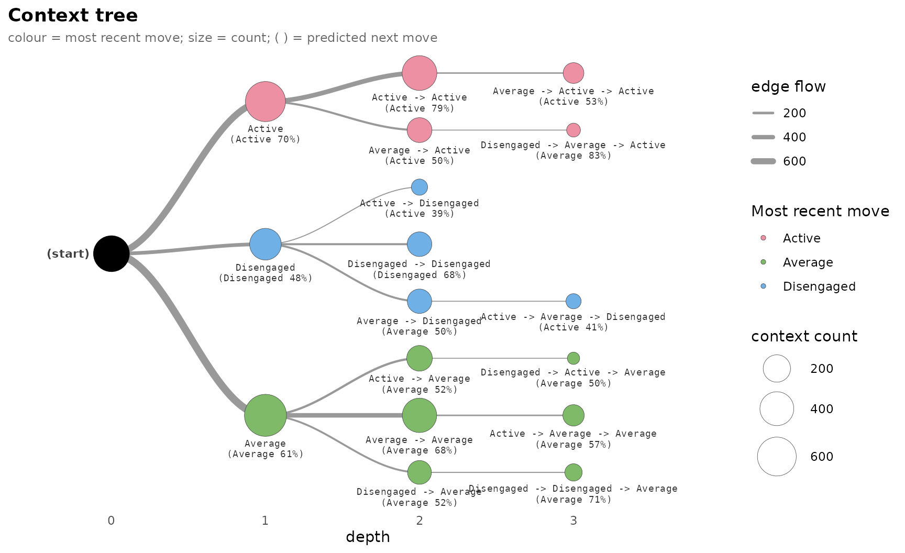

This style suits a report that cites specific pathways, because every
pathway and its prediction can be read from the figure. Adding
`show_prediction = FALSE` keeps only the pathway labels.
`point_size_range` and `edge_size_range` widen or compress the size
scales without changing the encoding.

``` r

plot(pruned, style = "horizontal", show_prediction = FALSE,
     point_size_range = c(3, 12), edge_size_range = c(0.4, 3.5))
```

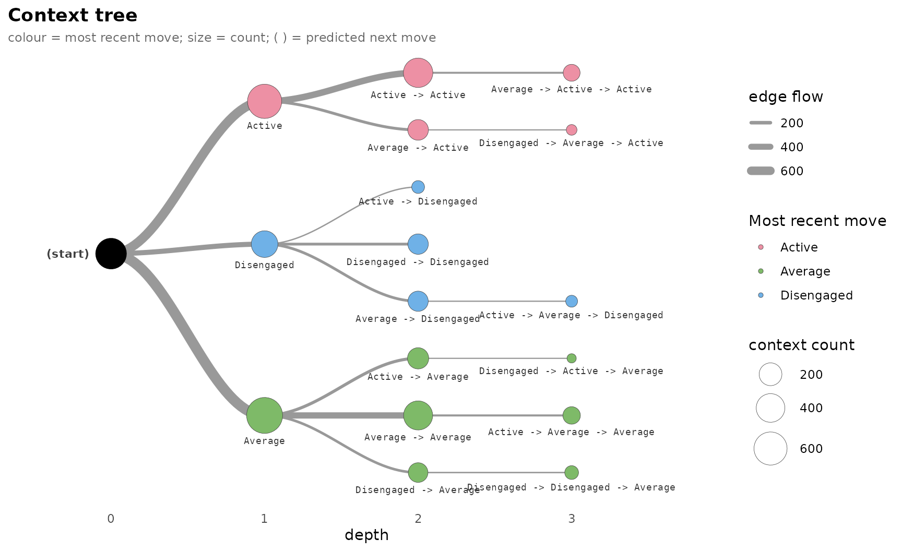

### Radial dendrogram

`style = "dendrogram"` wraps the tree into a circle with the root at the
center and the deepest contexts on the outer ring. Nodes are colored by
the oldest state of their pathway, so each first-level branch keeps one
color.

``` r

plot(pruned, style = "dendrogram")
```

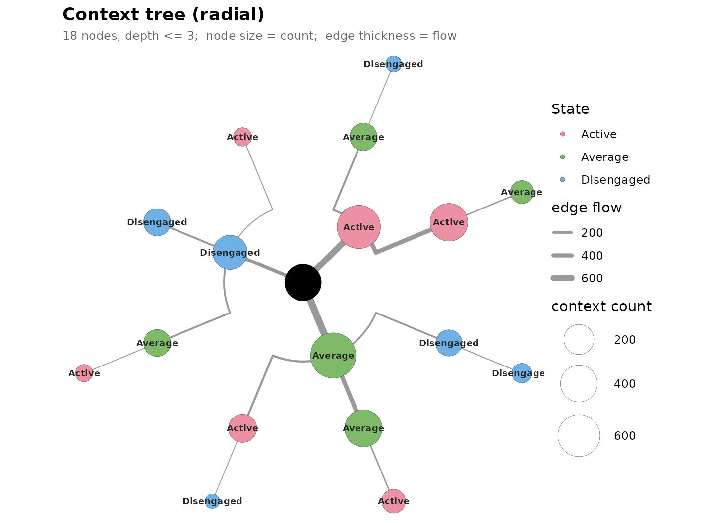

The thick inner branches are the frequent histories; the thin outer
twigs are deeper contexts that pruning kept because they change the
prediction, not because they are frequent.

### Icicle

`style = "icicle"` is a sunburst: each ring is one depth, and the angle
of a segment is proportional to the count of its context. The inner ring
carries the full state names and the outer rings three-letter
abbreviations.

``` r

plot(pruned, style = "icicle")
```

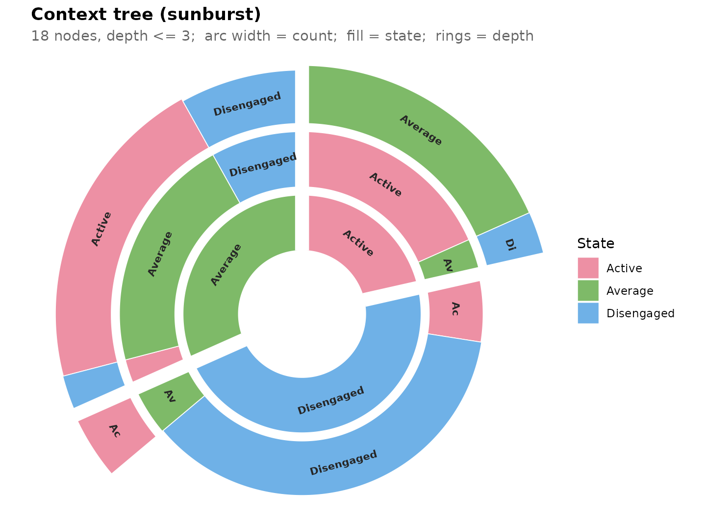

Because area follows the counts, a frequent state takes most of the ring
and the rare histories become thin slices. The display gives an accurate
impression of how the observations are distributed over the contexts.

### Interactive tree

`style = "interactive"` draws the same tree as a `visNetwork` widget
that can be dragged and zoomed. Hovering over a node shows its pathway,
count, most likely next state and full next-state distribution.
`visNetwork` is a suggested package, so the call is guarded.

``` r

plot(pruned, style = "interactive", height = "450px")
```

### One tree per group

A tree fitted with `group` holds one tree per group. To fit one, we call
[`context_tree()`](https://pak.dynasite.org/transitiontrees/reference/context_tree.md)
on the long log with `actor`, `time` and `action` naming the columns and
`group` naming the grouping column.

``` r

regulation <- context_tree(group_regulation_long, actor = "Actor",
                           time = "Time", action = "Action",
                           group = "Achiever", max_depth = 2L,
                           min_count = 10L)
regulation
#> <transitiontrees_group>  2 groups
#>   High            74 nodes, depth <= 2, 1000 seq, 13721 obs
#>   Low             77 nodes, depth <= 2, 1000 seq, 13812 obs
```

Each group’s tree has more than 70 contexts before pruning. To draw each
group’s pruned tree, we call
[`plot()`](https://rdrr.io/r/graphics/plot.default.html) on the pruned
group object. Further arguments are passed to each tree’s plot, and each
figure is captioned with its group.

``` r

plot(prune_tree(regulation), style = "dendrogram")
```

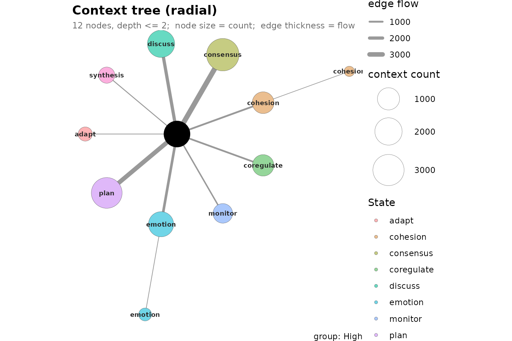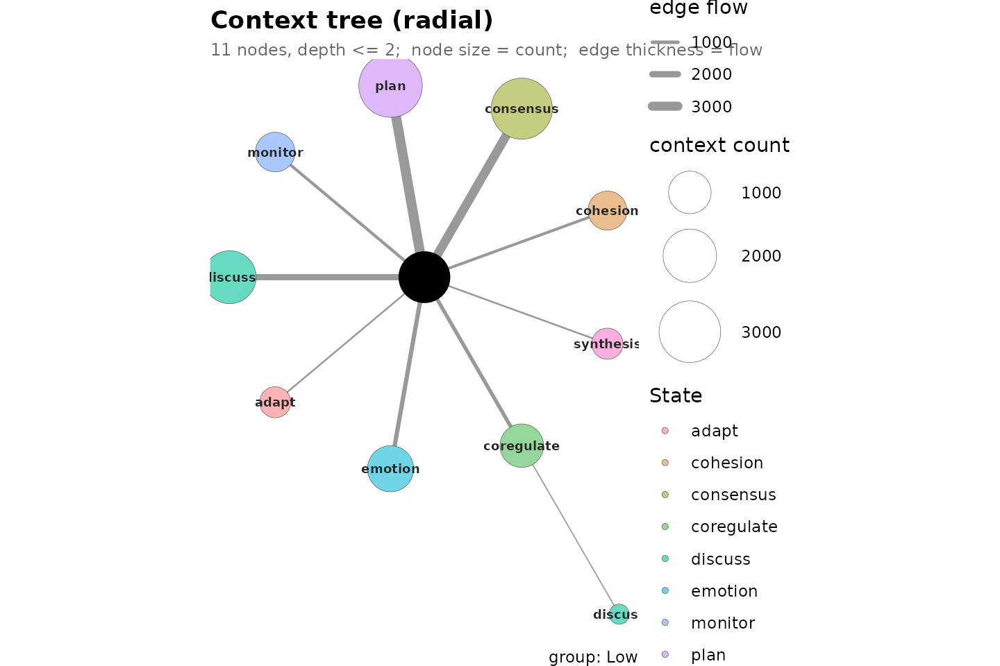

After pruning, the high achievers’ tree keeps 12 contexts and the low
achievers’ 11, almost all of depth one: for both groups the most recent
move carries most of what can be predicted.

## Ranking pathways

The tree drawings show structure. The pathway charts rank the contexts
so that the most frequent or most informative ones can be read directly.

### Next-state heatmap

To draw each context’s next-state distribution as a row of a heatmap, we
call
[`plot_pathways()`](https://pak.dynasite.org/transitiontrees/reference/plot_pathways.md)
with `top` for the number of contexts and `sort_by` for the order. The
most likely next state of each row is shown in bold, and a `>` before
the pathway marks a context whose most likely next state differs from
its parent’s.

``` r

plot_pathways(pruned, top = 12L, sort_by = "count")
```

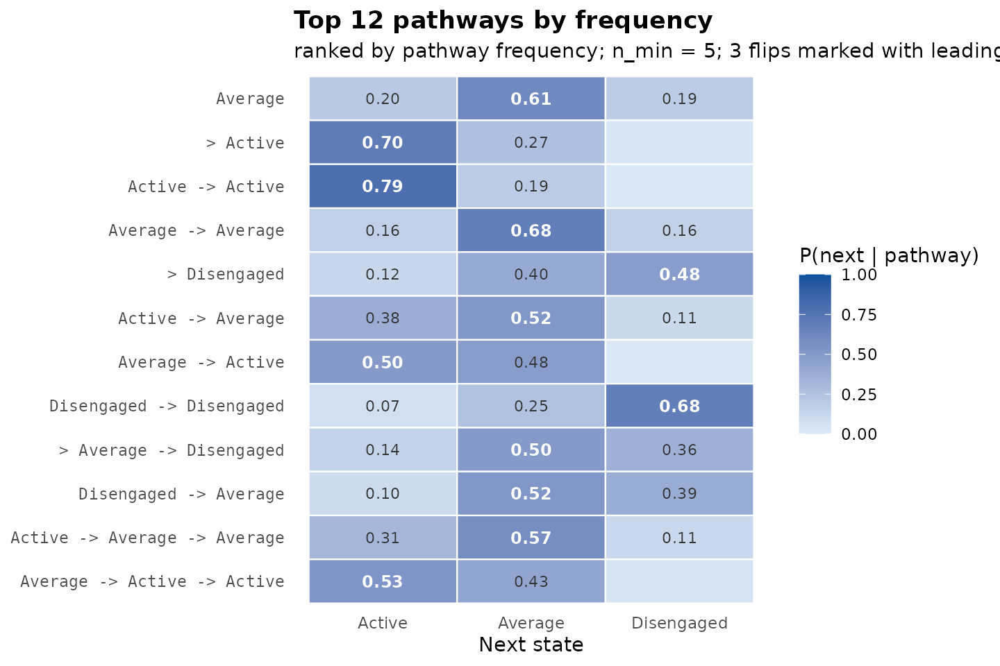

Sorted by count, the rows are the frequent histories, and most of them
continue to the same state. To rank by how far each context’s
distribution departs from its parent’s, we set `sort_by = "divergence"`.

``` r

plot_pathways(pruned, top = 12L, sort_by = "divergence")
```

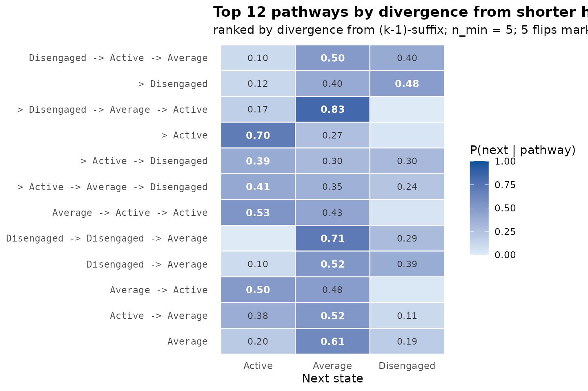

The two orderings answer different questions: which histories are
common, and which histories change what happens next.

### Divergence chart

To rank contexts by their Kullback-Leibler divergence from the parent,
we call
[`plot_divergence()`](https://pak.dynasite.org/transitiontrees/reference/plot_divergence.md)
with `top` and `min_count`. Contexts whose most likely next state
differs from their parent’s are marked.

``` r

plot_divergence(pruned, top = 12L, min_count = 5L)
```

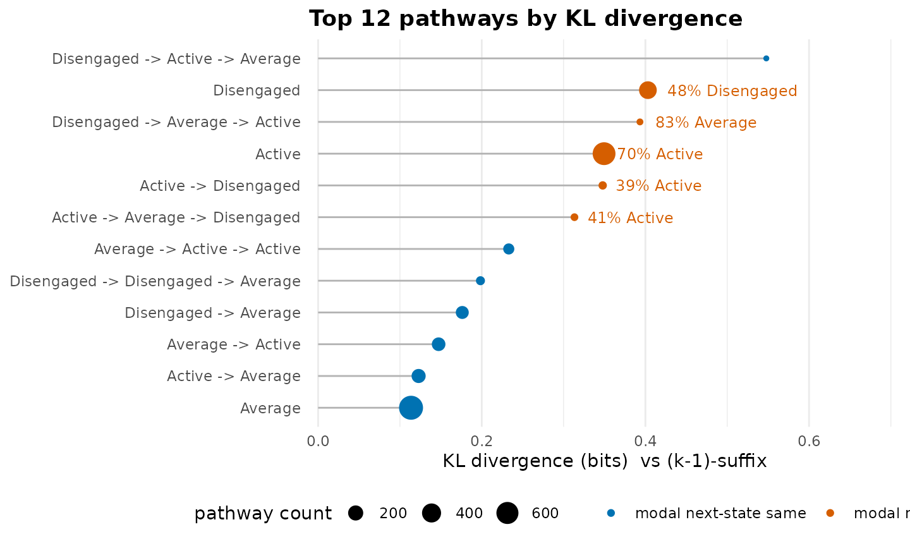

`min_count` removes contexts too rare for their divergence to be
trusted; the bootstrap in [Pathway reliability with the
bootstrap](https://pak.dynasite.org/transitiontrees/articles/pathway-reliability.md)
quantifies the same concern.

### Next-state distributions

To draw the full next-state distribution of each context as small
multiples, we call
[`plot_distributions()`](https://pak.dynasite.org/transitiontrees/reference/plot_distributions.md)
with `top` for the number of contexts, or `contexts` for chosen ones.

``` r

plot_distributions(pruned, top = 6L)
```

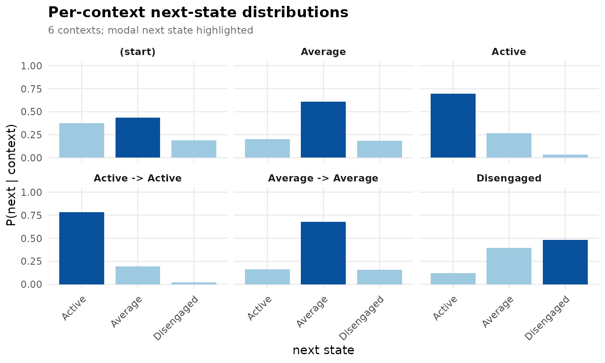

A panel with one tall bar is a context whose continuation is nearly
settled; a flat panel is a point where the history does not determine
the next state.

## How much history a pathway needs

To follow one pathway from its full context down to the root, we call
[`plot_pruning()`](https://pak.dynasite.org/transitiontrees/reference/plot_pruning.md)
on the unpruned tree with the pathway. Each row is one suffix of the
pathway, from the full context to the root, with its next-state
distribution; the suffixes that the $`G^2`$ pruning test keeps are drawn
solid and the ones it drops faded.

``` r

plot_pruning(tree, "Active -> Active -> Average")
```

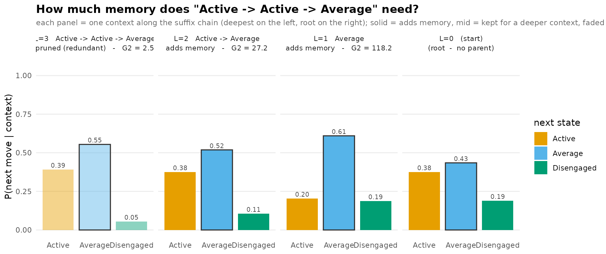

The figure answers, for one pathway, how far back the history has to
reach before the prediction stops changing. Here the context
`Active -> Average` changes the prediction of `Average` ($`G^2`$ =
27.2), but adding the earlier `Active` does not ($`G^2`$ = 2.5), so the
pathway needs two steps of history, not three.

## Forward trajectories

A context tree reads histories backwards from the present. To draw the
same sequences forward in time, as a tree of the paths that sequences
take from their first state, we call
[`plot_trajectories()`](https://pak.dynasite.org/transitiontrees/reference/plot_trajectories.md)
with `measure` and `min_count` for the smallest path shown. The forward
view needs a richer alphabet than three states to be informative, so we
fit a tree to the human-AI collaboration log.

``` r

ai_tree <- context_tree(ai_long, actor = "project", session = "session_id",
                        action = "code", max_depth = 3L, min_count = 10L)
```

With `measure = "frequency"` the paths are colored by the number of
sequences that take them.

``` r

plot_trajectories(ai_tree, measure = "frequency", min_count = 20L)
```

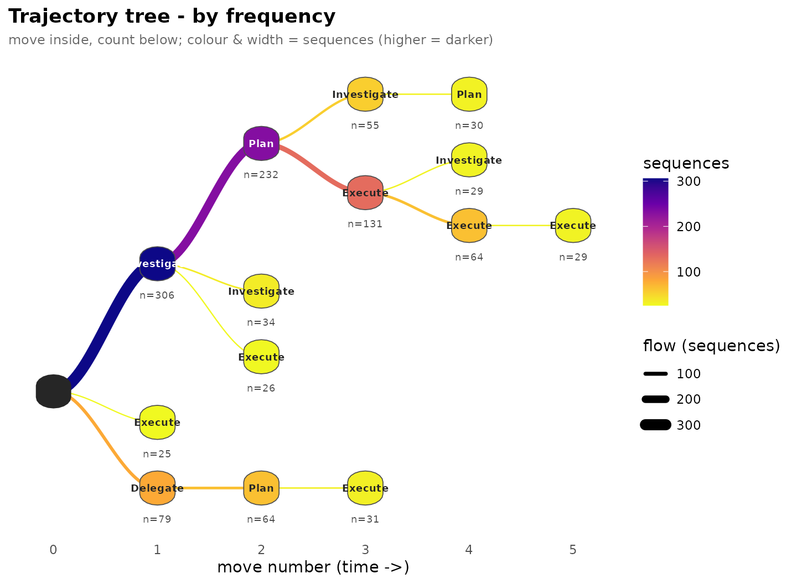

With `measure = "predictability"` they are colored by the probability
that the model gives each step, given the path before it.

``` r

plot_trajectories(ai_tree, measure = "predictability", min_count = 20L)
```

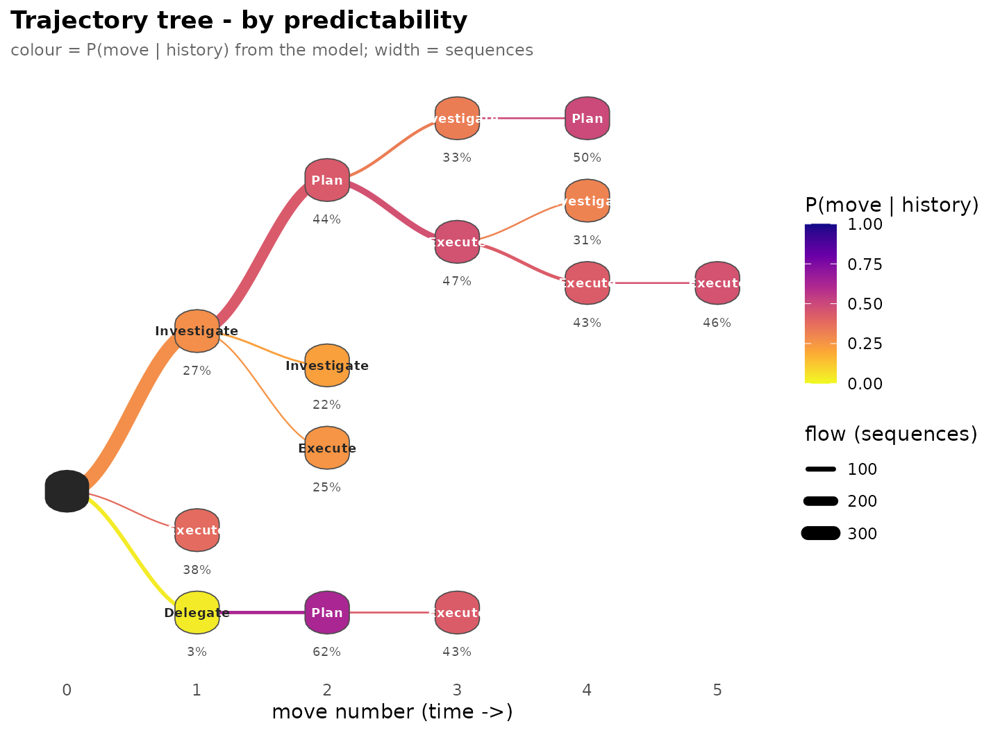

Read together, the two show where traffic and predictability part: a
path that many sequences take but that the model predicts poorly is a
decision point, where sequences with the same past go different ways.

## Predictive performance

To show how well the model predicts sequences, we call
[`plot_predictive()`](https://pak.dynasite.org/transitiontrees/reference/plot_predictive.md)
with `type`. `"logloss"` plots each transition’s surprise in bits
against its position; `"ecdf"` and `"position"` are the other views.
Held-out data should be used for an honest evaluation; the bundled data
are scored here only to show the display.

``` r

plot_predictive(pruned, newdata = trajectories, type = "logloss")
```

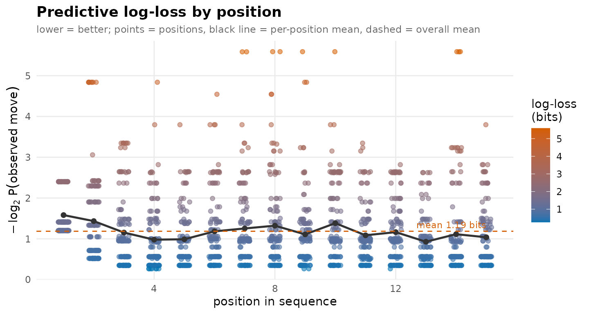

Held-out evaluation and the other two views are covered in [Prediction,
scoring, imputation and
mining](https://pak.dynasite.org/transitiontrees/articles/prediction-and-scoring.md).

## Uncertainty and comparison

### Bootstrap forest plot

To show the bootstrap uncertainty of each pathway, we call
[`plot()`](https://rdrr.io/r/graphics/plot.default.html) on the result
of
[`bootstrap_pathways()`](https://pak.dynasite.org/transitiontrees/reference/bootstrap_pathways.md).
Each row is a pathway’s $`G^2`$ against its parent with its 95%
bootstrap interval; the dashed line is the chi-square critical value;
color marks whether the pathway is stable, informative, both or neither.

``` r

boot <- bootstrap_pathways(pruned, iter = 200L, seed = 1L)
plot(boot)
```

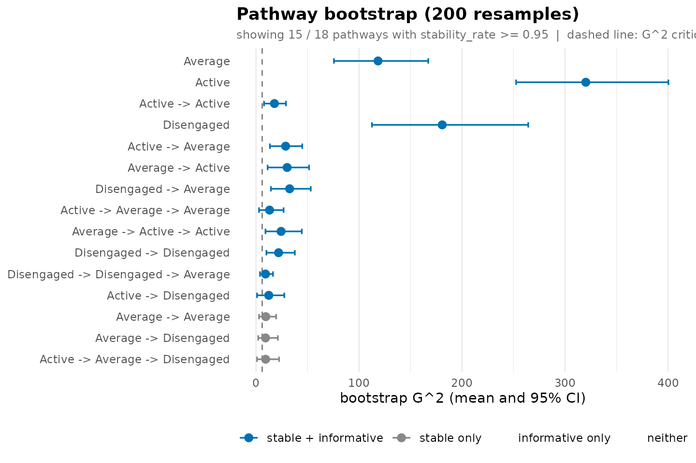

To draw the resample distribution of a statistic for the leading
pathways, we call
[`plot_pathway_resamples()`](https://pak.dynasite.org/transitiontrees/reference/plot_pathway_resamples.md)
with `stat` and `top`.

``` r

plot_pathway_resamples(boot, stat = "divergence", top = 6L)
```

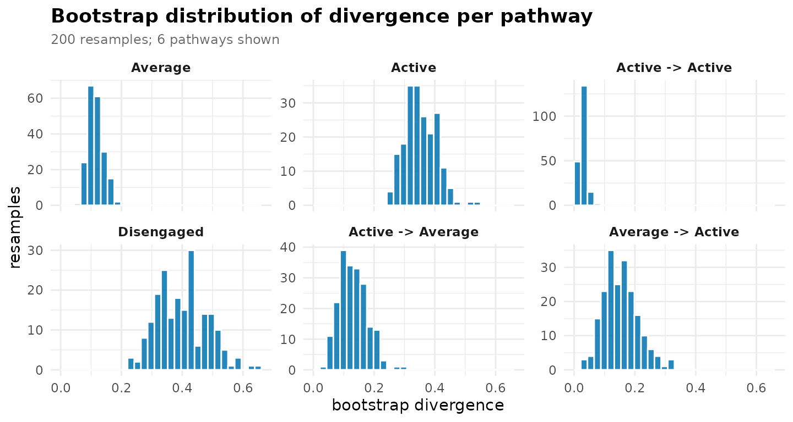

### Comparing two trees

To test whether two groups produce different pathway distributions, we
call
[`compare_trees()`](https://pak.dynasite.org/transitiontrees/reference/compare_trees.md)
on the group object with `iter` for the number of permutations.
[`plot()`](https://rdrr.io/r/graphics/plot.default.html) draws the
permutation null of the distance between the trees, with the observed
distance as a vertical line. A small `iter` keeps this guide fast; a
reported test should use more permutations.

``` r

comparison <- compare_trees(prune_tree(regulation), iter = 99L, seed = 1L)
plot(comparison)
```

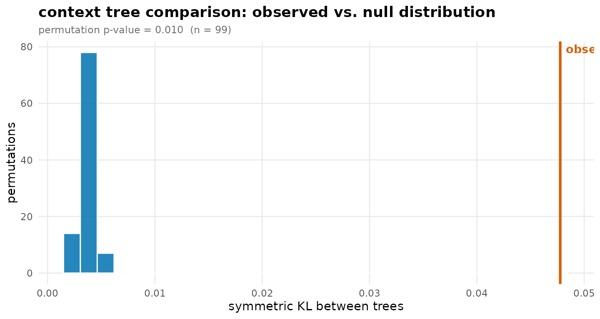

### Comparing groups pathway by pathway

[`compare_groups()`](https://pak.dynasite.org/transitiontrees/reference/compare_groups.md)
tests the groups context by context. To plot the contexts whose
next-state distributions differ most between the groups, we call
[`plot()`](https://rdrr.io/r/graphics/plot.default.html) on its result;
`style = "matrix"` draws the distances between all pairs of groups
instead.

``` r

group_comparison <- compare_groups(regulation, iter = 99L, seed = 1L)
plot(group_comparison, top = 12L)
```

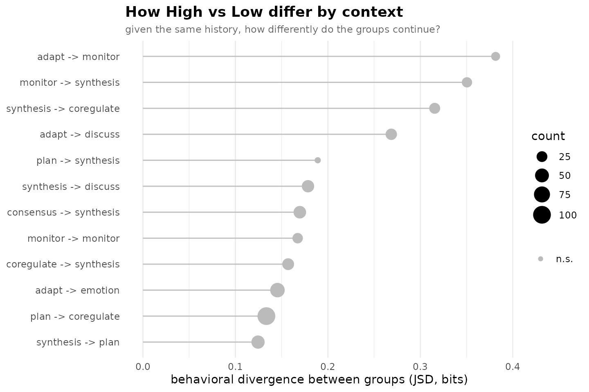

Most of the contexts with the largest divergence are rare, observed 11
to 101 times, and none of the twelve is significant after the false
discovery rate correction (grey points). To count the contexts that do
differ significantly, we call
[`summary()`](https://rdrr.io/r/base/summary.html).

``` r

summary(group_comparison)
#> Group comparison: High vs Low (80 contexts, 99 permutations)
#>   behavioral omnibus: JSD = 1772.142 bits, p = 0.010
#>   usage omnibus     : G2 = 1356.46, p = 0.010
#>   pathways with a behavioral difference (adjusted p < 0.05): 28
#>   pathways with a usage difference      (adjusted p < 0.05): 43
#>   pathways whose modal next state differs between groups: 26
```

Twenty-eight contexts differ in what follows them. Each of them is
observed at least 147 times, and their divergences are at most 0.12
bits: with frequent contexts a small difference is detectable, with rare
ones a large difference is not.

``` r

plot(group_comparison, style = "matrix")
```

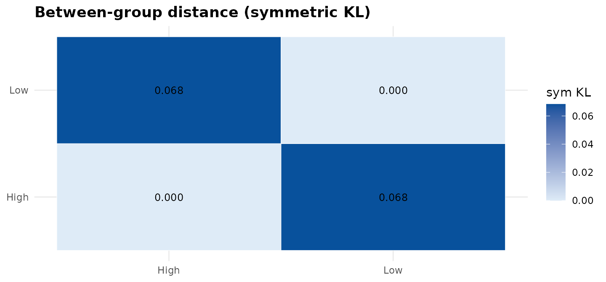

### Group difference map

To map, context by context, where two groups continue differently, we
call
[`plot_difference()`](https://pak.dynasite.org/transitiontrees/reference/plot_difference.md)
with `depth` for the context depth. Each cell is the Pearson residual of
the first group’s count of a next state against the count expected if
both groups continued alike; an absolute value above about 2 is notable.
With the
[`compare_groups()`](https://pak.dynasite.org/transitiontrees/reference/compare_groups.md)
result as `comparison`, contexts with a significant difference are
starred.

``` r

plot_difference(regulation, depth = 1L, comparison = group_comparison)
```

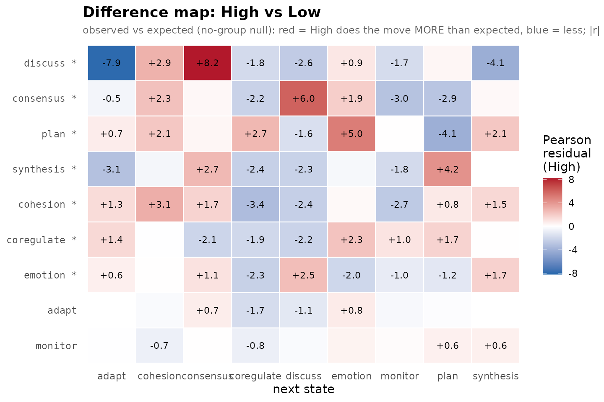

After `discuss`, high achievers move to `consensus` more often than
expected (residual 8.2) and to `adapt` less often (-7.9); seven of the
nine single-move contexts carry a significant difference.

With `layout = "tree"`, the tree of the pooled sequences is drawn with
each node colored by which group reaches that context more often. A tree
of depth two over nine states has too many leaves to label, so we fit
the groups at depth one for this view.

``` r

regulation_first <- context_tree(group_regulation_long, actor = "Actor",
                                 time = "Time", action = "Action",
                                 group = "Achiever", max_depth = 1L)
plot_difference(regulation_first, layout = "tree")
```

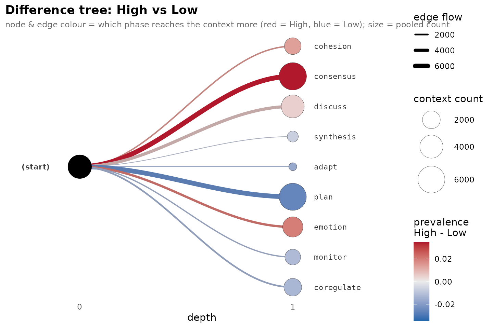

High achievers reach `consensus` and `emotion` more often, low achievers
`plan`.

The analysis of these two groups is developed in [Comparing
groups](https://pak.dynasite.org/transitiontrees/articles/comparing-groups.md).

### Tuning surface

To show the cross-validated perplexity of each configuration, we call
[`plot()`](https://rdrr.io/r/graphics/plot.default.html) on the result
of
[`tune_tree()`](https://pak.dynasite.org/transitiontrees/reference/tune_tree.md).

``` r

tuning <- tune_tree(trajectories, max_depth = 1L:4L, folds = 5L, seed = 1L)
plot(tuning)
```

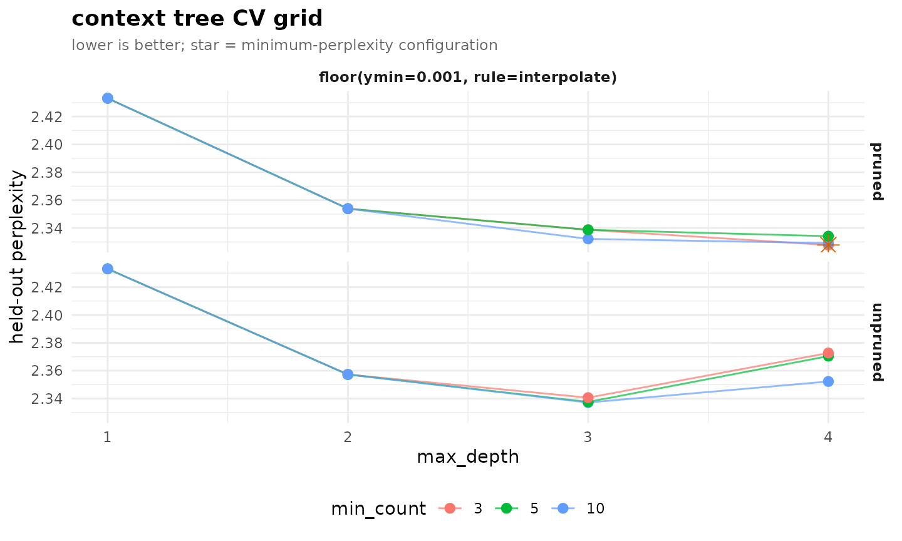

The choice of configuration from this surface is discussed in [Model
selection: tuning, fit and
perplexity](https://pak.dynasite.org/transitiontrees/articles/model-selection.md).

## Summary

| Question | Call |
|----|----|
| The tree with every pathway labeled | `plot(tree, style = "horizontal")` |
| The tree as a circle | `plot(tree, style = "dendrogram")` |
| The distribution of observations over contexts | `plot(tree, style = "icicle")` |
| An explorable tree | `plot(tree, style = "interactive")` |
| One tree per group | `plot(group_tree, style = "dendrogram")` |
| Frequent or informative contexts | `plot_pathways(tree, sort_by = "divergence")` |
| Contexts that change the prediction | `plot_divergence(tree)` |
| Next-state distributions | `plot_distributions(tree)` |
| How much history one pathway needs | `plot_pruning(tree, pathway)` |
| Sequences forward in time | `plot_trajectories(tree, measure = "frequency")` |
| Predictive performance | `plot_predictive(tree, newdata, type = "logloss")` |
| Bootstrap intervals | `plot(bootstrap_pathways(tree))`, [`plot_pathway_resamples()`](https://pak.dynasite.org/transitiontrees/reference/plot_pathway_resamples.md) |
| Group tests | `plot(compare_trees(group_tree))`, `plot(compare_groups(group_tree))` |
| Where two groups continue differently | `plot_difference(group_tree, depth = 1L)` |
| Tuning surface | `plot(tune_tree(data))` |

## References

Gabadinho, A., & Ritschard, G. (2016). Analyzing state sequences with
probabilistic suffix trees: The PST R package. *Journal of Statistical
Software, 72*(3). <https://doi.org/10.18637/jss.v072.i03>

Ron, D., Singer, Y., & Tishby, N. (1996). The power of amnesia: Learning
probabilistic automata with variable memory length. *Machine Learning,
25*(2-3), 117-149. <https://doi.org/10.1023/A:1026490906255>
